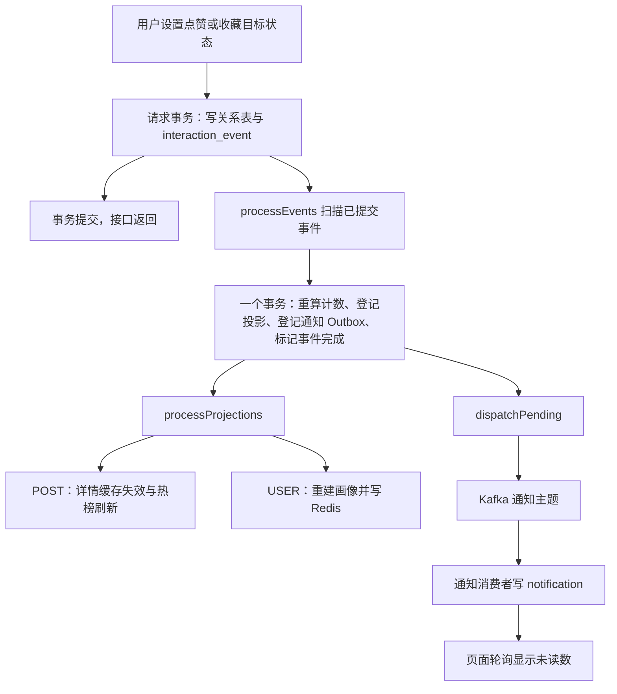

# QA-PLUS 后台任务梳理

关联笔记：[[QA-PLUS 锁与并发控制梳理]]。

本文按“为什么需要 → 谁触发 → 执行什么 → 如何恢复”介绍项目中的后台工作。核对范围为 `D:/ShengYi/QA-PLUS` 当前工作区，Git 基线为 `04eeecf`，其中 `UserInterestService.java` 包含本地未提交改动，本文以实际文件为准。

> [!info] 核对口径
> 本文来自 Java、Vue、YAML 和 SQL 的静态核对，没有启动 MySQL、Redis、Kafka 或 ES 做联调。时间参数采用当前 `application.yml` 的默认配置；环境变量、外部配置和运行环境仍可覆盖它们。本文作为原始资料保存。

## 1. 先分清项目中的几类后台工作

| 类型 | 触发者 | 项目实例 | 工作是否先持久化 |
| --- | --- | --- | --- |
| 定时扫描 | Spring `@Scheduled` | 互动事件处理、投影执行、Outbox 投递 | 取决于任务；前三者均读取 MySQL 中的待办 |
| 消息消费 | Kafka 监听容器 | 通知落库、死信入库、缓存失效、搜索索引 | 消息已经进入 Kafka 后，由 Kafka 承载待消费工作 |
| 请求触发的异步工作 | `CompletableFuture.runAsync` | 逻辑过期后的详情重建、发送缓存/搜索事件 | 这几处提交到 JVM 的工作本身没有独立持久化队列 |
| 启动事件 | `ApplicationReadyEvent` | 布隆过滤器预热 | 启动时重新读数据库，没有待办表 |
| 提交后回调 | `TransactionSynchronization.afterCommit` | 提交后先删缓存、再发 Kafka | 回调本身只是内存中的注册动作 |
| 浏览器轮询 | `setInterval` | 未读数每 30 秒刷新 | 浏览器页面存活期间执行 |

关键区别：**异步只说明执行时间/线程与原请求分开；可靠恢复还需要持久化待办、重试条件以及幂等处理。**

`afterCommit()` 只规定“提交后执行”，并不自动创建新线程。`AfterCommitExecutor` 这个类也是直接调用 `action.run()`，当前源码检索未发现调用方，不能把它当成正在运行的独立任务。

## 2. 调度如何启用，任务在哪些线程上执行

`ForumApplication` 上的注解启用 Spring 定时调度：

```java
@SpringBootApplication
@EnableScheduling
@MapperScan("com.forum.server.mapper")
public class ForumApplication { ... }
```

当前配置：

```yaml
spring:
  task:
    scheduling:
      pool:
        size: 4
```

可以理解成 Spring 启动后发现这些 Bean 上的 `@Scheduled` 方法，按约定提交给调度线程执行。业务代码不用自己写无限循环。

- 调度线程池配置为 4，多个不同任务可以并行；这并不代表每个任务都有 4 个线程。
- `fixedDelay = 1000` 表示本轮执行结束后，再等 1000 毫秒开始下一轮。若本轮用了 3 秒，启动间隔就约为 4 秒，还可能受线程繁忙影响。
- `cron = "0 0 * * * *"` 表示每小时整点触发。注解没有单独指定 `zone`，不应写成固定北京时间执行。
- Kafka 消费由监听容器驱动，与这个调度池不同。
- 目前几处 `runAsync` 都没有传入自定义执行器，也没有通过 `@Async` 配合专用业务线程池。它们使用 JDK 默认异步执行设施，不能把调度池的 4 个线程套用到这里。

## 3. 七个定时任务总览

| 所在类 / 方法 | 当前配置默认周期 | 每轮范围 | 主要目的 |
| --- | --- | --- | --- |
| `InteractionWorker.processEvents()` | 完成后间隔 1 秒 | 最多 500 条互动事件，整个批次一个事务 | 重算计数、登记通知 Outbox 和后续投影 |
| `InteractionWorker.processProjections()` | 完成后间隔 1 秒 | 最多 500 次循环，每次取一条、一个事务 | 删除详情缓存、刷新热榜、重建用户画像 |
| `InteractionWorker.cleanOrphans()` | 完成后间隔 60 秒 | 三张关系表分别最多查询 500 条孤儿关系 | 删除目标已不存在的互动关系、登记画像重建 |
| `InteractionWorker.monitor()` | 完成后间隔 30 秒 | 两张队列表的汇总查询 | 输出积压、最老任务时间和重试次数 |
| `ContentRankingService.rebuildHourly()` | 每小时整点 | 近 24 小时可见帖子和旧总榜成员的并集 | 登记热度衰减、超时淘汰对应的 POST 投影 |
| `NotificationOutboxDispatcher.dispatchPending()` | 完成后间隔 1 秒 | 最多 100 条候选，逐条抢占并发送 | 把已提交的通知事件发送到 Kafka |
| `NotificationDeliveryFailureService.replayDueConsumerFailures()` | 完成后间隔 10 分钟 | 最多 100 条到期死信 | 重新发送通知消费失败事件 |

> [!note] Outbox 周期有两层默认值
> 注解写的是 `${forum.distribution.outbox-dispatch-delay-ms:5000}`，但当前 `application.yml` 已定义此属性，默认值为 1000，因此正常加载该配置时采用 1 秒。仅在这个属性不存在时，才采用注解里的 5 秒。

## 4. 主链路：从一次点赞到后台更新



这里有两个后台分支：**投影更新**与**通知投递**。二者都从 `processEvents()` 提交后的持久化记录开始继续工作，但不要求彼此同步完成。

### 4.1 请求负责什么

入口为 `InteractionServiceImpl.setState()`，同时服务于帖子点赞、收藏和评论点赞。

1. 校验登录用户、目标帖子/评论的存在性和可见性。
2. 在独立事务中，对当前用户与目标的关系执行 `SELECT ... FOR UPDATE`。
3. 比较当前关系是否存在与请求的 `active` 是否一致。
4. 已经一致，直接返回，不再产生新事件。
5. 不一致，插入或删除关系，并插入 `interaction_event`。
6. 事务一起提交，接口返回目标状态。

请求侧**没有在这个事务里直接更新帖子点赞/收藏计数，也没有直接写 Redis 热榜或发送 Kafka 通知**。

```java
if (present == active) return active;
// INSERT 或 DELETE 关系
jdbc.update("INSERT INTO interaction_event (...) VALUES (...)", ...);
```

这使“用户是否点赞”首先以关系表为准，而计数和展示所需的派生数据稍后收敛。

### 4.2 为什么拆成事件处理与投影两段

数据库阶段需要保证“计数、Outbox、后续待办和事件完成”一起提交；Redis 阶段可能因网络或服务不可用失败。把二者拆开，可以让 MySQL 的事件处理不必反复重做，只重试未完成的 Redis 工作。

`processed_at` 有值，只代表**数据库事件阶段完成**；`pending = false` 则代表**该轮投影已被确认完成**。二者不是同一个完成标记。

## 5. 互动事件处理：processEvents()

源码：`service/distribution/InteractionWorker.java:56`。

### 5.1 执行顺序

每轮开启 `READ_COMMITTED + REQUIRES_NEW` 事务，超时配置为 30 秒。

1. 锁住 `interaction_worker_lock` 中的 `counts` 行，协调多个应用实例的同类 Worker。
2. 查询到期且尚未处理的事件：

```sql
SELECT * FROM interaction_event
WHERE processed_at IS NULL
  AND next_retry_at <= CURRENT_TIMESTAMP(6)
ORDER BY id
LIMIT ? FOR UPDATE;
```

3. 汇总受影响的帖子、评论、用户 ID，使用集合去重；不存在的目标会触发相应残留关系清理。
4. 对 `active = true`、目标当前可见且接收者不是操作者的事件，登记通知 Outbox。
5. 从关系表执行 `COUNT(*)`，回写帖子点赞数、收藏数以及涉及的评论点赞数。
6. 为帖子登记 POST 投影，为用户登记 USER 投影。
7. 将选中事件的 `processed_at` 设为当前时间。
8. 一起提交。

这里的计数采用**按当前关系重算**，不是对每个事件直接 `+1/-1`。同一帖子短时间收到很多事件时，本批只需针对去重后的帖子重算；重复执行也不靠重复累加制造错误计数。

通知 Outbox 的登记与事件完成在该事务中绑定。注意：点赞/收藏的通知不是在最初的请求事务中登记，而是在本阶段登记。评论/回复则是在创建评论的业务事务中直接登记，见第 10 节。

### 5.2 失败后怎么恢复

- 本批事务抛出运行时异常，则本批数据库改动回滚。
- 选中的事件仍然没有 `processed_at`，后续扫描仍可发现。
- catch 中尝试写入 `attempts + 1`、`last_error`、`next_retry_at`。
- 重试等待按 1、2、4、8、16、32、60 秒增长，此后上限为 60 秒。
- 代码没有对事件设置“重试到第 N 次永久停止”的次数上限。
- 如果连记录重试信息也失败，原事件仍留在库中；数据库恢复后可再次扫描。

> [!warning] 这是批处理事务
> 单个异常事件可能导致本批全部回滚，再等待重试。持久化避免了 JVM 崩溃后仅靠内存导致的任务丢失，但不能保证每条事件立即处理，也不能保证任意故障下固定时间完成。

## 6. 投影队列与 processProjections()

源码：`InteractionProjectionQueue.java`、`InteractionWorker.java:124`。

“投影”可以理解为：把数据库中已经提交的业务事实，转换成供读取使用的缓存、排行榜或用户画像。

### 6.1 队列为什么是一张表

`interaction_projection` 的主键是 `(kind, target_id)`，一条记录代表一个目标当前需要的刷新工作。

```sql
INSERT INTO interaction_projection (kind, target_id, previous_category_id)
VALUES (?, ?, ?)
ON DUPLICATE KEY UPDATE
    revision = revision + 1,
    pending = TRUE,
    attempts = 0,
    next_retry_at = CURRENT_TIMESTAMP(6),
    last_error = NULL;
```

上面摘录了关键字段；原 SQL 还维护待办时间和旧分类。

例如用户 8 连续产生 20 次需要重建画像的变化，表中仍是一条 `USER/8` 记录，但 `revision` 会增加。这叫**合并同一目标的待办**，不是把所有业务事件都删除合并；原始变化由关系表和 `interaction_event` 承载。

| 字段 | 含义 |
| --- | --- |
| `kind` | `POST` 或 `USER` |
| `target_id` | 帖子 ID 或用户 ID |
| `revision` | 当前要求处理的版本 |
| `completed_revision` | 已确认完成的版本 |
| `pending` | 是否仍需处理 |
| `previous_category_id` | 帖子换分类时需要清理的旧分类信息 |
| `attempts / next_retry_at / last_error` | 重试和故障排查信息 |

任务成功后保留这条记录，有助于版本继续递增；不是处理完就删行。

### 6.2 POST 和 USER 分别做什么

每轮最多循环 500 次，每次都新开一个事务：

1. 锁住全局 `projections` 协调行。
2. 对一条到期的 `pending = true` 投影执行 `FOR UPDATE`。
3. 如果是 POST，依次执行：
   - `cache.evictStrict(postId)`：原子更新缓存版本并删除详情缓存。
   - `ranking.refreshStrict(postId, previousCategory)`：读取当前帖子，删除不适用的分类榜成员，再按状态、发布时间决定添加或移除热榜。
4. 如果是 USER，执行 `interests.rebuildStrict(userId, revision)`：读取近 90 天互动，构建画像，用 Lua 写入 Redis。
5. 按 `(kind, target_id, revision)` 条件更新 `completed_revision`，设置 `pending = false`，清除错误与重试次数。
6. 提交；没有可用任务时提前结束本轮。

**执行 Redis 期间数据库投影行仍持锁。** 新的同目标入队会等待，待旧任务完成后再递增版本、重新置为待办，避免“新变化刚入队，旧任务却把它清成完成”。

### 6.3 Redis 成功但数据库提交失败怎么办

MySQL 事务不包含 Redis 的原子提交。如果 Redis 已改动，随后数据库失败，Redis 不会随 MySQL 回滚。

这里依赖的是可重复执行：

- 缓存重复失效仍指向“重新查当前数据”。
- 热榜按帖子 ID 执行 `ZADD/ZREM`，后续重试按最新状态修正。
- 画像按版本替换快照，较老版本会被 Lua 拒绝覆盖。

发生异常时任务保留为待办，重试等待与互动事件同样封顶 60 秒；没有永久停止次数。热榜涉及多次 Redis 调用，中途可能短暂只更新了一部分，后续重试负责收敛。

### 6.4 还有哪些地方会登记投影

| 触发点 | 登记的工作 |
| --- | --- |
| 点赞、收藏、评论点赞事件被处理 | 受影响的 POST 和 USER |
| 浏览帖子详情 | 同步增加浏览量，然后通过 `refreshPost()` 登记 POST |
| 创建或删除评论 | POST 热榜刷新及 USER 画像重建 |
| 编辑、删除、管理帖子 | `contentChanged()` 登记 POST，并查询相关点赞、收藏、评论用户登记 USER |
| 读取画像缓存未命中 | 登记 USER，当前请求自行查数据库返回画像 |
| 每小时热榜维护 | 登记相关 POST |
| 孤儿关系清理 | 登记受影响 USER |

`refreshPost()`、`recordInteraction()` 的名字容易让人以为立刻修改 Redis；当前实现主要是在 MySQL 登记投影。

画像未命中时，**后台任务负责稍后补 Redis，当前请求仍同步查数据库**。队列合并不会阻止多个并发请求各自查库。

## 7. 孤儿清理与积压监控

### 7.1 cleanOrphans()

源码：`InteractionWorker.java:173`。

每分钟在事务中取得 `cleanup` 协调锁，分别检查 `post_like`、`favorite`、`comment_like`。

- 帖子点赞/收藏：关系对应的帖子已经不存在。
- 评论点赞：通过评论再关联帖子，评论或其帖子不存在时会落入清理条件。
- 每张关系表最多查询 `batch-size` 条，再逐条删除。
- 去重收集用户，为其登记 USER 投影，与删除关系一起提交。

这里查的是 `p.id IS NULL`，不能把它理解成“清理所有隐藏帖子或隐藏评论的互动”。它主要处理物理目标缺失留下的孤儿关系。

失败后记录日志，下一轮重新扫描；没有另外一张清理任务表。它也没有定时删除已完成的事件、Outbox 或死信历史记录，当前这些数据的长期归档不在这段代码内。

### 7.2 monitor()

源码：`InteractionWorker.java:200`。

每 30 秒分别查询：

- `interaction_event` 中 `processed_at IS NULL` 的数量。
- `interaction_projection` 中 `pending = true` 的数量。
- 最早的 `created_at` 和待办记录的 `attempts` 总和。

当最老待办超过 5 秒，输出警告日志。**5 秒是代码中的观察目标，不是所有请求的完成 SLA。** 当前实现是日志监控，没有在这里自动扩容、修复或推送告警。

## 8. 每小时热榜维护：rebuildHourly()

源码：`ContentRankingService.java:110`。

互动变化会触发刷新，但帖子即使没人互动，也会变旧、热度衰减，并最终超出 24 小时窗口，因此还需要周期维护。

执行顺序：

1. 使用 Redis 锁 `forum:distribution:hot:rebuild:lock` 尝试获得本轮执行资格，租期 5 分钟。
2. 查询近 24 小时、`status = 1` 的帖子。
3. 读取旧的全站热榜成员，加入 ID 集合。
4. 为这个并集逐个登记 POST 投影。
5. 在 finally 中尝试释放自己持有的 Redis 锁。
6. 后续由 `processProjections()` 真正刷新榜单；超窗、隐藏或已删除的帖子会被移除。

旧榜成员必须加入集合，否则“已经超过 24 小时但仍留在旧榜”这一类帖子不会仅靠查近期帖子被清掉。

热度公式为：

```text
engagement = 浏览量×0.2 + 点赞数×2 + 评论数×3 + 收藏数×4
hotScore = (engagement + 1) × exp(-发布小时数 / 12)
```

资格窗口按**帖子发布时间**计算，不是“最近 24 小时所有互动的增量”。Redis 总榜、分类榜的 TTL 为 26 小时；成员是否仍符合 24 小时窗口，由刷新逻辑判断。

> [!important] “重建”方法实际上登记待办
> `rebuildHourly()` 没有直接清空并重填整张 Redis 榜单。它把周期维护统一交给持久化投影 Worker，避免周期批量写与其他 POST 投影形成两条无序写入路径。

本轮失败会记日志，已成功登记的 POST 仍留在数据库；尚未登记的部分依赖后续触发。Redis 不可用时无法取得该 Redis 锁，因此这一轮会失败退出。

## 9. Outbox 定时投递与通知消费

### 9.1 Outbox：先把要发的内容写进数据库

`NotificationEventPublisher.publish()` 使用 `@Transactional(propagation = MANDATORY)`，要求调用方已有事务。它只插入 `notification_outbox_event`，不直接发送 Kafka。

事务来源有两种：

- 点赞/收藏/评论点赞：来自 `processEvents()` 的后台数据库事务。
- 评论/回复：来自 `CommentServiceImpl.createComment()` 的业务事务。

Outbox 与该阶段业务改动一起提交，避免只依赖内存中“等会儿发消息”的动作。

### 9.2 dispatchPending() 怎么发

源码：`messaging/NotificationOutboxDispatcher.java:35`。

1. 查询最多 100 条候选：待发送且到期，或发送中但租约已经过期。
2. 为每条生成 UUID，调用 Mapper 的条件 UPDATE 抢占。
3. 只有 UPDATE 影响行数为 1 的实例才继续发送。
4. 将状态设为 1，保存 `lock_token`，设置 2 分钟 `locked_until`。
5. 使用原有 Outbox `event_id` 构造 Kafka 事件，执行 `send(...).get()` 等待发送结果。
6. 成功后按相同 token 标记为 2；失败后记录重试信息并释放租约。

发送失败时，累计第 1～4 次失败分别约等待 2、4、8、16 秒；第 5 次失败转为状态 3，自动扫描不再选它。实际重试时刻还取决于扫描周期与执行耗时。管理员可以重置失败记录再投递。

| Outbox 状态 | 含义 |
| --- | --- |
| 0 | 待发送，等待 `next_retry_at` |
| 1 | 某个实例已抢占、正在发送；租约过期可被接管 |
| 2 | Kafka 发送成功并已回写发送状态 |
| 3 | 达到失败上限，等待人工处理 |

**状态 2 不代表通知已经写入 `notification`，更不代表用户已经读到通知。**

### 9.3 通知消费者怎么处理重复

`NotificationEventConsumer` 监听 `forum.notification.events`，调用 `createNotificationFromEvent()` 插入通知。

数据库 `notification.event_id` 上有唯一约束，重复事件触发 `DuplicateKeyException` 时视为已经处理。通知创建后还会调用 `failureService.resolve(eventId)` 标记对应死信解决。

例如 Kafka 已收到消息，但应用在更新 Outbox 状态前崩溃，租约到期后会再次发送同一个 `event_id`。消费者依靠数据库唯一约束避免产生第二条相同事件的通知。因此该链路应描述为**允许至少一次投递，通过幂等约束处理重复**。

事件以接收者 ID 为 Kafka key，有助于相同接收者进入同分区；但 Outbox 多实例抢占、重试和死信重放仍可能改变业务事件的处理先后，不能把 key 相同写成端到端绝对有序。

## 10. 通知消费失败、死信与重放

### 10.1 消费线程内的短重试

`NotificationKafkaConfig` 为通知监听器配置：

```java
new DefaultErrorHandler(recoverer, new FixedBackOff(1000L, 3L))
```

即失败后间隔约 1 秒重试 3 次，仍失败则交给恢复器发送到 `forum.notification.events.DLT`。这是消费错误处理器驱动的工作，不是另一个 `@Scheduled` 方法。

### 10.2 DLT 监听器持久化死信

`NotificationDeadLetterConsumer` 从死信主题读取事件及错误信息，调用 `recordConsumerFailure()` 将其写入 `notification_dead_letter`。

- `event_id` 唯一，避免多个消费者重复插入同一死信。
- 保存事件内容、错误原因、被消费的 DLT 记录的主题/分区/位移信息。
- 新记录默认 10 分钟后才可重放。
- 这里保留原事件 ID，后续重发不会绕开消费幂等约束。

### 10.3 定时重放任务

源码：`service/NotificationDeliveryFailureService.java:121`。

每 10 分钟扫描最多 100 条：

```text
status 属于 0、1
replay_count < 3
next_retry_at <= 当前时间
```

将原通知事件重新发到普通通知主题，等待 Kafka 发送结果。

| 死信状态 | 含义 |
| --- | --- |
| 0 | 待重放 |
| 1 | 已重新发送，等待后续消费结果；未解决且次数允许时还会被扫描 |
| 2 | 消费成功，标记已解决 |
| 3 | 耗尽自动重放次数 |

一次重发成功只说明回到 Kafka，不说明消费已经成功。消费者成功后调用 `resolve()`，才进入状态 2。

自动最多重放 3 次。若第 3 次发送成功但尚未解决，记录可能暂留状态 1、次数为 3，不再入选；消费再次失败进入 DLT 时可被记录为 3，因此不能简单说“次数等于 3 就必定立即是状态 3”。管理员还可通过管理接口重置并手动重放。

> [!warning] 死信重放的并发保护比 Outbox 弱
> 这里没有 Outbox 那样的条件抢占 token 和租约。多个实例或人工重放与定时任务可能重复发送；重放后的状态写入也可能与消费者的 `resolve()` 竞争。通知表唯一 `event_id` 能防重复通知，但不等于死信状态在所有并发时序下都准确。

## 11. 详情缓存逻辑过期后的异步重建

源码：`PostServiceImpl.java:224`、`:262`，`PostDetailCacheService.java`。

### 11.1 什么时候触发

详情缓存里保存了 `data` 和 `expireAtMillis`。默认逻辑 TTL 为 `600 + [0,120]` 秒，物理 TTL 再多保留 300 秒，因此存在“逻辑已经过期，但 Redis key 仍在”的时间段。

读取命中这种缓存时：

1. 先拿到旧详情。
2. 尝试获取 `forum:post:detail:lock:{postId}`，默认 10 秒。
3. 获得锁的请求提交 `CompletableFuture.runAsync` 重建。
4. 其他请求不等待重建，继续返回旧详情。
5. 重建线程先取缓存版本，再查数据库构造详情，最后用 Lua 校验版本并写入。
6. finally 中释放重建锁。

个性化的 `isLiked/isFavorited` 会在返回时按当前用户填充，共享缓存里存的是公共详情。

### 11.2 哪些路径不受这把锁保护

**Redis key 完全不存在、物理过期、被主动删除，或者缓存读取失败时，当前请求直接走数据库查询与条件回填，不会调用 `tryLockRebuild()`。**

所以：逻辑过期重建锁可以减少旧缓存仍存在时的并发重建；它没有覆盖所有缓存未命中场景。

此外，详情接口在读缓存前仍会同步增加数据库浏览量、登记 POST 投影，后者还会让 Worker 删除详情缓存。因此不能把缓存命中描述成“请求完全不访问数据库”，也不能假定所有详情缓存刷新都走逻辑过期链路。

### 11.3 异步任务本身会不会丢

重建 Runnable 没有先登记到任务表，进程退出后不保证继续执行。恢复依赖后续访问再次触发或缓存未命中的数据库兜底。任务异常还会尝试清缓存，再向上抛出；这里没有额外持久化重建重试器。

锁的超时、释放安全性与版本隔离见 [[QA-PLUS 锁与并发控制梳理#3. Redis 详情缓存重建锁]]。

## 12. 缓存失效事件与搜索索引事件

### 12.1 缓存失效：提交后先直接删除，再异步发消息

`PostCacheInvalidationEventPublisher.publishAfterCommit()` 的真实顺序：

```text
业务事务提交
→ afterCommit 回调直接调用 fallbackConsumer.evict()
→ 提交 runAsync 发送 Kafka
→ Kafka 消费者再次执行失效
```

如果没有事务同步上下文，则直接执行删除并提交异步发送。Kafka 发送异常时还会尝试直接失效。

消费者会删除详情缓存；`EVICT_ALL` 还会清理历史点赞/收藏 Redis Set。当前关系状态由 MySQL 管理，这些 Set 的清理不是旧版 Lua 互动切换逻辑仍在使用的证据。

可靠性边界：

- 直接删缓存发生在回调线程，会占用提交后的执行时间；不是整个动作都在异步线程。
- 发送动作没有 Outbox，进程可在提交后、异步发送前退出。
- `evict()` 捕获 Redis 异常并记录日志，消费者可能正常返回，不能指望每次删除失败都触发 Kafka 重试。
- 部分业务还登记 POST 投影，它提供另一条持久化失效路径；该保证来自投影表，不能归因于缓存 Kafka 发布器本身。

### 12.2 搜索索引：提交后异步同步

`SearchIndexEventPublisher` 在提交后通过 `runAsync` 发送事件，`SearchIndexEventConsumer` 按事件调用 `SearchIndexWriter`。

- `SYNC`：按帖子当前状态重建文档，以帖子 ID 为文档 ID 覆盖。
- `DELETE`：删除对应 ID 的文档。
- Kafka 发送失败：尝试调用本地 `SearchIndexWriter` 直接同步。
- ES 开关关闭时，注入的是 `DatabaseSearchServiceImpl`，它的索引写方法有意为空，因为搜索直接查询数据库。

这条链路**没有 Outbox**。而且当前 `EsSearchServiceImpl.syncPostIndex()`、`deletePostIndex()` 会捕获异常并仅记录日志，失败通常不会继续抛给 Kafka 监听器。重复覆盖同一文档是幂等操作，但**幂等不代表失败一定会被发现并重试**。

### 12.3 四个 Kafka 监听器一览

| 监听器 | 默认主题 | 动作 | 需要注意 |
| --- | --- | --- | --- |
| `NotificationEventConsumer` | `forum.notification.events` | 通知落库、解决死信 | 显式配置消费重试与 DLT |
| `NotificationDeadLetterConsumer` | `forum.notification.events.DLT` | 死信落 MySQL | 不等于直接成功恢复通知 |
| `PostCacheInvalidationEventConsumer` | `forum.post-cache-invalidation.events` | 删除详情及历史互动缓存 | 失效方法会捕获异常 |
| `SearchIndexEventConsumer` | `forum.search-index.events` | 调用索引写入器 | ES 实现会捕获写入异常 |

通知专用的 `notificationKafkaListenerContainerFactory` 只被通知普通消费者显式引用，不能把它的“三次重试后进通知 DLT”规则套用到所有监听器。

## 13. 启动预热与前端未读轮询

### 13.1 布隆过滤器预热

`PostBloomFilterService.loadExistingPosts()` 监听 `ApplicationReadyEvent`：

1. 查询 `status = 1` 的帖子 ID。
2. 为每个 ID 计算多个 hash 对应的 Redis bitmap 位并置 1。
3. 设置 `forum:post:bloom:ready`。

这是启动事件处理，当前方法没有异步注解，也没有定时重复预热。新增或恢复可见帖子时还有 `add()` 调用补位。

没有 ready 标记或 Redis 查询异常时，`mightContain()` 放行到数据库，避免直接误杀正常帖子。但 `add()` 内部也会吞掉写入异常，因此不能把 ready 标记等同于每一位都经过成功确认；本文没有对断连中途恢复场景做联调。

### 13.2 未读数轮询

`forum-web/src/components/layout/BaseLayout.vue`：

- 登录后先刷新一次，再每 30 秒查询未读数。
- 未登录或页面不可见时跳过请求。
- 页面重新可见时立即刷新。
- 退出登录或卸载组件时停止轮询。
- 请求失败时保留上一次成功的数字。

因此“后台通知已经入库”和“页面角标已经变化”之间还可能隔着一次轮询。它不是 WebSocket 主动推送。

搜索建议防抖、悬浮卡片延迟关闭、页面动画等 `setTimeout/requestAnimationFrame` 属于 UI 行为，没有列为业务后台任务。

## 14. 排查时沿着哪条链看

| 现象 | 优先检查 |
| --- | --- |
| 点赞状态已变化，计数仍旧 | 关系表 → `interaction_event.processed_at`、重试时间和错误 → Worker 日志 |
| 计数已变化，详情/热榜仍旧 | `interaction_projection` 的 pending、revision、completed_revision、错误 → Redis 状态 |
| 推荐画像缺失或更新慢 | USER 投影是否产生、是否重试；区分请求侧查库返回与后台 Redis 写入 |
| 通知一直没有 | Outbox 是否登记 → 发送状态/租约 → Kafka 消费日志 → notification → dead_letter |
| Outbox 已是 2，页面没有角标 | 先查通知是否真正入库，再查前端登录状态、页面可见性和轮询 |
| ES 搜索内容旧 | 发布/消费日志与 ES 写入日志；注意写入异常可能已被捕获，不能仅看消费者是否抛错 |
| 多种定时任务一起慢 | 调度池是否被阻塞、数据库锁等待、Redis/Kafka 等待时间 |

适合只读排查的 SQL：

```sql
SELECT id, kind, target_id, attempts, next_retry_at, last_error
FROM interaction_event
WHERE processed_at IS NULL ORDER BY id LIMIT 20;

SELECT kind, target_id, revision, completed_revision, attempts,
       next_retry_at, last_error
FROM interaction_projection
WHERE pending = TRUE ORDER BY created_at LIMIT 20;

SELECT id, event_id, status, retry_count, locked_until, last_error
FROM notification_outbox_event
WHERE status <> 2 ORDER BY id LIMIT 20;

SELECT id, event_id, status, replay_count, next_retry_at, failure_reason
FROM notification_dead_letter
WHERE status <> 2 ORDER BY id LIMIT 20;
```

不要仅因为任务慢就删除任务记录或手动清完成标记；先判断事务、重试时间、持锁实例以及外部服务是否正常。

## 15. 面试时可以怎样介绍

> 项目把点赞、收藏等互动拆成请求写入、数据库聚合和 Redis 投影三个阶段。请求事务只写个人关系和持久化事件；后台 Worker 按关系表重算计数，在同一事务内登记通知 Outbox、投影和事件完成状态。投影按目标合并，通过版本和重试机制更新缓存、热榜、兴趣画像。通知由 Outbox 抢占投递到 Kafka，消费者通过事件 ID 唯一约束去重，失败进入死信并支持重放。其他缓存失效和搜索同步使用提交后异步事件，可靠性边界比 Outbox 链路弱。

回答时不要说“所有异步操作都不会丢”“用了定时任务所以 1 秒内完成”“Kafka 发成功就表示通知已入库”。这些都超出了当前实现的保证。

## 16. 源码定位

以下 Java 路径均相对于 `forum/forum-server/src/main/java/com/forum/server/`；行号对应本次核对快照，后续改动可能移动。

| 路径 | 核心定位 |
| --- | --- |
| `ForumApplication.java` | `@EnableScheduling` |
| `service/impl/InteractionServiceImpl.java` | `setState()`，关系和事件同事务 |
| `service/distribution/InteractionWorker.java` | 56 事件、124 投影、173 清理、200 监控 |
| `service/distribution/InteractionProjectionQueue.java` | `enqueue()`、`contentChanged()` |
| `service/distribution/ContentRankingService.java` | `refreshStrict()`、110 小时任务 |
| `service/distribution/UserInterestService.java` | 85 读取画像、170 严格重建、43 保存 Lua |
| `service/impl/PostServiceImpl.java` | 224 详情查询、262 异步重建 |
| `service/cache/PostDetailCacheService.java` | TTL、逻辑过期、版本 Lua、重建锁 |
| `messaging/NotificationEventPublisher.java` | `publish()` 仅登记 Outbox |
| `messaging/NotificationOutboxDispatcher.java` | 35 扫描、60 投递 |
| `mapper/NotificationOutboxEventMapper.java` | `claim/markSent/markFailedAttempt` |
| `messaging/NotificationEventConsumer.java` | 通知普通消费者 |
| `config/NotificationKafkaConfig.java` | 通知消费短重试与 DLT |
| `messaging/NotificationDeadLetterConsumer.java` | 死信消费者 |
| `service/NotificationDeliveryFailureService.java` | 121 定时重放、人工重放、resolve |
| `messaging/PostCacheInvalidationEventPublisher.java` | 提交后直接删缓存和异步发布 |
| `messaging/PostCacheInvalidationEventConsumer.java` | 缓存事件消费 |
| `messaging/SearchIndexEventPublisher.java` | 提交后搜索事件发布与直接写入兜底 |
| `messaging/SearchIndexEventConsumer.java` | 调用 `SearchIndexWriter` |
| `service/impl/EsSearchServiceImpl.java` | ES 写入及异常捕获 |
| `service/impl/DatabaseSearchServiceImpl.java` | 数据库搜索模式下索引操作为空 |
| `service/cache/PostBloomFilterService.java` | 40 启动预热 |
| `service/distribution/AfterCommitExecutor.java` | 提交后同步回调工具，目前未发现调用方 |

其他依据：

- `forum/forum-server/src/main/resources/application.yml`：调度线程池、时间参数、Kafka 主题。
- `forum/forum-server/src/main/resources/db/migration/V8__async_interactions.sql`：事件、投影和 Worker 锁表。
- `forum/sql/v6_notification_delivery.sql`：Outbox、死信和通知事件唯一约束。
- `forum-web/src/components/layout/BaseLayout.vue`：未读数轮询。
