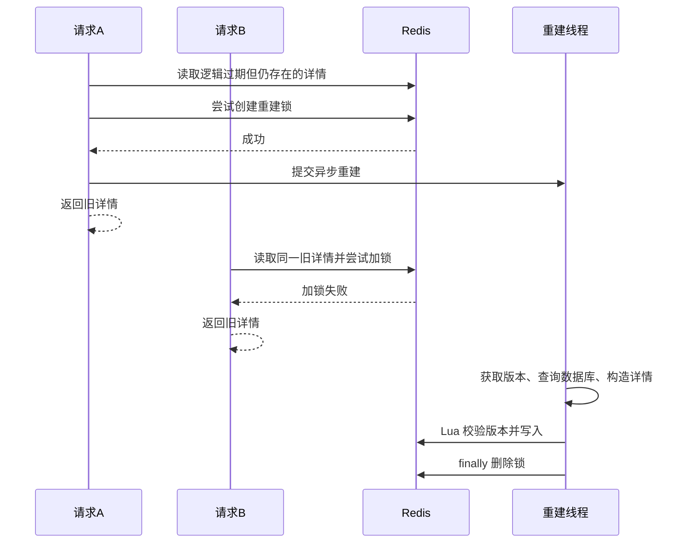

# QA-PLUS 锁与并发控制梳理

关联笔记：[[QA-PLUS 后台任务梳理]]。

核对范围为 `D:/ShengYi/QA-PLUS` 当前工作区，Git 基线 `04eeecf`；`UserInterestService.java` 包含本地未提交改动，本文采用当前文件。以下结论来自源码和 SQL 静态核对，没有运行外部服务做并发联调。配置默认值可能被环境覆盖。

## 1. 先明确“锁”要保护什么

锁的作用，是让多个执行者在操作同一受保护资源时按规则进入临界区。例如同一帖子只允许一个请求重建旧缓存，或者多个应用实例不能同时执行同一阶段的 Worker。

项目的并发控制主要放在 **MySQL 与 Redis**。当前生产 Java 源码没有检索到业务用 `synchronized`、`ReentrantLock`、读写锁或 Redisson 锁的实现。测试代码中的线程池、同步集合和协调工具不能算作生产业务锁。

还要区分以下概念：

| 机制 | 回答的问题 | 项目例子 |
| --- | --- | --- |
| 互斥锁 | 此刻谁可以执行受保护工作？ | Redis 详情重建锁、MySQL Worker 协调锁 |
| 租约抢占 | 谁在一段时间内拥有处理资格？ | Outbox 的 token 和 `locked_until` |
| 版本校验 | 这个执行结果是否仍有资格写入？ | 详情缓存 UUID 版本、画像 revision |
| 幂等约束 | 同一事件再来一次是否产生重复结果？ | `notification.event_id` 唯一索引 |
| 原子更新 | 一组判断/修改能否作为不可交错的操作执行？ | Redis Lua、单条 SQL 条件 UPDATE |
| 事务边界 | 哪些数据库改动一起提交或回滚？ | 关系与事件同事务；Outbox 与事件处理同事务 |

版本、幂等和原子性经常与锁配合，但它们不是同一个能力。

## 2. 项目锁清单

| 编号 | 锁或抢占机制 | 保护粒度 | 获得方式 | 释放方式 / 有效期 |
| --- | --- | --- | --- | --- |
| L1 | Redis 详情重建锁 | 单个帖子 | `setIfAbsent(key, "1", TTL)` | finally 直接删除；默认 10 秒过期 |
| L2 | Redis 热榜周期任务锁 | 全站小时维护入口 | `setIfAbsent(key, UUID, 5 分钟)` | GET 比较 token 后 DEL；无续期 |
| L3 | 互动关系行锁 | 某用户与某目标的现存关系 | `SELECT ... FOR UPDATE` | 请求事务提交/回滚 |
| L4 | 帖子/评论业务行锁 | 单个帖子或评论 | Mapper `selectByIdForUpdate()` | 业务事务提交/回滚 |
| L5 | Worker 协调行锁 | `counts/projections/cleanup` 各一个全局阶段 | 锁表定点 `FOR UPDATE` | 所在事务提交/回滚 |
| L6 | 待办事件/投影行锁 | 本批事件或单条投影 | 队列表 `FOR UPDATE` | 所在事务提交/回滚 |
| L7 | Outbox 处理租约 | 单条 Outbox | 带状态条件的 UPDATE、UUID token | 完成/失败时按 token 清租约；2 分钟到期可接管 |

L3～L6 都使用 MySQL 事务锁，只是保护对象不同。L7 的抢占 SQL 本身会涉及数据库行锁，但“发送 Kafka 期间的归属”主要由持久化租约字段表达，并非一直打开一个数据库事务持锁等待发送。

## 3. Redis 详情缓存重建锁

源码：`PostDetailCacheService.tryLockRebuild()`、`unlockRebuild()`，`PostServiceImpl.rebuildPostDetailCacheAsync()`。

### 3.1 为什么要用

热点详情逻辑过期时，如果每个请求都去重建，数据库可能同时收到很多相同查询。项目保留一段时间的旧缓存，先返回旧值，让获得重建资格的请求提交后台查询。

```java
Boolean locked = stringRedisTemplate.opsForValue().setIfAbsent(
        "forum:post:detail:lock:" + postId,
        "1",
        Duration.ofSeconds(postDetailRebuildLockSeconds)
);
```

等价思路：**只有 key 不存在时才能创建它，并在同一个加锁操作中附带过期时间。** 多个应用实例使用同一个 Redis 时，也会竞争同一个帖子锁 key。

### 3.2 运行时序



请求不需要等待新缓存生成，获得锁也只是获得后台重建资格。

### 3.3 只保护逻辑过期命中路径

`getPostDetail()` 的两个分支必须分开看：

```text
命中缓存且逻辑过期
→ tryLockRebuild
→ 成功者后台重建，所有请求可先返回旧值

缓存完全未命中
→ 取版本
→ 当前请求直接查 MySQL
→ Lua 条件回填
```

第二条路径没有这把重建锁。因此主动失效、物理过期、首次访问或 Redis 读取失败时，多个请求可能并发查库。**“用了重建锁”不能推导出“所有详情查询都防击穿”。**

用户画像未命中也没有类似请求侧锁；`projectionQueue.user()` 合并后台工作，不阻止当下多个请求各自构建数据库画像。

### 3.4 当前释放方式存在什么边界

当前锁值固定为 `"1"`，解锁直接执行：

```java
stringRedisTemplate.delete(buildLockKey(postId));
```

没有持有者 token，也没有校验归属。假设出现以下时序：

```text
0 秒：A 获得锁，开始重建
10 秒：A 尚未完成，锁自动过期
11 秒：B 获得同名锁，开始重建
12 秒：A 完成，finally 直接 DEL，删掉 B 的锁
13 秒：C 又能获得锁，与 B 并发重建
```

因此它是带超时的轻量互斥实现，**不具备续期，也不具备安全的持有者校验释放**。即使没有误删，超过 10 秒的任务也可能与新持有者重叠执行。

可改进方向是 UUID token 加锁、Lua 比较 token 后删除；长任务还需要评估续期或超时。这里仅记录实现边界，没有修改项目代码。缓存版本保护解决的是另一类写入问题，见第 9 节。

## 4. Redis 热榜周期任务锁

源码：`ContentRankingService.rebuildHourly()`。

```text
key：forum:distribution:hot:rebuild:lock
value：每次执行新生成的 UUID
TTL：5 分钟
范围：每小时收集并登记 POST 待办的入口
```

加锁方式：

```java
String token = UUID.randomUUID().toString();
Boolean locked = redis.opsForValue().setIfAbsent(REBUILD_LOCK, token, REBUILD_LOCK_TTL);
if (!Boolean.TRUE.equals(locked)) return;
rebuildNow();
```

它避免多个应用实例在同一整点同时扫描并登记一批相同工作。实际热榜 Redis 写入由后续 POST 投影完成，**这个锁没有包住后续所有投影刷新时间**。

### 4.1 UUID 有什么作用

finally 中读取当前值，只有仍等于本次 token 才删除：

```java
String current = redis.opsForValue().get(REBUILD_LOCK);
if (token.equals(current)) redis.delete(REBUILD_LOCK);
```

这比完全不检查归属更谨慎，能避免“发现已经是别人的 token 仍然删除”的常见情况。

### 4.2 GET 与 DEL 之间仍然有窗口

上述检查和删除是两条 Redis 命令，不是一个 Lua 操作：

```text
A 读取锁值，确认仍是自己的 token
→ A 暂停，此时锁过期
→ B 获得同名锁
→ A 恢复执行 DEL，可能删掉 B 的锁
```

因此不能描述成“已经通过 Lua 安全释放”。代码也没有自动续期；执行超过 5 分钟仍可能被另一个实例接管。

重复入队会由投影主键和 revision 合并，但仍会增加扫描、数据库写入和版本增长，不代表锁失效完全没有成本。

## 5. MySQL 互动关系行锁

源码：`InteractionServiceImpl.setState()`。

### 5.1 锁的是谁

请求事务使用 `READ_COMMITTED + REQUIRES_NEW`，超时配置为 10 秒。锁定查询按用户和目标定位：

```sql
SELECT user_id FROM post_like
WHERE user_id = ? AND post_id = ? FOR UPDATE;
```

收藏与评论点赞分别替换为 `favorite` 和 `comment_like`。

保护的是**个人关系**，不是先锁住整个帖子再让所有点赞者排队。当前互动请求校验帖子使用的是普通 `selectById()`，不能根据旧注释写成“每次点赞都先获取 post 行锁”。

### 5.2 为什么仅有普通查询不够

如果两个请求同时读到“已点赞”，随后都尝试取消或切换，单靠各自读到的状态容易产生竞争。代码把判断和关系修改放在同一个事务，现存关系由 `FOR UPDATE` 参与协调，再使用目标状态语义：

```java
if (present == active) return active;
// 按目标状态插入或删除
// 同一事务插入 interaction_event
```

`active = true` 意味着“设置为已点赞”，重复发送仍是已点赞，避免传统 toggle 在网络重试后又翻转一次。

### 5.3 不存在的关系靠什么约束

表结构提供联合主键：

```text
post_like    PRIMARY KEY (user_id, post_id)
favorite     PRIMARY KEY (user_id, post_id)
comment_like PRIMARY KEY (user_id, comment_id)
```

不能把“查不到记录的 FOR UPDATE”理解为已经可靠锁住某条不存在的关系。在当前 `READ_COMMITTED` 事务中，并发首次插入还需要联合主键兜底。

示例：

```text
A、B 都请求同一用户给同一帖子 active=true
→ 两者可能都查询到关系不存在
→ A 插入关系并提交事件
→ B 的相同主键插入冲突，回滚整个事务
→ B 重新开启事务，读到关系已存在
→ 目标状态一致，直接返回，不再插入新事件
```

实际胜负取决于执行先后；重点在于**唯一约束 + 整事务重试 + 目标状态判断**一起完成并发收敛。

### 5.4 谁释放行锁，失败重试多少次

代码没有手工调用 unlock。事务正常提交或异常回滚时，由数据库释放事务锁。

`DuplicateKeyException` 或 `TransientDataAccessException` 会触发整事务重试，最多额外重试 3 次，即最多执行 4 次尝试。这里不是在已经失败的事务里继续补一条 SQL。

请求成功也不代表计数已更新。计数与 Redis 后续走 Worker，见 [[QA-PLUS 后台任务梳理#4. 主链路：从一次点赞到后台更新]]。

## 6. 帖子与评论的业务行锁

### 6.1 帖子行锁

`PostMapper.selectByIdForUpdate()`：

```java
@Select("SELECT * FROM post WHERE id = #{id} FOR UPDATE")
Post selectByIdForUpdate(@Param("id") Long id);
```

当前调用点主要包括：

- `PostServiceImpl.updatePost()`：编辑帖子时锁住当前帖子。
- `PostServiceImpl.deletePost()`：删除帖子及关联数据前锁住帖子。
- `PostServiceImpl.adminUpdatePost()`：修改可见性、置顶、精华等状态前锁住帖子。
- `CommentServiceImpl.createComment()`：确认帖子状态并增加评论前锁住帖子。
- `CommentServiceImpl.deleteComment()`：先锁评论所属帖子。

这些方法由 `@Transactional(rollbackFor = Exception.class)` 包裹。锁让遵守同一行锁协议的并发业务在同一帖子上协调，但不能推导出“所有读取都被阻塞”或“整个项目所有更新都经过这段锁查询”。普通读、不同数据行及不同写入路径需分别分析。

### 6.2 删除评论的锁顺序

代码先普通查询评论以确定帖子 ID，进入关键阶段后按顺序重新加锁：

```java
Post post = postMapper.selectByIdForUpdate(comment.getPostId());
comment = baseMapper.selectByIdForUpdate(id);
```

即 **post → comment**。重新锁定后再次检查评论存在和状态，再做权限检查、软删除和计数修改。

固定相同资源的锁顺序，有助于减少“一个事务持有帖子锁等评论锁，另一个事务持有评论锁等帖子锁”的循环等待，但不能保证系统完全没有死锁。

源码注释提到与 likes 共享锁顺序，但当前 `InteractionServiceImpl` 已采用个人关系锁，说明解释应以实际调用为准，不能只复制注释。

### 6.3 Mapper 里有定义不等于正在使用

`PostLikeMapper`、`FavoriteMapper`、`CommentLikeMapper` 仍定义了 `selectForUpdate()`。本次生产源码检索没有发现调用这些方法；当前互动写入走 `InteractionServiceImpl` 中的 JDBC SQL。

所以锁清单应区分：

- 业务链路实际执行的 SQL。
- Mapper 内保留但当前没有调用的方法。

不能因为看到 Mapper 方法，就认为每次点赞一定执行它。

### 6.4 UPDATE 本身也会参与数据库并发控制

例如浏览量使用：

```sql
UPDATE post SET view_count = view_count + 1 WHERE id = ?;
```

数据库内的单条自增避免在 Java 中“先读旧值、加一、覆盖写回”带来的丢失更新。它执行时也会有数据库写锁，但不是项目手工创建的分布式锁。

同样，帖子计数的回写、关系的插入/删除、投影的 UPSERT 都可能产生行锁等待。不能把“没看到 FOR UPDATE”理解为“不会争用数据库锁”。

## 7. Worker 全局协调锁与待办行锁

源码：`InteractionWorker.lock()`、`processEvents()`、`processProjections()`、`cleanOrphans()`；建表见 `V8__async_interactions.sql`。

### 7.1 用一行数据库记录协调多个实例

锁表只存三行：

```sql
CREATE TABLE interaction_worker_lock (
    name VARCHAR(20) PRIMARY KEY
) ENGINE=InnoDB;

INSERT INTO interaction_worker_lock
VALUES ('counts'), ('projections'), ('cleanup');
```

取得锁时：

```sql
SELECT name FROM interaction_worker_lock WHERE name = ? FOR UPDATE;
```

| name | 使用者 | 锁住的执行范围 |
| --- | --- | --- |
| `counts` | `processEvents()` | 一整个事件批次的数据库事务 |
| `projections` | `processProjections()` | 每次取一条并执行投影的事务 |
| `cleanup` | `cleanOrphans()` | 一轮孤儿关系清理事务 |

多个实例必须连接同一数据库、使用同一张锁表才能协调。持锁进程异常断连后，数据库事务回滚并释放锁；没有 Redis 式的“租约固定 N 秒后才能释放”机制。源码的事务超时配置也不应简单理解为统一等价于数据库所有锁等待超时参数。

### 7.2 三种 Worker 是否互相阻塞

锁的是三个不同名字，因此三个阶段不因同一把协调锁直接互斥，仍可能在数据操作中因锁住相同业务行或投影行而等待。

同类阶段则会竞争同一行。例如所有实例的 POST 和 USER 投影都使用同一个 `projections` 协调锁，即使目标 ID 不同，也不能同时进入受保护投影事务。

这是一种保守的串行化设计：协调简单，但多部署几个实例不会让不同投影自动并行。Redis 慢或画像数据库重建耗时长，也会延长持锁时间。

### 7.3 已经有协调锁，为何还锁任务行

事件扫描与投影扫描仍有 `FOR UPDATE`：

```sql
-- processEvents
SELECT * FROM interaction_event
WHERE processed_at IS NULL AND next_retry_at <= CURRENT_TIMESTAMP(6)
ORDER BY id LIMIT ? FOR UPDATE;

-- processProjections
SELECT * FROM interaction_projection
WHERE pending = TRUE AND next_retry_at <= CURRENT_TIMESTAMP(6)
ORDER BY created_at, kind, target_id LIMIT 1 FOR UPDATE;
```

协调锁解决“Worker 同类阶段谁进入”；任务行锁保护“这条记录的状态由谁改”，也协调请求侧的同目标入队。

当前查询没有 `SKIP LOCKED`，不能描述成多个实例自动跳过锁定任务后并行分片消费。

### 7.4 一条投影如何避免漏掉新变化

```text
Worker 锁定 POST/10，读取 revision=5
→ 在事务仍持锁时执行详情失效与热榜刷新
→ 请求又为 POST/10 入队，UPSERT 等待投影行锁
→ Worker 标记 completed_revision=5、pending=false 后提交
→ 等待中的入队执行，将 revision 增到 6、pending=true
→ 后续 Worker 再处理 revision=6
```

完成 SQL 还校验 `WHERE revision = ?`。**行锁、合并主键和版本条件**共同保护新工作，不能只说“加了一个 revision 字段就不会漏”。

### 7.5 持数据库锁调用 Redis 的代价

`processProjections()` 在数据库事务中执行 Redis，任务行和全局 `projections` 锁一直保留到事务结束。

- 好处：同目标新版本不能在旧投影尚未结束时被清除。
- 代价：外部服务延迟会占用数据库连接并阻塞投影处理与同目标入队。
- MySQL 回滚不会撤销已经发生的 Redis 修改；失败后仍要靠待办和可重复执行恢复。

代码设置了 30 秒事务超时，也有重试逻辑，但这不构成 MySQL 与 Redis 的分布式原子事务。

## 8. Outbox 的 token 与处理租约

源码：`NotificationOutboxDispatcher`、`NotificationOutboxEventMapper`。

### 8.1 为什么先查候选还要抢占

多个实例都可能查询到同一条待发送 Outbox。普通 `selectList()` 只是找到候选，真正决定处理权的是这条条件更新：

```sql
UPDATE notification_outbox_event
SET status = 1,
    lock_token = #{token},
    locked_until = #{lockedUntil}
WHERE id = #{id}
  AND ((status = 0 AND next_retry_at <= NOW())
       OR (status = 1 AND locked_until < NOW()));
```

只有影响行数为 1 才发送消息；为 0 说明当前状态已经不符合条件，可能被别人抢先取得。

```java
if (outboxMapper.claim(id, token, now.plusMinutes(2)) == 1) {
    dispatch(event, token);
}
```

### 8.2 token 与截止时间各负责什么

- `locked_until`：允许进程崩溃或卡住后，其他实例在租约到期后接管。
- `lock_token`：区分不同时期的持有者，限制谁能确认本次结果。
- `status`：表示待发送、处理中、已发送或失败。

成功和失败的回写都要求：

```sql
WHERE id = #{id} AND status = 1 AND lock_token = #{token}
```

因此旧持有者恢复后，若租约已经被新 token 接管，就不能用旧 token 覆盖新持有者的数据库状态。归属比较与状态更新在同一条 SQL 中完成。

### 8.3 租约不保证只发送一次

```text
A 抢占并成功发送 Kafka
→ A 在回写已发送状态前崩溃
→ 2 分钟租约过期
→ B 接管并再次发送同一事件
```

另外，这段代码没有租约续期，执行跨过截止时间也可能出现两个持有者的发送重叠。token 保护数据库确认权，不会撤销已经发出的消息，也不会阻止旧持有者继续调用 Kafka。

因此完整方案还需要消费者按相同 `event_id` 幂等落库，不能用“有锁”推导出“Kafka 恰好只收到一次”。

### 8.4 死信重放没有同等抢占保护

`replayDueConsumerFailures()` 选中到期记录后直接发送并更新实体，没有条件 claim、token 或租约。

- 定时重放与人工重放可能重复处理同一条。
- 多实例可能同时重发。
- 发送成功后的状态回写可能覆盖另一线程刚写入的已解决状态。

通知唯一事件 ID 仍然防止同事件重复通知，但不能替代死信状态自身的并发控制。

## 9. 详情缓存 UUID 版本与 Lua：防旧值回填

源码：`PostDetailCacheService` 的 `EVICT_SCRIPT`、`PUT_IF_VERSION_SCRIPT`。

这不是互斥锁。它允许请求并发查库，但限制过时查询结果写回缓存。

### 9.1 两个相关 key

```text
详情：forum:post:detail:{postId}
版本：forum:post:detail:version:{postId}
```

查库前，读取当前版本作为 `expectedVersion`；版本 key 不存在时用字符串 `"0"`。如果读取 Redis 版本失败返回 null，`put()` 跳过缓存写入。

失效使用一个 Lua 脚本完成：

```lua
redis.call('SET', KEYS[2], ARGV[1])
return redis.call('DEL', KEYS[1])
```

`ARGV[1]` 是新 UUID。即使详情 key 原来不存在，也会更新版本，阻止在途的旧查询回填。

回填也使用 Lua：

```lua
local version = redis.call('GET', KEYS[2]) or '0'
if version ~= ARGV[1] then
    return 0
end
redis.call('SET', KEYS[1], ARGV[2], 'PX', ARGV[3])
return 1
```

比较和 SET 在一个脚本里执行，避免“Java 先判断版本没变，紧接着别人失效，再写回旧值”的窗口。

### 9.2 一条并发时序

```text
A 读取版本 V1
→ A 查询数据库，得到旧帖子内容
→ B 修改帖子并提交
→ 缓存失效脚本把版本改成 V2，同时删除详情
→ A 尝试按 V1 回填
→ Lua 发现当前是 V2，拒绝 A 的写入
```

UUID 只作为**相等性标记**，不是可比较大小的时间版本。

### 9.3 哪些事情它做不到

- 不阻止 A、C、D 同时查数据库，因此不是请求合并锁。
- 不阻止已经获得旧数据的 A 把旧响应返回客户端。
- 不能把数据库提交和 Redis 失效变成同一个事务；若失效尚未发生或失败，旧结果仍有可能按旧版本通过。
- 当前版本 key 没有 TTL；它是否长期保留、是否被人为删除，需要单独管理。删除版本标记会削弱对旧在途请求的隔离。
- Lua 保证的是脚本内 Redis 操作不被其他命令交错执行，不等于整个数据库查询过程都处于锁保护中。

如果重建锁超时后两个重建者使用同一版本，两者仍可能通过比较并写入；版本校验主要阻挡跨过一次已成功失效的旧回填，不是所有并发写入的全序协议。

## 10. 用户画像 revision 与 Lua 快照替换

源码：`UserInterestService.SAVE_PROFILE`、`rebuildStrict()`，配合 `InteractionProjectionQueue`。

### 10.1 版本从哪里来

`interaction_projection` 中相同 USER 的记录一直保留，入队时 `revision + 1`，Worker 将本轮 revision 传给 `rebuildStrict(userId, revision)`。

Redis 相关 key：

```text
forum:distribution:interest:tag:{userId}
forum:distribution:interest:category:{userId}
forum:distribution:interest:ready:{userId}
forum:distribution:interest:version:{userId}
```

标签、分类和 ready 默认 TTL 为 90 天，version 当前不设置 TTL。

### 10.2 Lua 做哪些并发保护

脚本先比较版本：

```lua
local version = tonumber(redis.call('GET', KEYS[4]) or '0')
if version > tonumber(ARGV[1]) then return 0 end
```

如果 Redis 已经是 8，新来的版本是 7，就直接拒绝。相同版本允许重写，有利于失败后的重复执行。

校验通过后，脚本在一次执行中删除旧标签/分类 ZSet，写入整份新画像，设置 TTL 和 ready，再保存新版本。

这是**按版本覆盖快照**，当前不是每个点赞事件直接对画像 `ZINCRBY`。`recordInteraction()` 虽然接受 weight 参数，当前主要用它判断是否需要登记 USER 投影，画像分数仍通过近 90 天数据库关系重算。

### 10.3 原子写不等于所有读取都得到同一代快照

Lua 写入期间不会暴露脚本执行到一半的状态，但 `getProfile()` 分别读取 ready、标签和分类，并非用一个脚本一次读取所有 key。

假如一次读取在脚本执行前读了标签、执行后读了分类，仍可能拿到不同代的组合。因此应描述为“写入原子替换”，不要扩展成“所有请求读取都具备多 key 快照隔离”。

同样，画像数据库构建涉及多张表读取，不能仅凭最后用 Lua 保存就声称数据库读取本身具有跨表全局快照。

## 11. 幂等、主键和合并队列分别守住什么

| 约束 / 机制 | 直接效果 | 不保证什么 |
| --- | --- | --- |
| 关系表 `(user_id, target_id)` 主键 | 同用户同目标最多一条关系 | 不表示计数和 Redis 立即更新 |
| 请求使用目标状态 `active` | 相同目标状态重试不再次翻转 | 相反目标状态并发不等于自动识别用户真实先后意图 |
| `interaction_event.event_id` 唯一 | 防相同事件 ID 重复插入 | 随机生成不同 ID 的重复业务动作仍需业务幂等 |
| 投影主键 `(kind, target_id)` | 相同目标工作合并、revision 累增 | 不阻止请求侧重复查数据库 |
| `notification_outbox_event.event_id` 唯一 | 同一 ID 不重复登记 Outbox | 不阻止同一条 Outbox 重复发送 Kafka |
| `notification.event_id` 唯一 | 相同通知事件不重复落库 | 不等于每个用户动作只生成一个事件 ID |
| `notification_dead_letter.event_id` 唯一 | 同事件死信不重复插入多行 | 不等于死信重放具有独占处理权 |
| ES 文档 ID 使用 postId | 同 ID 覆盖或删除可重复执行 | 不保证写失败一定重试，也不证明所有乱序都无影响 |
| 热榜 `ZADD/ZREM` 按 postId | 重试可按当前状态收敛 | 多条 Redis 命令整体没有自动事务回滚 |

“去重”应讲清楚去重键是谁；“幂等”应讲清楚同一个输入重复执行后什么结果保持不变。

## 12. 当前实现能力与边界速查

| 场景 | 当前保护 | 需要记住的边界 |
| --- | --- | --- |
| 热点详情逻辑过期，大量请求同时到来 | 旧值返回 + Redis 重建锁 | 锁超时可重叠；直接 DEL 可误删他人锁 |
| 详情 key 完全未命中 | MySQL 兜底 + 版本回填 | 没有请求侧重建互斥锁，可能并发查库 |
| 旧查询跨越一次缓存失效后回填 | UUID 版本 + Lua 比较写入 | 只隔离缓存写入；不撤回旧响应 |
| 同用户同目标并发点赞 | 行锁 + 联合主键 + 事务重试 + 目标状态 | 并发相反意图仍按实际数据库执行结果收敛 |
| 多实例同时处理互动事件 | counts 协调行锁 + 事件行锁 | 整批串行；异常事件可能拖慢同批 |
| 投影处理中再次有同目标变化 | 全局锁 + 投影行锁 + revision 条件 | Redis 延迟延长数据库持锁时间 |
| 多实例同时投递 Outbox | 原子 claim + token + 2 分钟租约 | 发送可能重复，需消费者事件 ID 幂等 |
| 多实例同时重放通知死信 | 通知落库唯一 ID 兜底 | 重放过程没有独占 claim，死信状态可能竞争 |
| 旧画像重建结果晚到 | revision 比较 + Lua 原子替换 | 不自动提供请求侧多 key 一致快照 |
| 多实例每小时同时维护热榜 | Redis UUID 锁 | GET/DEL 非原子，无续期，仅保护登记阶段 |

以上是源码边界分析，不是已执行故障注入后得到的测试结果。

## 13. 面试时怎样组织回答

可以先按资源回答，再补可靠性边界：

> 项目使用 MySQL 行锁和 Redis 锁处理不同粒度的竞争。互动请求锁个人关系，并通过联合主键、目标状态和整事务重试处理并发；编辑帖子和评论操作使用帖子、评论行锁。多实例 Worker 用数据库锁表协调，投影执行期间锁住任务行，并结合 revision 防止新待办被旧任务覆盖。缓存逻辑过期使用 Redis 重建锁，热榜周期维护也使用 Redis 锁。通知 Outbox 则用条件更新抢占、UUID token 和租约控制投递归属。除此之外，详情缓存的 UUID 版本与画像 revision 属于旧结果写入校验，通知 event_id 唯一约束负责重复消费幂等。

如果被追问“是不是绝对安全”，应具体说明：详情重建锁没有归属校验；热榜释放不是原子比较删除；租约过期可能出现重复执行；未命中缓存没有统一互斥；MySQL 与 Redis/Kafka 不在同一个原子事务里。

## 14. 源码定位

以下 Java 路径相对于 `forum/forum-server/src/main/java/com/forum/server/`，行号以本次核对文件为准。

| 机制 | 位置 |
| --- | --- |
| 详情加锁/解锁 | `service/cache/PostDetailCacheService.java:133`、`:147` |
| 详情加锁的调用路径 | `service/impl/PostServiceImpl.java:224`、`:262` |
| 热榜周期锁 | `service/distribution/ContentRankingService.java:110` |
| 个人关系行锁与事务重试 | `service/impl/InteractionServiceImpl.java`，`setState()` |
| 帖子行锁 Mapper | `mapper/PostMapper.java:16` |
| 评论行锁 Mapper | `mapper/CommentMapper.java`，`selectByIdForUpdate()` |
| 帖子编辑/删除/管理 | `service/impl/PostServiceImpl.java`，`updatePost/deletePost/adminUpdatePost` |
| 评论创建/删除锁顺序 | `service/impl/CommentServiceImpl.java:62`、`:126` |
| Worker 协调行锁 | `service/distribution/InteractionWorker.java:217` |
| 事件和投影行锁 | `service/distribution/InteractionWorker.java:56`、`:124` |
| 投影主键和 revision 入队 | `service/distribution/InteractionProjectionQueue.java`，`enqueue()` |
| Outbox 抢占/确认 | `mapper/NotificationOutboxEventMapper.java`，`claim/markSent/markFailedAttempt` |
| Outbox 租约调用 | `messaging/NotificationOutboxDispatcher.java:35` |
| 详情版本校验 Lua | `service/cache/PostDetailCacheService.java:29`、`:38` |
| 画像版本校验 Lua | `service/distribution/UserInterestService.java:43`、`:170` |
| 通知消费唯一键处理 | `service/impl/NotificationServiceImpl.java:51` |
| 死信非独占重放 | `service/NotificationDeliveryFailureService.java:121`，`replayConsumer()` |

表结构与配置依据：

- `forum/sql/init.sql`：互动关系表联合主键。
- `forum/forum-server/src/main/resources/db/migration/V8__async_interactions.sql`：锁表三行、投影主键与版本字段。
- `forum/sql/v6_notification_delivery.sql`：Outbox 租约字段、通知和死信唯一事件 ID。
- `forum/forum-server/src/main/resources/application.yml`：详情重建锁默认时长等配置。
