# Wiki Documentation for /workspace/Project-of-sky-take-out-master/Project-of-sky-take-out-master

Generated on: 2026-08-12 11:45:58

## Table of Contents

- [项目概览与演进](#page-overview)
- [微服务架构总览](#page-microservice-architecture)
- [网关路由与认证机制](#page-gateway-auth-routing)
- [核心业务功能模块](#page-business-features)
- [购物车与订单流程](#page-order-cart-flow)
- [数据访问与多数据源设计](#page-data-access-multidatasource)
- [缓存体系与性能优化](#page-cache-performance)
- [前端交互与接口契约](#page-frontend-api-contract)
- [公共后端组件与异常体系](#page-common-backend-components)
- [模型集成现状](#page-model-integration-status)
- [部署配置与运行环境](#page-deployment-config)
- [扩展性与定制能力](#page-extensibility-customization)

<a id='page-overview'></a>

## 项目概览与演进

### Related Pages

Related topics: [微服务架构总览](#page-microservice-architecture), [部署配置与运行环境](#page-deployment-config)

<details>
<summary>Relevant source files</summary>

The following files were used as context for generating this wiki page:

- [README.md](README.md)
- [read.md](read.md)
- [wiki.md](wiki.md)
</details>


Error with dashscope API: peer closed connection without sending complete message body (incomplete chunked read)

Please check that you have set the DASHSCOPE_API_KEY (and optionally DASHSCOPE_WORKSPACE_ID) environment variables with valid values.

---

<a id='page-microservice-architecture'></a>

## 微服务架构总览

### Related Pages

Related topics: [网关路由与认证机制](#page-gateway-auth-routing), [核心业务功能模块](#page-business-features), [数据访问与多数据源设计](#page-data-access-multidatasource)

<details>
<summary>Relevant source files</summary>

The following files were used as context for generating this wiki page:

- [sky-gateway/src/main/java/com/sky/gateway/GatewayApplication.java](sky-gateway/src/main/java/com/sky/gateway/GatewayApplication.java)
- [sky-gateway/src/main/java/com/sky/gateway/route/DynamicRouteLoader.java](sky-gateway/src/main/java/com/sky/gateway/route/DynamicRouteLoader.java)
- [sky-gateway/src/main/resources/application.yml](sky-gateway/src/main/resources/application.yml)
- [sky-gateway/src/main/resources/bootstrap.yaml](sky-gateway/src/main/resources/bootstrap.yaml)
- [admin-service/src/main/java/com/sky/AdminApplication.java](admin-service/src/main/java/com/sky/AdminApplication.java)
- [item-service/src/main/java/com/sky/ItemApplication.java](item-service/src/main/java/com/sky/ItemApplication.java)
- [user-service/src/main/java/com/sky/UserApplication.java](user-service/src/main/java/com/sky/UserApplication.java)
- [cart-service/src/main/java/com/sky/CartApplication.java](cart-service/src/main/java/com/sky/CartApplication.java)
- [order-service/src/main/java/com/sky/OrderApplication.java](order-service/src/main/java/com/sky/OrderApplication.java)
</details>

# 微服务架构总览

本项目从源码结构看，采用网关入口加多个业务服务的微服务划分方式。`sky-gateway` 提供统一入口、跨域处理与全局认证过滤；`user-service`、`cart-service`、`order-service`、`admin-service` 分别承载用户、购物车、订单与管理端报表/员工等业务能力；`sky-common` 与 `sky-pojo` 提供公共工具、常量、异常和 VO 模型。网关通过解析请求头中的用户或管理员 JWT 来识别请求身份，业务服务通过 Spring MVC Controller 暴露 REST API。  
Sources: [sky-gateway/src/main/java/com/sky/gateway/GatewayApplication.java:1-12](), [sky-gateway/src/main/java/com/sky/gateway/filter/AuthGlobalFilter.java:1-65](), [sky-gateway/src/main/java/com/sky/gateway/config/CorsConfig.java:1-37](), [user-service/src/main/java/com/sky/controller/UserController.java:1-74](), [cart-service/src/main/java/com/sky/controller/user/ShoppingCartController.java:1-98](), [order-service/src/main/java/com/sky/controller/user/OrderController.java:1-75](), [admin-service/src/main/java/com/sky/controller/ReportController.java:1-80]()

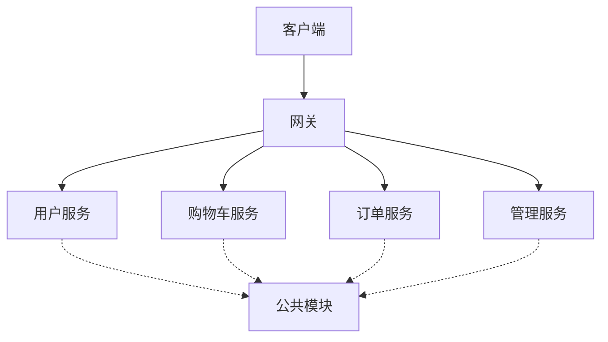

上图展示了从客户端到网关，再到各业务服务的总体请求路径；公共模块为多个服务提供共享的 JWT、常量、异常和 VO 等支撑能力。  
Sources: [sky-gateway/src/main/java/com/sky/gateway/GatewayApplication.java:1-12](), [sky-gateway/src/main/java/com/sky/gateway/filter/AuthGlobalFilter.java:1-65](), [sky-common/src/main/java/com/sky/utils/JwtTool.java:39-62](), [sky-common/src/main/java/com/sky/constant/JwtClaimsConstant.java:1-12](), [sky-pojo/src/main/java/com/sky/vo/OrderReportVO.java:1-35]()

## 架构组件与职责

| 组件/模块 | 关键文件 | 职责 |
|---|---|---|
| 网关启动入口 | `GatewayApplication` | 使用 `@SpringBootApplication` 启动网关服务 |
| 全局认证过滤器 | `AuthGlobalFilter` | 拦截请求、判断排除路径、读取用户/管理员 token、解析 JWT |
| 跨域配置 | `CorsConfig` | 通过 `WebFilter` 处理 CORS 请求并写入响应头 |
| 用户服务 | `UserController`、`UserService` | 提供用户登录、新增用户能力 |
| 购物车服务 | `ShoppingCartController` | 提供添加、查看、清空、删除购物车商品等接口 |
| 订单服务 | 用户端/管理端 `OrderController` | 提供用户下单、历史订单查询、管理端接单/拒单/取消/派送/完成 |
| 管理服务 | `EmployeeController`、`ReportController` | 提供员工管理与报表统计接口 |
| 订单数据源配置 | `OrderDataSourceConfig` | 在 `admin-service` 中配置 order 数据源、SqlSessionFactory 和 Mapper XML |
| 公共模块 | `sky-common`、`sky-pojo` | 提供 JWT 工具、常量、异常、VO 模型 |

Sources: [sky-gateway/src/main/java/com/sky/gateway/GatewayApplication.java:1-12](), [sky-gateway/src/main/java/com/sky/gateway/filter/AuthGlobalFilter.java:1-65](), [sky-gateway/src/main/java/com/sky/gateway/config/CorsConfig.java:1-37](), [user-service/src/main/java/com/sky/controller/UserController.java:1-74](), [user-service/src/main/java/com/sky/service/UserService.java:1-18](), [cart-service/src/main/java/com/sky/controller/user/ShoppingCartController.java:1-98](), [order-service/src/main/java/com/sky/controller/user/OrderController.java:1-75](), [order-service/src/main/java/com/sky/controller/admin/OrderController.java:69-128](), [admin-service/src/main/java/com/sky/controller/EmployeeController.java:101-144](), [admin-service/src/main/java/com/sky/controller/ReportController.java:1-80](), [admin-service/src/main/java/com/sky/api/config/OrderDataSourceConfig.java:1-35](), [sky-common/src/main/java/com/sky/exception/OrderBusinessException.java:1-10](), [sky-pojo/src/main/java/com/sky/vo/OrderReportVO.java:1-35]()

## 网关入口与全局过滤

`sky-gateway` 的启动类 `GatewayApplication` 使用 `@SpringBootApplication` 标注，并通过 `SpringApplication.run` 启动。该模块是整个微服务架构的统一入口。  
Sources: [sky-gateway/src/main/java/com/sky/gateway/GatewayApplication.java:1-12]()

`AuthGlobalFilter` 实现了 `GlobalFilter` 和 `Ordered`，说明它是 Spring Cloud Gateway 的全局过滤器，并可参与过滤器排序。过滤器首先获取 `ServerHttpRequest`，然后调用 `isExclude(request.getPath().toString())` 判断当前路径是否在排除列表中；如果不需要拦截，则直接通过 `chain.filter(exchange)` 放行。  
Sources: [sky-gateway/src/main/java/com/sky/gateway/filter/AuthGlobalFilter.java:1-65]()

对于需要鉴权的请求，过滤器会尝试从请求头中读取 token：优先读取 `jwtProperties.getUserTokenName()` 对应的用户 token；如果不存在，再读取 `jwtProperties.getAdminTokenName()` 对应的管理员 token。变量 `isUserToken` 用于区分当前 token 是用户 token 还是管理员 token。随后代码进入 JWT 校验与解析阶段。  
Sources: [sky-gateway/src/main/java/com/sky/gateway/filter/AuthGlobalFilter.java:1-65]()

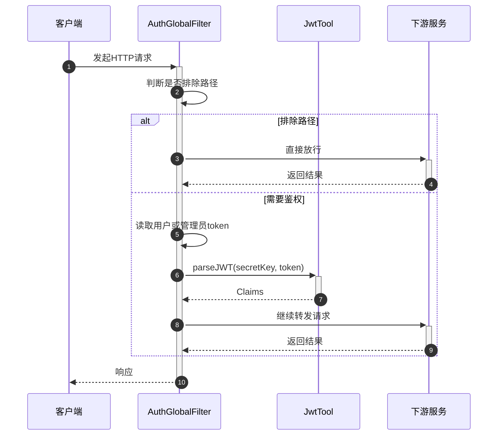

该时序图展示了网关认证过滤器的核心流程：先判断是否放行，再读取并解析 JWT，最后继续向下游服务转发。  
Sources: [sky-gateway/src/main/java/com/sky/gateway/filter/AuthGlobalFilter.java:1-65](), [sky-gateway/src/main/java/com/sky/gateway/utils/JwtTool.java:35-57]()

## 跨域处理

`CorsConfig` 通过注册 `WebFilter` 实现跨域处理。其逻辑是：先使用 `CorsUtils.isCorsRequest(request)` 判断当前请求是否为跨域请求；如果不是跨域请求，则直接放行。  
Sources: [sky-gateway/src/main/java/com/sky/gateway/config/CorsConfig.java:1-37]()

如果是跨域请求，配置会从请求头中读取 `Origin` 和 `Access-Control-Request-Headers`，并将它们写入响应头：

| 响应头 | 来源 | 作用 |
|---|---|---|
| `ACCESS_CONTROL_ALLOW_ORIGIN` | 请求头中的 `Origin` | 允许当前请求源访问 |
| `ACCESS_CONTROL_ALLOW_HEADERS` | 请求头中的 `Access-Control-Request-Headers` | 允许客户端携带的请求头 |
| 请求方法相关头 | `Access-Control-RequestMethod` | 处理预检请求方法 |

Sources: [sky-gateway/src/main/java/com/sky/gateway/config/CorsConfig.java:1-37]()

## JWT 身份认证体系

项目中存在两个 `JwtTool`：一个位于 `sky-gateway`，一个位于 `sky-common`。两者都提供了 `parseJWT(String secretKey, String token)` 方法，用于解析 JWT。解析时使用 `Jwts.parser()`，并通过 `setSigningKey(secretKey.getBytes(StandardCharsets.UTF_8))` 设置签名密钥。  
Sources: [sky-gateway/src/main/java/com/sky/gateway/utils/JwtTool.java:35-57](), [sky-common/src/main/java/com/sky/utils/JwtTool.java:39-62]()

`JwtClaimsConstant` 在 `sky-gateway` 和 `sky-common` 中都定义了相同常量：

| 常量 | 值 | 说明 |
|---|---:|---|
| `EMP_ID` | `userId` | 员工/管理员身份 claim |
| `USER_ID` | `userId` | 用户身份 claim |

源码注释明确说明：将二者设置成一样，方便 `FeignClient` 进行微服务之间的请求。  
Sources: [sky-gateway/src/main/java/com/sky/gateway/constant/JwtClaimsConstant.java:1-12](), [sky-common/src/main/java/com/sky/constant/JwtClaimsConstant.java:1-12]()

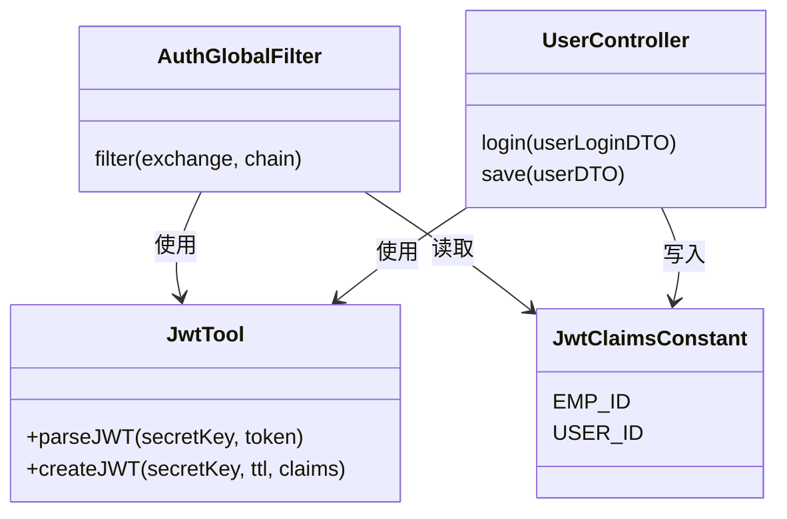

该类图展示了 JWT 生成、解析与身份 claim 在网关和用户服务之间的关系。  
Sources: [sky-gateway/src/main/java/com/sky/gateway/filter/AuthGlobalFilter.java:1-65](), [sky-gateway/src/main/java/com/sky/gateway/utils/JwtTool.java:35-57](), [user-service/src/main/java/com/sky/controller/UserController.java:1-74](), [sky-common/src/main/java/com/sky/utils/JwtTool.java:39-62](), [sky-common/src/main/java/com/sky/constant/JwtClaimsConstant.java:1-12]()

## 用户服务

`user-service` 中的 `UserController` 映射在 `/user/user` 路径下，提供 C 端用户相关接口。其 `login` 接口接收 `UserLoginDTO`，调用 `UserService.login` 完成登录；登录成功后，将用户 ID 写入 JWT claims，并使用 `JwtTool.createJWT` 生成用户 token，最终返回 `UserLoginVO`。  
Sources: [user-service/src/main/java/com/sky/controller/UserController.java:1-74]()

`UserService` 接口定义了两个能力：

| 方法 | 说明 |
|---|---|
| `login(UserLoginDTO userLoginDTO)` | 网页登录 |
| `save(UserDTO userDTO)` | 新增用户 |

Sources: [user-service/src/main/java/com/sky/service/UserService.java:1-18]()

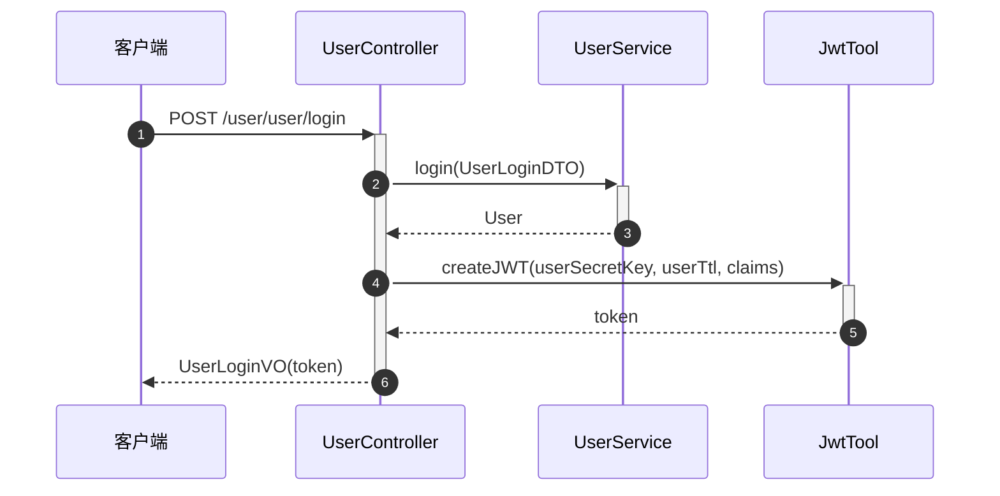

该时序图展示了用户登录并获取 JWT 的过程。  
Sources: [user-service/src/main/java/com/sky/controller/UserController.java:1-74](), [user-service/src/main/java/com/sky/service/UserService.java:1-18](), [sky-common/src/main/java/com/sky/utils/JwtTool.java:39-62]()

## 购物车服务

`cart-service` 的 `ShoppingCartController` 映射在 `/user/shoppingCart` 路径下，提供 C 端购物车接口。该控制器同时注入了 `ShoppingCartService` 和 `ShoppingCartMapper`，部分业务通过 service 完成，部分操作直接调用 mapper。  
Sources: [cart-service/src/main/java/com/sky/controller/user/ShoppingCartController.java:1-98]()

| HTTP 方法 | 路径 | 功能 | 实现方式 |
|---|---|---|---|
| POST | `/user/shoppingCart/add` | 添加购物车 | `shoppingCartService.addShoppingCart` |
| POST | `/user/shoppingCart/insertBatch` | 批量添加购物车 | `shoppingCartMapper.insertBatch` |
| GET | `/user/shoppingCart/list` | 查看购物车 | `shoppingCartService.showShoppingCart` |
| DELETE | `/user/shoppingCart/clean` | 清空购物车 | `shoppingCartService.cleanShoppingCart` |
| DELETE | `/user/shoppingCart/deleteByUserId` | 根据用户 ID 清空购物车 | `shoppingCartMapper.deleteByUserId` |
| POST | `/user/shoppingCart/sub` | 删除购物车中一个商品 | `shoppingCartService.subShoppingCart` |

Sources: [cart-service/src/main/java/com/sky/controller/user/ShoppingCartController.java:1-98]()

## 订单服务

`order-service` 同时包含用户端订单接口和管理端订单接口。用户端控制器名为 `userOrderController`，映射路径为 `/user/order`；管理端控制器提供接单、拒单、取消、派送、完成等订单状态流转操作。  
Sources: [order-service/src/main/java/com/sky/controller/user/OrderController.java:1-75](), [order-service/src/main/java/com/sky/controller/admin/OrderController.java:69-128]()

### 用户端订单接口

| HTTP 方法 | 路径 | 功能 |
|---|---|---|
| POST | `/user/order/submit` | 用户下单 |
| GET | `/user/order/historyOrders` | 历史订单查询 |
| GET | `/user/order/orderDetail/{id}` | 查询订单详情 |

Sources: [order-service/src/main/java/com/sky/controller/user/OrderController.java:1-75]()

用户端历史订单查询支持分页参数 `page`、`pageSize`，以及订单状态 `status`。源码注释列出了订单状态含义：

| 状态值 | 状态说明 |
|---:|---|
| 1 | 待付款 |
| 2 | 待接单 |
| 3 | 已接单 |
| 4 | 派送中 |
| 5 | 已完成 |
| 6 | 已取消 |

Sources: [order-service/src/main/java/com/sky/controller/user/OrderController.java:1-75]()

### 管理端订单操作

| HTTP 方法 | 路径 | 功能 |
|---|---|---|
| PUT | `/confirm` | 接单 |
| PUT | `/rejection` | 拒单 |
| PUT | `/cancel` | 取消订单 |
| PUT | `/delivery/{id}` | 派送订单 |
| PUT | `/complete/{id}` | 完成订单 |

Sources: [order-service/src/main/java/com/sky/controller/admin/OrderController.java:69-128]()

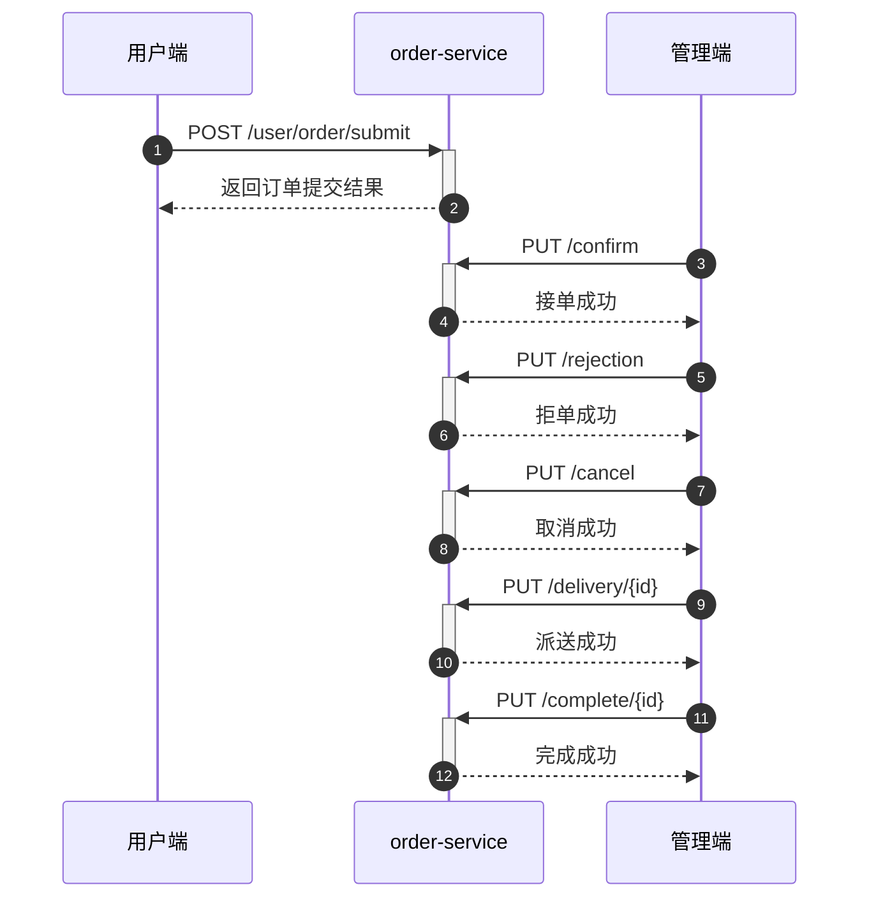

该时序图展示了订单从用户提交到管理端进行接单、拒单、取消、派送和完成的主要操作入口。  
Sources: [order-service/src/main/java/com/sky/controller/user/OrderController.java:1-75](), [order-service/src/main/java/com/sky/controller/admin/OrderController.java:69-128]()

## 管理端服务

`admin-service` 提供员工管理和数据统计能力。`EmployeeService` 定义了员工登录、新增、分页查询、启用/禁用、根据 ID 查询和编辑员工信息等接口。  
Sources: [admin-service/src/main/java/com/sky/service/EmployeeService.java:1-51]()

`EmployeeController` 中可见以下管理端员工操作：

| HTTP 方法 | 路径 | 功能 |
|---|---|---|
| POST | `/status/{status}` | 启用/禁用员工账号 |
| GET | `/{id}` | 根据 ID 查询员工信息 |
| PUT | `/` | 编辑员工信息 |

Sources: [admin-service/src/main/java/com/sky/controller/EmployeeController.java:101-144]()

`ReportController` 映射在 `/admin/report` 路径下，提供营业额统计、用户统计和订单统计接口。所有接口均接收 `begin` 和 `end` 两个日期参数，并使用 `@DateTimeFormat(pattern = "yyyy-MM-dd")` 解析为 `LocalDate`。  
Sources: [admin-service/src/main/java/com/sky/controller/ReportController.java:1-80]()

| HTTP 方法 | 路径 | 返回 VO |
|---|---|---|
| GET | `/admin/report/turnoverStatistics` | `TurnoverReportVO` |
| GET | `/admin/report/userStatistics` | `UserReportVO` |
| GET | `/admin/report/ordersStatistics` | `OrderReportVO` |

Sources: [admin-service/src/main/java/com/sky/controller/ReportController.java:1-80]()

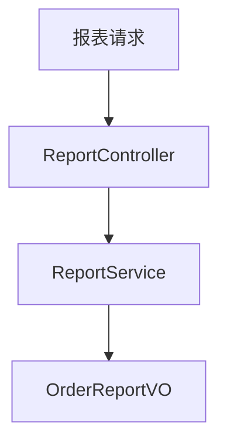

订单统计接口通过 `ReportService` 生成报表结果，其中订单统计返回 `OrderReportVO`。  
Sources: [admin-service/src/main/java/com/sky/controller/ReportController.java:1-80](), [sky-pojo/src/main/java/com/sky/vo/OrderReportVO.java:1-35]()

### 订单报表数据模型

`OrderReportVO` 用于封装订单统计结果，其字段以逗号分隔字符串的形式表达日期、订单数和有效订单数，同时也提供总数和完成率字段。

| 字段 | 类型 | 说明 |
|---|---|---|
| `dateList` | `String` | 日期列表，例如 `2022-10-01,2022-10-02` |
| `orderCountList` | `String` | 每日订单数 |
| `validOrderCountList` | `String` | 每日有效订单数 |
| `totalOrderCount` | `Integer` | 订单总数 |
| `validOrderCount` | `Integer` | 有效订单数 |
| `orderCompletionRate` | `Double` | 订单完成率 |

Sources: [sky-pojo/src/main/java/com/sky/vo/OrderReportVO.java:1-35]()

## admin-service 中的订单数据源配置

`admin-service` 中的 `OrderDataSourceConfig` 表明该服务集成了对 order 数据的访问能力。它使用 `@Configuration` 和 `@MapperScan` 扫描 `com.sky.api.client.order` 包，并指定 `sqlSessionFactoryRef` 为 `orderSqlSessionFactory`。  
Sources: [admin-service/src/main/java/com/sky/api/config/OrderDataSourceConfig.java:1-35]()

该配置类定义了两个核心 Bean：

| Bean 名称 | 类型 | 配置来源/作用 |
|---|---|---|
| `orderDataSource` | `DataSource` | 绑定 `spring.datasource.order` 配置 |
| `orderSqlSessionFactory` | `SqlSessionFactory` | 使用 `orderDataSource`，加载 `classpath:api/client/order/*.xml` |

Sources: [admin-service/src/main/java/com/sky/api/config/OrderDataSourceConfig.java:1-35]()

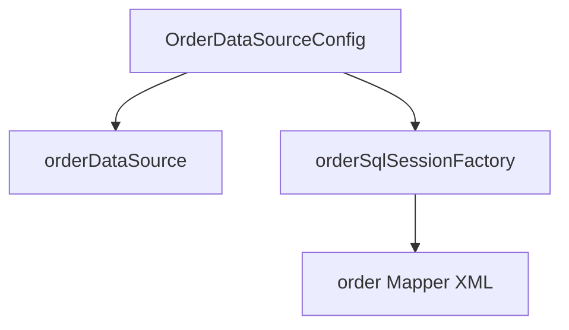

该图展示了 `admin-service` 中 order 数据源、MyBatis SqlSessionFactory 和 Mapper XML 的配置关系。  
Sources: [admin-service/src/main/java/com/sky/api/config/OrderDataSourceConfig.java:1-35]()

## 公共模块与异常模型

`sky-common` 提供了跨服务共享的 JWT 工具和常量。`JwtTool.parseJWT` 用于服务端解析 token，`JwtClaimsConstant` 定义了统一的身份 claim 名称。  
Sources: [sky-common/src/main/java/com/sky/utils/JwtTool.java:39-62](), [sky-common/src/main/java/com/sky/constant/JwtClaimsConstant.java:1-12]()

`OrderBusinessException` 继承自 `BaseException`，用于表示订单业务异常。它的构造方法只接收一个错误消息，并传递给父类。  
Sources: [sky-common/src/main/java/com/sky/exception/OrderBusinessException.java:1-10]()

## 总体请求流转

从提供的源码可以归纳出如下请求流转路径：客户端请求先进入 `sky-gateway`，由 `CorsConfig` 处理跨域，由 `AuthGlobalFilter` 判断是否排除路径并解析 JWT；通过网关后，请求根据业务路径进入用户、购物车、订单或管理端服务；各服务通过 Controller 暴露 REST API，并调用对应 Service 或 Mapper 完成业务处理。  
Sources: [sky-gateway/src/main/java/com/sky/gateway/config/CorsConfig.java:1-37](), [sky-gateway/src/main/java/com/sky/gateway/filter/AuthGlobalFilter.java:1-65](), [user-service/src/main/java/com/sky/controller/UserController.java:1-74](), [cart-service/src/main/java/com/sky/controller/user/ShoppingCartController.java:1-98](), [order-service/src/main/java/com/sky/controller/user/OrderController.java:1-75](), [admin-service/src/main/java/com/sky/controller/ReportController.java:1-80]()

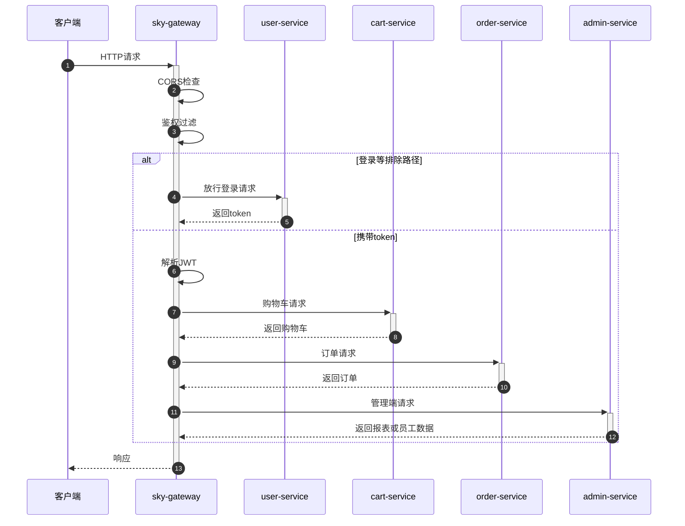

该时序图是对整体微服务请求链路的汇总：网关负责统一入口和认证，业务服务负责具体领域逻辑。  
Sources: [sky-gateway/src/main/java/com/sky/gateway/config/CorsConfig.java:1-37](), [sky-gateway/src/main/java/com/sky/gateway/filter/AuthGlobalFilter.java:1-65](), [user-service/src/main/java/com/sky/controller/UserController.java:1-74](), [cart-service/src/main/java/com/sky/controller/user/ShoppingCartController.java:1-98](), [order-service/src/main/java/com/sky/controller/user/OrderController.java:1-75](), [admin-service/src/main/java/com/sky/controller/ReportController.java:1-80]()

## 总结

本项目的微服务架构以 `sky-gateway` 为统一入口，通过 `AuthGlobalFilter` 实现用户/管理员 JWT 鉴权，通过 `CorsConfig` 处理跨域请求。业务侧由 `user-service`、`cart-service`、`order-service` 和 `admin-service` 分别承担用户、购物车、订单和管理端能力。`sky-common` 提供共享的 JWT 解析、身份常量和订单业务异常，`sky-pojo` 提供报表等 VO 模型。`admin-service` 还通过独立的 order 数据源配置，展现了管理端对订单数据统计的支撑能力。

---

<a id='page-gateway-auth-routing'></a>

## 网关路由与认证机制

### Related Pages

Related topics: [微服务架构总览](#page-microservice-architecture), [公共后端组件与异常体系](#page-common-backend-components)

<details>
<summary>Relevant source files</summary>

The following files were used as context for generating this wiki page:

- [sky-gateway/src/main/java/com/sky/gateway/filter/AuthGlobalFilter.java](sky-gateway/src/main/java/com/sky/gateway/filter/AuthGlobalFilter.java)
- [sky-gateway/src/main/java/com/sky/gateway/config/CorsConfig.java](sky-gateway/src/main/java/com/sky/gateway/config/CorsConfig.java)
- [sky-gateway/src/main/java/com/sky/gateway/properties/AuthProperties.java](sky-gateway/src/main/java/com/sky/gateway/properties/AuthProperties.java)
- [sky-gateway/src/main/java/com/sky/gateway/properties/JwtProperties.java](sky-gateway/src/main/java/com/sky/gateway/properties/JwtProperties.java)
- [sky-gateway/src/main/java/com/sky/gateway/utils/JwtTool.java](sky-gateway/src/main/java/com/sky/gateway/utils/JwtTool.java)
- [sky-gateway/src/main/java/com/sky/gateway/constant/JwtClaimsConstant.java](sky-gateway/src/main/java/com/sky/gateway/constant/JwtClaimsConstant.java)
- [sky-gateway/src/main/java/com/sky/gateway/route/DynamicRouteLoader.java](sky-gateway/src/main/java/com/sky/gateway/route/DynamicRouteLoader.java)
</details>

# 网关路由与认证机制

本页面基于当前可见源码，说明项目中与“网关路由与认证机制”直接相关的 JWT 签发、JWT 解析、Claims 约定，以及网关可能转发到的 `/user`、`/admin` HTTP 端点。当前上下文未包含网关过滤器、CORS 配置、认证属性、JWT 属性、动态路由加载器等实现源码，因此本页不推断这些缺失文件的具体行为。

## 1. 认证与路由可见范围

可见源码中，认证机制主要由三部分构成：

1. `user-service` 提供登录接口并签发 JWT。
2. `sky-common` 与 `sky-gateway` 均提供 `JwtTool.parseJWT`，用于解析 JWT Claims。
3. `JwtClaimsConstant` 统一约定 JWT Claims 中的用户标识字段为 `userId`。

路由方面，可见源码仅能确认各微服务暴露了 `/user/**` 与 `/admin/**` 控制器路径；网关层的路由规则、过滤器链和跨域配置未在当前上下文中提供。

| 组件 | 模块 | 可见职责 |
|---|---|---|
| `JwtTool` | `sky-gateway` | 解析 JWT，返回 `Claims` |
| `JwtTool` | `sky-common` | 提供 JWT 生成与解析能力 |
| `JwtClaimsConstant` | `sky-gateway` / `sky-common` | 定义 `EMP_ID`、`USER_ID` 均为 `userId` |
| `UserController` | `user-service` | 用户登录并返回 JWT |
| 各业务 Controller | `order-service`、`cart-service`、`admin-service` | 暴露 `/user` 或 `/admin` 业务接口 |

Sources: [sky-gateway/src/main/java/com/sky/gateway/utils/JwtTool.java:47-54](), [sky-common/src/main/java/com/sky/utils/JwtTool.java:51-59](), [sky-gateway/src/main/java/com/sky/gateway/constant/JwtClaimsConstant.java:5-6](), [sky-common/src/main/java/com/sky/constant/JwtClaimsConstant.java:5-6](), [user-service/src/main/java/com/sky/controller/UserController.java:41-59]()

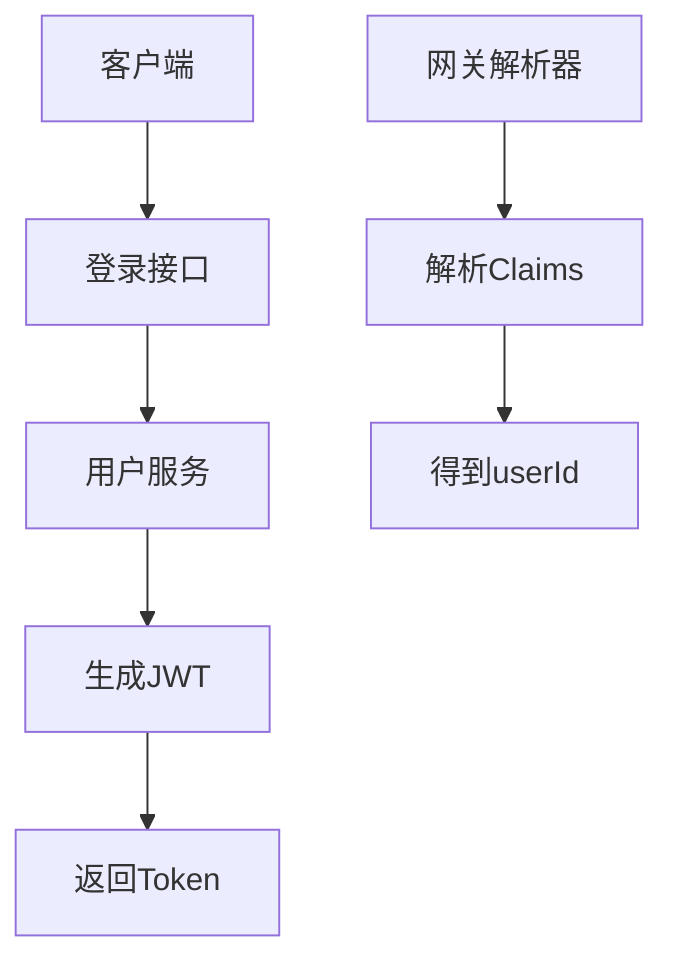

上图展示可见源码中的认证主线：登录接口负责生成 Token，网关模块中的 `JwtTool` 具备解析 Token 并得到 Claims 的能力。

Sources: [user-service/src/main/java/com/sky/controller/UserController.java:41-59](), [sky-gateway/src/main/java/com/sky/gateway/utils/JwtTool.java:47-54]()

## 2. JWT 签发

### 2.1 用户登录接口

`user-service` 的 `UserController` 提供 `POST /user/user/login` 接口。登录成功后，服务端调用 `UserService.login`，随后使用 `JwtTool.createJWT` 生成 JWT，并将 Token 封装到 `UserLoginVO` 中返回。

```java
claims.put(JwtClaimsConstant.USER_ID, user.getId());
String token = JwtTool.createJWT(
        jwtProperties.getUserSecretKey(),
        jwtProperties.getUserTtl(),
        claims
);
```

该代码表明：

- JWT Claim 使用 `JwtClaimsConstant.USER_ID` 作为键。
- Claim 值为当前登录用户的 `user.getId()`。
- 密钥与有效期来自 `JwtProperties`。
- `JwtProperties` 的具体字段未在当前上下文中展示。

Sources: [user-service/src/main/java/com/sky/controller/UserController.java:41-59]()

### 2.2 登录签发时序

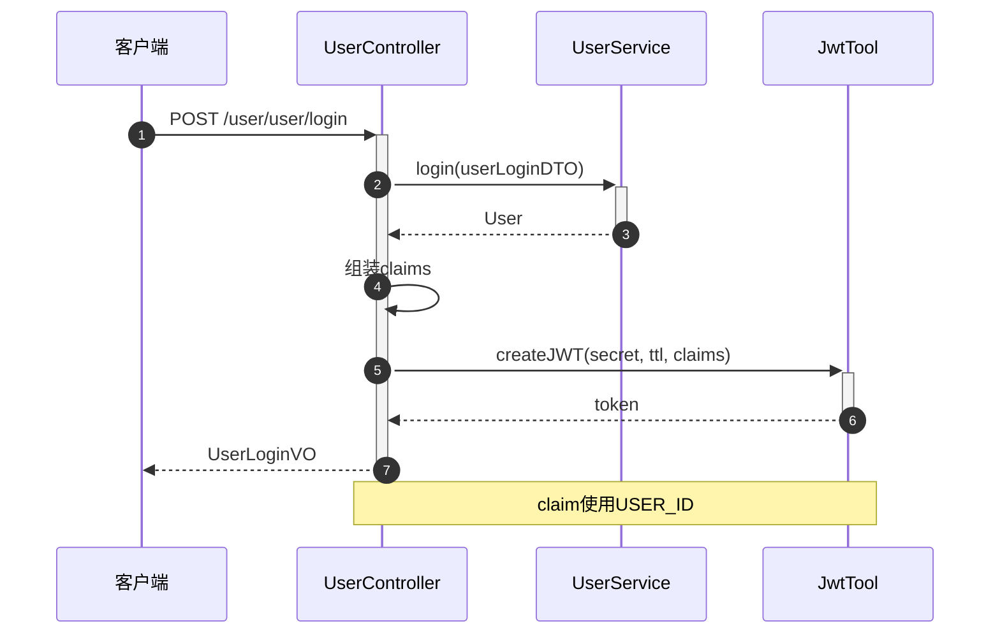

该时序对应 `UserController.login` 的可见流程：登录校验、生成 Claims、调用 JWT 工具、返回 Token。

Sources: [user-service/src/main/java/com/sky/controller/UserController.java:41-59]()

## 3. JWT 解析与 Claims 约定

### 3.1 网关侧 JWT 解析

`sky-gateway` 中的 `JwtTool.parseJWT` 使用 `secretKey` 的 UTF-8 字节作为签名密钥，并通过 JJWT 解析 Token。

```java
public static Claims parseJWT(String secretKey, String token) {
    return Jwts.parser()
            .setSigningKey(secretKey.getBytes(StandardCharsets.UTF_8))
            .parseClaimsJws(token).getBody();
}
```

该方法返回 `Claims`，供调用方读取 JWT 中的用户身份或其他声明信息。

Sources: [sky-gateway/src/main/java/com/sky/gateway/utils/JwtTool.java:47-54]()

### 3.2 通用模块 JWT 解析

`sky-common` 中的 `JwtTool.parseJWT` 与网关版本逻辑一致，同样通过 `Jwts.parser()` 设置签名密钥并解析 `ClaimsJws`。

```java
Claims claims = Jwts.parser()
        .setSigningKey(secretKey.getBytes(StandardCharsets.UTF_8))
        .parseClaimsJws(token).getBody();
return claims;
```

Sources: [sky-common/src/main/java/com/sky/utils/JwtTool.java:51-59]()

### 3.3 Claims 常量

网关与通用模块都定义了 `JwtClaimsConstant`，其中 `EMP_ID` 与 `USER_ID` 均被设置为字符串 `"userId"`。源码注释说明这样做的目的是方便 FeignClient 在微服务之间传递请求时统一读取用户标识。

```java
public static final String EMP_ID = "userId";
public static final String USER_ID = "userId";
```

| Claim 常量 | 值 | 可见用途 |
|---|---|---|
| `EMP_ID` | `userId` | 员工或后台用户标识 |
| `USER_ID` | `userId` | C 端用户标识 |
| 统一键名 | `userId` | 便于微服务间 Feign 请求传递身份 |

Sources: [sky-gateway/src/main/java/com/sky/gateway/constant/JwtClaimsConstant.java:5-6](), [sky-common/src/main/java/com/sky/constant/JwtClaimsConstant.java:5-6]()

### 3.4 解析流程

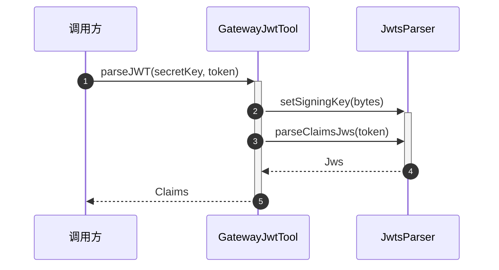

该流程仅表示 `JwtTool.parseJWT` 的内部调用关系；当前上下文没有展示网关过滤器、路由处理器或业务拦截器在何处调用该方法。

Sources: [sky-gateway/src/main/java/com/sky/gateway/utils/JwtTool.java:47-54]()

## 4. 路由目标端点

虽然网关路由规则未在当前上下文中展示，但各微服务 Controller 明确暴露了 `/user/**` 与 `/admin/**` 路径。这些路径是网关路由可能转发到的目标端点。

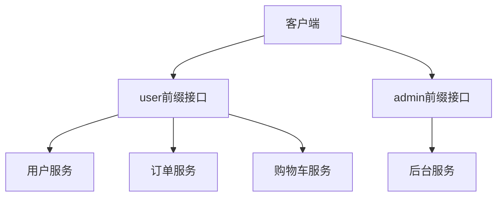

该图仅基于 Controller 的 `@RequestMapping` 路径前缀归纳，不表示已确认的网关路由配置。

Sources: [user-service/src/main/java/com/sky/controller/UserController.java:23-25](), [order-service/src/main/java/com/sky/controller/user/OrderController.java:16-18](), [cart-service/src/main/java/com/sky/controller/user/ShoppingCartController.java:17-19](), [admin-service/src/main/java/com/sky/controller/ReportController.java:24-26]()

### 4.1 用户端订单接口

`order-service` 的用户端订单 Controller 映射到 `/user/order`。

| HTTP 方法 | 路径 | 功能 |
|---|---|---|
| `POST` | `/user/order/submit` | 用户下单 |
| `GET` | `/user/order/historyOrders` | 历史订单分页查询 |
| `GET` | `/user/order/orderDetail/{id}` | 查询订单详情 |

Sources: [order-service/src/main/java/com/sky/controller/user/OrderController.java:16-34](), [order-service/src/main/java/com/sky/controller/user/OrderController.java:58-63](), [order-service/src/main/java/com/sky/controller/user/OrderController.java:70-72]()

### 4.2 用户端购物车接口

`cart-service` 的用户端购物车 Controller 映射到 `/user/shoppingCart`。

| HTTP 方法 | 路径 | 功能 |
|---|---|---|
| `POST` | `/user/shoppingCart/add` | 添加购物车 |
| `POST` | `/user/shoppingCart/insertBatch` | 批量添加购物车 |
| `GET` | `/user/shoppingCart/list` | 查看购物车 |
| `DELETE` | `/user/shoppingCart/clean` | 清空购物车 |
| `DELETE` | `/user/shoppingCart/deleteByUserId` | 按用户 ID 清空购物车 |
| `POST` | `/user/shoppingCart/sub` | 删除购物车中一个商品 |

Sources: [cart-service/src/main/java/com/sky/controller/user/ShoppingCartController.java:17-37](), [cart-service/src/main/java/com/sky/controller/user/ShoppingCartController.java:43-45](), [cart-service/src/main/java/com/sky/controller/user/ShoppingCartController.java:53-58](), [cart-service/src/main/java/com/sky/controller/user/ShoppingCartController.java:64-69](), [cart-service/src/main/java/com/sky/controller/user/ShoppingCartController.java:75-80](), [cart-service/src/main/java/com/sky/controller/user/ShoppingCartController.java:86-92]()

### 4.3 用户登录接口

`user-service` 的用户 Controller 映射到 `/user/user`。

| HTTP 方法 | 路径 | 功能 |
|---|---|---|
| `POST` | `/user/user/login` | 顾客登录并返回 JWT |
| `POST` | `/user/user` | 新增用户 |

Sources: [user-service/src/main/java/com/sky/controller/UserController.java:23-25](), [user-service/src/main/java/com/sky/controller/UserController.java:41-59](), [user-service/src/main/java/com/sky/controller/UserController.java:66-73]()

### 4.4 后台报表接口

`admin-service` 的报表 Controller 映射到 `/admin/report`。

| HTTP 方法 | 路径 | 功能 |
|---|---|---|
| `GET` | `/admin/report/turnoverStatistics` | 营业额统计 |
| `GET` | `/admin/report/userStatistics` | 用户统计 |
| `GET` | `/admin/report/ordersStatistics` | 订单统计 |
| `GET` | `/admin/report/top10` | 销量排名 Top10 |
| `GET` | `/admin/report/export` | 导出运营数据报表 |

Sources: [admin-service/src/main/java/com/sky/controller/ReportController.java:24-46](), [admin-service/src/main/java/com/sky/controller/ReportController.java:53-76](), [admin-service/src/main/java/com/sky/controller/ReportController.java:65-105]()

### 4.5 后台订单与员工接口

后台订单管理 Controller 可见接单、拒单、取消、派送、完成等操作；员工管理 Controller 可见启用/禁用、按 ID 查询、编辑员工等操作。当前上下文未展示这两个 Controller 的类级 `@RequestMapping`，因此不能确定其完整路由路径。

| 模块 | 可见操作 | HTTP 方法 |
|---|---|---|
| 后台订单 | 接单 | `PUT` |
| 后台订单 | 拒单 | `PUT` |
| 后台订单 | 取消订单 | `PUT` |
| 后台订单 | 派送订单 | `PUT` |
| 后台订单 | 完成订单 | `PUT` |
| 员工管理 | 启用/禁用员工账号 | `POST` |
| 员工管理 | 根据 ID 查询员工 | `GET` |
| 员工管理 | 编辑员工信息 | `PUT` |

Sources: [order-service/src/main/java/com/sky/controller/admin/OrderController.java:69-128](), [admin-service/src/main/java/com/sky/controller/EmployeeController.java:101-144]()

## 5. 网关路由与过滤缺失信息

当前上下文没有提供以下网关核心实现源码：

- 全局认证过滤器
- CORS 配置
- 认证白名单属性
- JWT 配置属性
- 动态路由加载器

因此无法从当前材料中确认：

- 哪些路径需要认证，哪些路径免认证。
- Token 在网关中如何被读取、校验和转发。
- 网关是否将 `userId` 写入请求头传递给下游服务。
- 路由规则是静态配置还是动态加载。
- CORS 允许的来源、方法和头部范围。

可确认的是：网关模块中存在 `JwtTool.parseJWT` 与 `JwtClaimsConstant`，说明网关侧具备解析 JWT 和统一用户标识键名的代码基础。

Sources: [sky-gateway/src/main/java/com/sky/gateway/utils/JwtTool.java:47-54](), [sky-gateway/src/main/java/com/sky/gateway/constant/JwtClaimsConstant.java:5-6]()

## 6. 总结

该项目的认证机制在可见源码中表现为：`user-service` 登录成功后使用 `JwtTool.createJWT` 签发包含 `userId` Claim 的 JWT；`sky-gateway` 与 `sky-common` 均提供基于 JJWT 的 `parseJWT` 方法；`JwtClaimsConstant` 将员工与用户身份 Claim 统一为 `userId`，以便微服务间传递身份。路由层面可见 `/user/**` 与 `/admin/**` 业务端点，但网关路由规则、认证过滤器和跨域配置的具体实现未在当前上下文中提供。

---

<a id='page-business-features'></a>

## 核心业务功能模块

### Related Pages

Related topics: [购物车与订单流程](#page-order-cart-flow), [微服务架构总览](#page-microservice-architecture)

<details>
<summary>Relevant source files</summary>

The following files were used as context for generating this wiki page:

- [admin-service/src/main/java/com/sky/controller/EmployeeController.java](admin-service/src/main/java/com/sky/controller/EmployeeController.java)
- [admin-service/src/main/java/com/sky/controller/ReportController.java](admin-service/src/main/java/com/sky/controller/ReportController.java)
- [admin-service/src/main/java/com/sky/controller/WorkSpaceController.java](admin-service/src/main/java/com/sky/controller/WorkSpaceController.java)
- [item-service/src/main/java/com/sky/controller/admin/DishController.java](item-service/src/main/java/com/sky/controller/admin/DishController.java)
- [item-service/src/main/java/com/sky/controller/admin/SetmealController.java](item-service/src/main/java/com/sky/controller/admin/SetmealController.java)
- [item-service/src/main/java/com/sky/controller/admin/CategoryController.java](item-service/src/main/java/com/sky/controller/admin/CategoryController.java)
- [item-service/src/main/java/com/sky/controller/admin/ShopController.java](item-service/src/main/java/com/sky/controller/admin/ShopController.java)
- [user-service/src/main/java/com/sky/controller/UserController.java](user-service/src/main/java/com/sky/controller/UserController.java)
- [user-service/src/main/java/com/sky/controller/AddressBookController.java](user-service/src/main/java/com/sky/controller/AddressBookController.java)
- [cart-service/src/main/java/com/sky/controller/user/ShoppingCartController.java](cart-service/src/main/java/com/sky/controller/user/ShoppingCartController.java)
- [order-service/src/main/java/com/sky/controller/user/OrderController.java](order-service/src/main/java/com/sky/controller/user/OrderController.java)
- [order-service/src/main/java/com/sky/controller/admin/OrderController.java](order-service/src/main/java/com/sky/controller/admin/OrderController.java)
</details>

# 核心业务功能模块

核心业务功能模块覆盖该项目中顾客端与管理端的主要业务能力，包括用户登录、地址簿管理、购物车操作、用户下单与查询、管理端订单处理、订单状态流转以及报表统计。根据源码中的控制器与服务分布，这些能力分别位于 `user-service`、`cart-service`、`order-service`、`admin-service`，以及公共模块 `sky-common` 和网关模块 `sky-gateway` 中。  
Sources: [user-service/src/main/java/com/sky/controller/UserController.java:1-74](), [user-service/src/main/java/com/sky/controller/AddressBookController.java:1-79](), [cart-service/src/main/java/com/sky/controller/user/ShoppingCartController.java:1-98](), [order-service/src/main/java/com/sky/controller/user/OrderController.java:1-75](), [order-service/src/main/java/com/sky/controller/admin/OrderController.java:69-128](), [admin-service/src/main/java/com/sky/controller/ReportController.java:1-80]()

## 模块总览

| 模块 | 主要入口 | 核心职责 |
|---|---|---|
| 用户服务 | `UserController` | 顾客登录、新增用户 |
| 地址簿服务 | `AddressBookController` | 查询、新增、修改地址，设置默认地址 |
| 购物车服务 | `ShoppingCartController` | 添加购物车、查看购物车、清空购物车、删除购物车商品 |
| 用户订单服务 | `order-service` 用户端 `OrderController` | 用户下单、历史订单查询、订单详情查询 |
| 管理端订单服务 | `order-service` 管理端 `OrderController` | 接单、拒单、取消订单、派送订单、完成订单 |
| 报表服务 | `ReportController` | 营业额统计、用户统计、订单统计 |
| 公共能力 | `JwtTool`、`MessageConstant`、`StatusConstant` | JWT 生成与解析、业务提示信息、状态常量 |

Sources: [user-service/src/main/java/com/sky/controller/UserController.java:1-74](), [user-service/src/main/java/com/sky/controller/AddressBookController.java:1-79](), [cart-service/src/main/java/com/sky/controller/user/ShoppingCartController.java:1-98](), [order-service/src/main/java/com/sky/controller/user/OrderController.java:1-75](), [order-service/src/main/java/com/sky/controller/admin/OrderController.java:69-128](), [admin-service/src/main/java/com/sky/controller/ReportController.java:1-80](), [sky-common/src/main/java/com/sky/utils/JwtTool.java:1-62](), [sky-common/src/main/java/com/sky/constant/MessageConstant.java:1-29](), [sky-common/src/main/java/com/sky/constant/StatusConstant.java:1-14]()

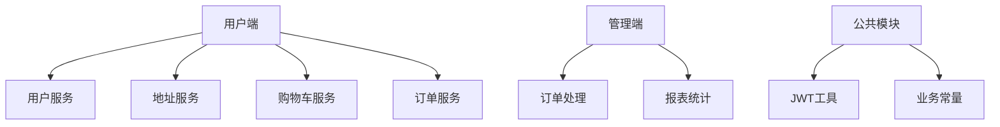

该图展示了核心业务模块之间的总体关系：用户端主要访问用户、地址、购物车和订单功能，管理端主要进行订单处理与数据统计，公共模块提供 JWT 与常量支撑。  
Sources: [user-service/src/main/java/com/sky/controller/UserController.java:1-74](), [user-service/src/main/java/com/sky/controller/AddressBookController.java:1-79](), [cart-service/src/main/java/com/sky/controller/user/ShoppingCartController.java:1-98](), [order-service/src/main/java/com/sky/controller/user/OrderController.java:1-75](), [order-service/src/main/java/com/sky/controller/admin/OrderController.java:69-128](), [admin-service/src/main/java/com/sky/controller/ReportController.java:1-80]()

## 用户认证与 JWT

### 用户登录接口

用户登录入口位于 `UserController`，接口路径为 `POST /user/user/login`。控制器接收 `UserLoginDTO`，调用 `UserService.login` 完成登录逻辑，然后使用 `JwtTool.createJWT` 生成顾客端 JWT 令牌，并将用户 ID 写入 claims。最终返回 `UserLoginVO`，其中包含用户 ID 和 token。  
Sources: [user-service/src/main/java/com/sky/controller/UserController.java:41-59]()

| 接口 | 方法 | 请求体 | 返回结果 |
|---|---:|---|---|
| `/user/user/login` | POST | `UserLoginDTO` | `Result<UserLoginVO>` |
| `/user/user` | POST | `UserDTO` | `Result` |

Sources: [user-service/src/main/java/com/sky/controller/UserController.java:41-73]()

### JWT 生成与解析

`sky-common` 中的 `JwtTool.createJWT` 使用 `SignatureAlgorithm.HS256` 算法，根据传入的 `secretKey`、`ttlMillis` 和 `claims` 生成 JWT。该方法会计算过期时间，并通过 `JwtBuilder` 设置 claims、签名算法与过期时间。  
Sources: [sky-common/src/main/java/com/sky/utils/JwtTool.java:24-42]()

`sky-common` 和 `sky-gateway` 中都提供了 `parseJWT` 方法，用于解析 JWT 并返回 `Claims`。网关模块中的 `createJWT` 方法被注释，当前可见能力主要是 `parseJWT`。  
Sources: [sky-common/src/main/java/com/sky/utils/JwtTool.java:51-59](), [sky-gateway/src/main/java/com/sky/gateway/utils/JwtTool.java:48-55]()

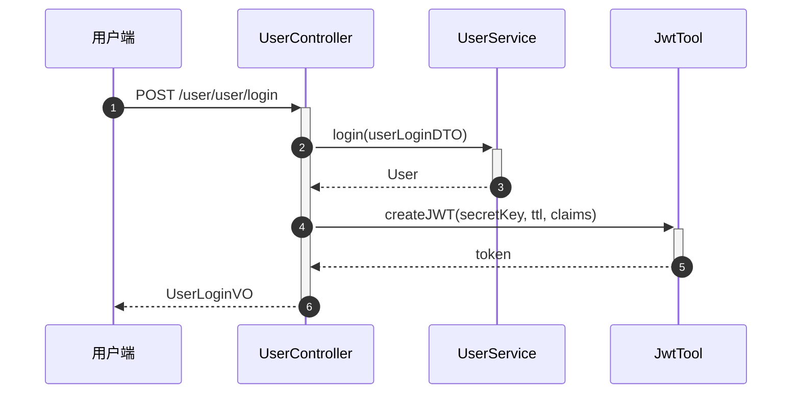

该时序图描述了顾客登录的核心流程：控制器接收登录请求，服务层返回用户实体，`JwtTool` 生成 token，控制器将 token 封装到登录响应中。  
Sources: [user-service/src/main/java/com/sky/controller/UserController.java:41-59](), [sky-common/src/main/java/com/sky/utils/JwtTool.java:24-42]()

## 地址簿管理

`AddressBookController` 提供 C 端地址簿接口，基础路径为 `/user/addressBook`。查询当前登录用户地址列表时，控制器创建 `AddressBook` 查询条件，并通过 `BaseContext.getCurrentId()` 设置当前用户 ID，然后调用 `AddressBookService.list`。  
Sources: [user-service/src/main/java/com/sky/controller/AddressBookController.java:27-35]()

| 接口 | 方法 | 功能 |
|---|---:|---|
| `/user/addressBook/list` | GET | 查询当前登录用户的所有地址 |
| `/user/addressBook` | POST | 新增地址 |
| `/user/addressBook/{id}` | GET | 根据 ID 查询地址 |
| `/user/addressBook` | PUT | 根据 ID 修改地址 |
| `/user/addressBook/default` | PUT | 设置默认地址 |

Sources: [user-service/src/main/java/com/sky/controller/AddressBookController.java:27-79]()

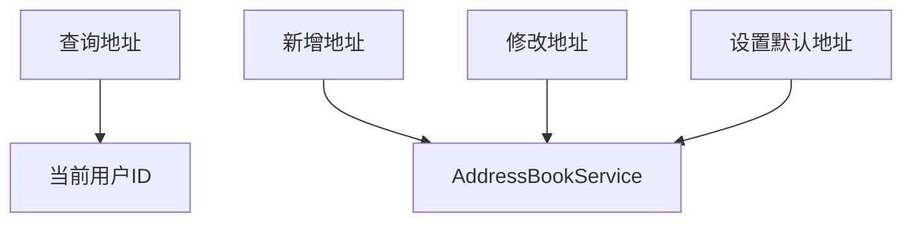

地址簿模块围绕 `AddressBookService` 完成业务处理，查询当前用户地址时依赖 `BaseContext` 提供的当前用户 ID。  
Sources: [user-service/src/main/java/com/sky/controller/AddressBookController.java:27-79]()

## 购物车管理

`ShoppingCartController` 提供 C 端购物车接口，基础路径为 `/user/shoppingCart`。添加购物车、查看购物车、清空购物车、删除购物车中一个商品等操作主要通过 `ShoppingCartService` 完成；批量插入和按用户 ID 清空购物车则直接调用 `ShoppingCartMapper`。  
Sources: [cart-service/src/main/java/com/sky/controller/user/ShoppingCartController.java:1-98]()

| 接口 | 方法 | 功能 | 实现依赖 |
|---|---:|---|---|
| `/user/shoppingCart/add` | POST | 添加购物车 | `ShoppingCartService.addShoppingCart` |
| `/user/shoppingCart/insertBatch` | POST | 批量添加购物车 | `ShoppingCartMapper.insertBatch` |
| `/user/shoppingCart/list` | GET | 查看购物车 | `ShoppingCartService.showShoppingCart` |
| `/user/shoppingCart/clean` | DELETE | 清空购物车 | `ShoppingCartService.cleanShoppingCart` |
| `/user/shoppingCart/deleteByUserId` | DELETE | 根据用户 ID 清空购物车 | `ShoppingCartMapper.deleteByUserId` |
| `/user/shoppingCart/sub` | POST | 删除购物车中一个商品 | `ShoppingCartService.subShoppingCart` |

Sources: [cart-service/src/main/java/com/sky/controller/user/ShoppingCartController.java:1-98]()

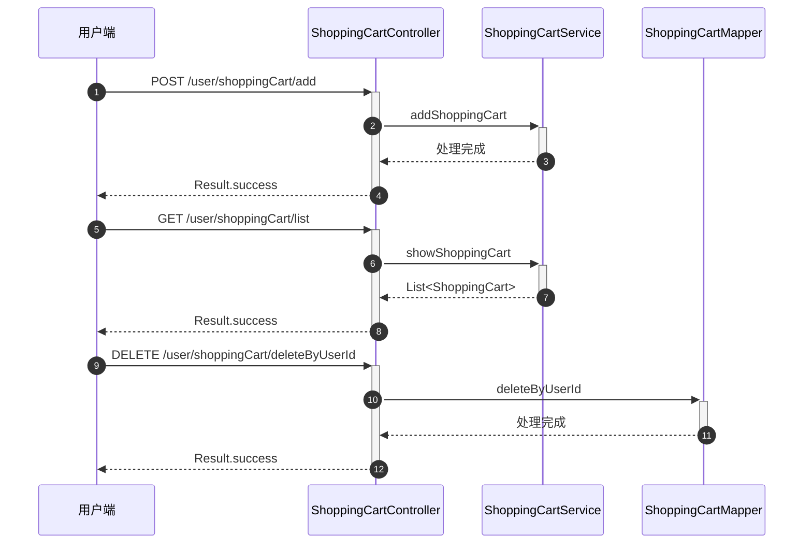

该时序图展示了购物车模块中三类典型调用：业务服务处理添加与查询，Mapper 直接处理按用户清空。  
Sources: [cart-service/src/main/java/com/sky/controller/user/ShoppingCartController.java:1-98]()

## 用户订单功能

### 用户下单与查询

用户端订单接口位于 `order-service` 的 `OrderController`，基础路径为 `/user/order`。用户下单接口接收 `OrdersSubmitDTO`，调用 `OrderService.submitOrder`，返回 `OrderSubmitVO`。历史订单查询支持分页和订单状态过滤，订单详情接口根据订单 ID 查询。  
Sources: [order-service/src/main/java/com/sky/controller/user/OrderController.java:28-75]()

| 接口 | 方法 | 功能 |
|---|---:|---|
| `/user/order/submit` | POST | 用户下单 |
| `/user/order/historyOrders` | GET | 历史订单分页查询 |
| `/user/order/orderDetail/{id}` | GET | 查询订单详情 |

Sources: [order-service/src/main/java/com/sky/controller/user/OrderController.java:28-75]()

源码注释中明确订单状态含义：`1` 待付款、`2` 待接单、`3` 已接单、`4` 派送中、`5` 已完成、`6` 已取消。  
Sources: [order-service/src/main/java/com/sky/controller/user/OrderController.java:52-58]()

### 用户取消订单与再来一单

`OrderServiceImpl.userCancelById` 实现了用户取消订单逻辑。该方法先根据 ID 查询订单，如果订单不存在则抛出 `OrderBusinessException`，提示信息来自 `MessageConstant.ORDER_NOT_FOUND`。如果订单状态大于 `2`，则不允许取消，并提示 `MessageConstant.ORDER_STATUS_ERROR`。当订单处于待接单状态时，支付状态会被设置为退款状态。最终订单状态更新为已取消，并写入取消原因和取消时间。  
Sources: [order-service/src/main/java/com/sky/service/impl/OrderServiceImpl.java:328-360](), [sky-common/src/main/java/com/sky/constant/MessageConstant.java:14-28]()

`OrderServiceImpl.repetition` 实现了“再来一单”逻辑。该方法获取当前用户 ID，根据订单 ID 查询订单详情列表，并将订单详情对象转换为购物车对象。  
Sources: [order-service/src/main/java/com/sky/service/impl/OrderServiceImpl.java:362-375]()

| 订单状态 | 含义 |
|---:|---|
| 1 | 待付款 |
| 2 | 待接单 |
| 3 | 已接单 |
| 4 | 派送中 |
| 5 | 已完成 |
| 6 | 已取消 |

Sources: [order-service/src/main/java/com/sky/controller/user/OrderController.java:52-58]()

## 管理端订单处理

管理端订单接口同样位于 `order-service`，由 `admin` 包下的 `OrderController` 提供。接口包括接单、拒单、取消订单、派送订单和完成订单。  
Sources: [order-service/src/main/java/com/sky/controller/admin/OrderController.java:69-128]()

| 接口 | 方法 | 功能 |
|---|---:|---|
| `/confirm` | PUT | 接单 |
| `/rejection` | PUT | 拒单 |
| `/cancel` | PUT | 取消订单 |
| `/delivery/{id}` | PUT | 派送订单 |
| `/complete/{id}` | PUT | 完成订单 |

Sources: [order-service/src/main/java/com/sky/controller/admin/OrderController.java:69-128]()

### 拒单与取消订单

`OrderServiceImpl.rejection` 会校验订单是否存在且状态是否为待接单。如果状态不符合，会抛出订单状态错误。若订单支付状态为已支付，则记录申请退款日志。随后订单状态更新为已取消，并写入拒单原因和取消时间。  
Sources: [order-service/src/main/java/com/sky/service/impl/OrderServiceImpl.java:490-511]()

`OrderServiceImpl.cancel` 用于管理端取消订单。该方法根据订单 ID 查询订单，如果支付状态为已支付，则记录退款日志，然后更新订单状态为已取消，并写入取消原因和取消时间。  
Sources: [order-service/src/main/java/com/sky/service/impl/OrderServiceImpl.java:513-533]()

### 派送与完成订单

`OrderServiceImpl.delivery` 会查询订单并校验订单是否存在且状态是否为已接单。如果校验失败，抛出订单状态错误。校验通过后，订单状态更新为派送中。  
Sources: [order-service/src/main/java/com/sky/service/impl/OrderServiceImpl.java:535-556]()

`OrderServiceImpl.complete` 会查询订单并校验订单是否存在且状态是否为派送中。该逻辑表明完成订单操作发生在派送中状态之后。  
Sources: [order-service/src/main/java/com/sky/service/impl/OrderServiceImpl.java:558-571]()

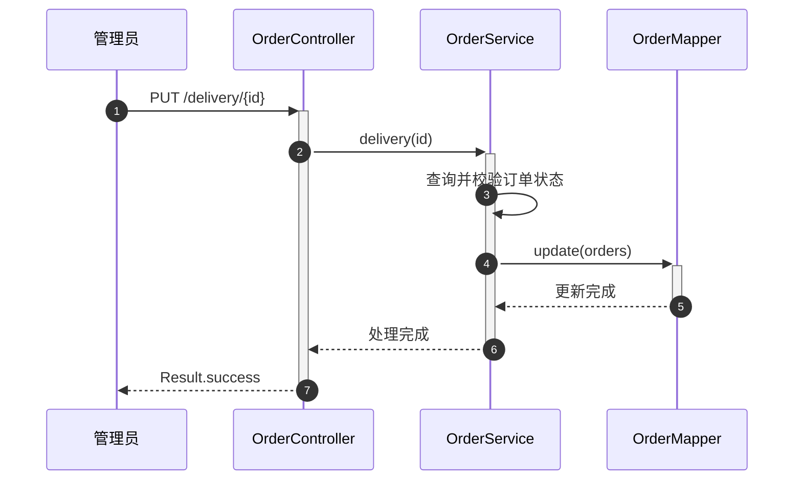

该时序图展示了管理端派送订单的调用链：控制器接收请求，服务层执行状态校验，Mapper 持久化订单状态变更。  
Sources: [order-service/src/main/java/com/sky/controller/admin/OrderController.java:105-113](), [order-service/src/main/java/com/sky/service/impl/OrderServiceImpl.java:535-556]()

## 订单状态流转

根据用户端订单注释和 `OrderServiceImpl` 中的状态校验逻辑，订单状态之间存在明确的业务约束：用户取消订单时状态不能大于待接单；管理端派送订单要求订单处于已接单状态；完成订单要求订单处于派送中状态。  
Sources: [order-service/src/main/java/com/sky/controller/user/OrderController.java:52-58](), [order-service/src/main/java/com/sky/service/impl/OrderServiceImpl.java:328-360](), [order-service/src/main/java/com/sky/service/impl/OrderServiceImpl.java:535-571]()

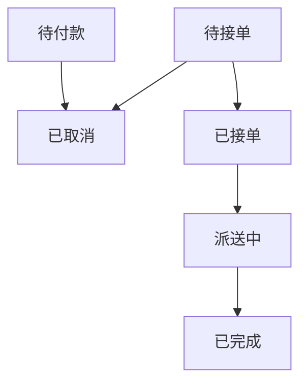

该图概括了源码中可确认的主要订单状态流转方向。待付款和待接单状态可进入已取消状态，待接单状态可进入已接单状态，已接单状态可进入派送中状态，派送中状态可进入已完成状态。  
Sources: [order-service/src/main/java/com/sky/controller/user/OrderController.java:52-58](), [order-service/src/main/java/com/sky/service/impl/OrderServiceImpl.java:328-360](), [order-service/src/main/java/com/sky/service/impl/OrderServiceImpl.java:535-571]()

## 报表统计

`ReportController` 提供数据统计接口，基础路径为 `/admin/report`。当前源码中可见的统计接口包括营业额统计、用户统计和订单统计。这些接口均接收 `begin` 和 `end` 日期参数，并通过 `@DateTimeFormat(pattern = "yyyy-MM-dd")` 进行日期格式化。  
Sources: [admin-service/src/main/java/com/sky/controller/ReportController.java:27-80]()

| 接口 | 方法 | 返回类型 |
|---|---:|---|
| `/admin/report/turnoverStatistics` | GET | `Result<TurnoverReportVO>` |
| `/admin/report/userStatistics` | GET | `Result<UserReportVO>` |
| `/admin/report/ordersStatistics` | GET | `Result<OrderReportVO>` |

Sources: [admin-service/src/main/java/com/sky/controller/ReportController.java:38-80]()

`OrderReportVO` 用于订单统计结果，包含日期列表、每日订单数、每日有效订单数、订单总数、有效订单数和订单完成率。  
Sources: [sky-pojo/src/main/java/com/sky/vo/OrderReportVO.java:14-35]()

| 字段 | 类型 | 说明 |
|---|---:|---|
| `dateList` | `String` | 日期列表，以逗号分隔 |
| `orderCountList` | `String` | 每日订单数，以逗号分隔 |
| `validOrderCountList` | `String` | 每日有效订单数，以逗号分隔 |
| `totalOrderCount` | `Integer` | 订单总数 |
| `validOrderCount` | `Integer` | 有效订单数 |
| `orderCompletionRate` | `Double` | 订单完成率 |

Sources: [sky-pojo/src/main/java/com/sky/vo/OrderReportVO.java:14-35]()

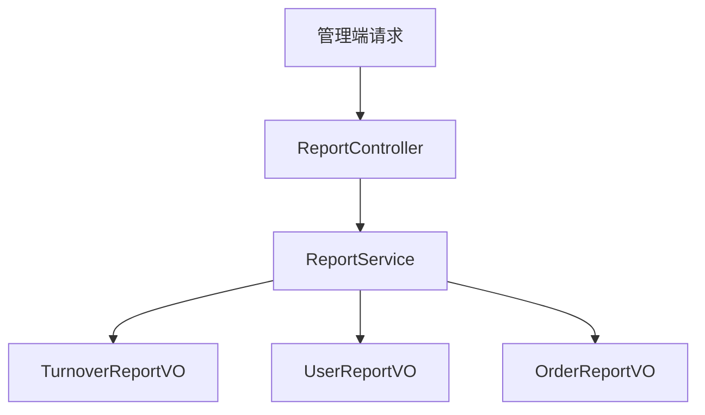

报表模块由管理端控制器接收日期范围参数，委托 `ReportService` 生成对应 VO 返回。  
Sources: [admin-service/src/main/java/com/sky/controller/ReportController.java:27-80](), [sky-pojo/src/main/java/com/sky/vo/OrderReportVO.java:14-35]()

## 公共常量与接口文档配置

### 业务提示常量

`MessageConstant` 定义了多项业务提示信息，例如用户未登录、购物车为空、地址为空、订单状态错误、订单不存在等。这些常量在订单等业务逻辑中用于统一异常提示信息。  
Sources: [sky-common/src/main/java/com/sky/constant/MessageConstant.java:7-28]()

| 常量 | 值 |
|---|---|
| `USER_NOT_LOGIN` | 用户未登录 |
| `SHOPPING_CART_IS_NULL` | 购物车数据为空，不能下单 |
| `ADDRESS_BOOK_IS_NULL` | 用户地址为空，不能下单 |
| `ORDER_STATUS_ERROR` | 订单状态错误 |
| `ORDER_NOT_FOUND` | 订单不存在 |

Sources: [sky-common/src/main/java/com/sky/constant/MessageConstant.java:13-28]()

### 状态常量

`StatusConstant` 定义了启用和禁用两种通用状态，其中 `ENABLE` 为 `1`，`DISABLE` 为 `0`。  
Sources: [sky-common/src/main/java/com/sky/constant/StatusConstant.java:7-13]()

### Swagger 接口文档配置

`order-service` 的 `WebMvcConfiguration` 中配置了管理端接口和用户端接口的 Swagger Docket。管理端接口扫描 `com.sky.controller.admin` 包，用户端接口扫描 `com.sky.controller` 包。  
Sources: [order-service/src/main/java/com/sky/config/WebMvcConfiguration.java:61-91]()

`item-service` 的 `WebMvcConfiguration` 也配置了管理端接口和用户端接口文档，其中管理端接口扫描 `com.sky.controller.admin` 包。  
Sources: [item-service/src/main/java/com/sky/config/WebMvcConfiguration.java:60-90]()

| 服务 | 分组 | 扫描包 |
|---|---|---|
| `order-service` | 管理端接口 | `com.sky.controller.admin` |
| `order-service` | 用户端接口 | `com.sky.controller` |
| `item-service` | 管理端接口 | `com.sky.controller.admin` |

Sources: [order-service/src/main/java/com/sky/config/WebMvcConfiguration.java:61-91](), [item-service/src/main/java/com/sky/config/WebMvcConfiguration.java:60-90]()

## 总结

核心业务功能模块以用户端购物链路和管理端运营链路为主线：用户端通过登录获取 JWT，维护地址簿和购物车，并提交订单；管理端对订单执行接单、拒单、取消、派送和完成等操作；报表模块提供营业额、用户和订单统计能力。公共模块则提供 JWT 工具、业务提示常量、状态常量以及接口文档配置支撑。

---

<a id='page-order-cart-flow'></a>

## 购物车与订单流程

### Related Pages

Related topics: [核心业务功能模块](#page-business-features), [数据访问与多数据源设计](#page-data-access-multidatasource)

<details>
<summary>Relevant source files</summary>

The following files were used as context for generating this wiki page:

- [cart-service/src/main/java/com/sky/controller/user/ShoppingCartController.java](cart-service/src/main/java/com/sky/controller/user/ShoppingCartController.java)
- [cart-service/src/main/java/com/sky/service/ShoppingCartService.java](cart-service/src/main/java/com/sky/service/ShoppingCartService.java)
- [cart-service/src/main/java/com/sky/mapper/ShoppingCartMapper.java](cart-service/src/main/java/com/sky/mapper/ShoppingCartMapper.java)
- [sky-api/src/main/java/com/sky/api/client/ShoppingCartClient.java](sky-api/src/main/java/com/sky/api/client/ShoppingCartClient.java)
- [order-service/src/main/java/com/sky/controller/user/OrderController.java](order-service/src/main/java/com/sky/controller/user/OrderController.java)
- [order-service/src/main/java/com/sky/service/OrderService.java](order-service/src/main/java/com/sky/service/OrderService.java)
- [order-service/src/main/java/com/sky/websocket/WebSocketServer.java](order-service/src/main/java/com/sky/websocket/WebSocketServer.java)
- [sky-pojo/src/main/java/com/sky/dto/OrdersSubmitDTO.java](sky-pojo/src/main/java/com/sky/dto/OrdersSubmitDTO.java)
</details>

# 购物车与订单流程

购物车与订单流程覆盖 C 端用户从登录获取 JWT、操作购物车，到提交订单与查询订单的主要业务链路。该流程由 `cart-service` 提供购物车接口，由 `order-service` 提供订单接口，并通过 `sky-gateway` 的全局过滤器完成请求级 JWT 解析；用户登录签发 JWT 的能力位于 `user-service`。

Sources: [cart-service/src/main/java/com/sky/controller/user/ShoppingCartController.java:17-98](), [order-service/src/main/java/com/sky/controller/user/OrderController.java:16-75](), [sky-gateway/src/main/java/com/sky/gateway/filter/AuthGlobalFilter.java:24-65](), [user-service/src/main/java/com/sky/controller/UserController.java:40-58]()

## 总体架构

该流程涉及以下模块：

- `cart-service`：提供 `/user/shoppingCart` 路径下的 C 端购物车接口。
- `order-service`：提供 `/user/order` 路径下的 C 端订单接口。
- `sky-gateway`：通过 `AuthGlobalFilter` 拦截请求并解析请求头中的 JWT。
- `user-service`：提供用户登录接口，并生成用户端 JWT。
- `order-service` 中还包含 WebSocket 配置，为订单相关实时能力提供基础 Bean。

Sources: [cart-service/src/main/java/com/sky/controller/user/ShoppingCartController.java:17-26](), [order-service/src/main/java/com/sky/controller/user/OrderController.java:16-20](), [sky-gateway/src/main/java/com/sky/gateway/filter/AuthGlobalFilter.java:24-65](), [user-service/src/main/java/com/sky/controller/UserController.java:27-58](), [order-service/src/main/java/com/sky/config/WebsocketConfig.java:10-17]()

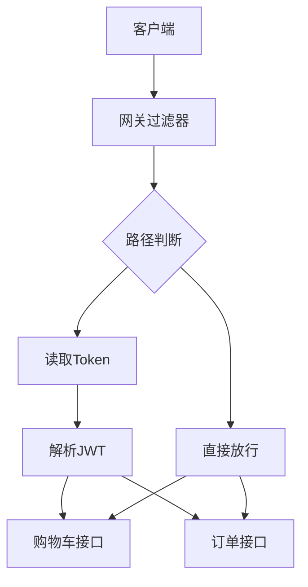

上图展示了请求进入系统后的总体路径：网关先判断是否需要放行，未放行时读取并解析 JWT，随后请求进入购物车或订单接口。

Sources: [sky-gateway/src/main/java/com/sky/gateway/filter/AuthGlobalFilter.java:38-65]()

## 用户登录与网关鉴权

### 用户登录签发 JWT

`user-service` 的 `UserController` 提供 `/user/user/login` 接口。登录成功后，会将用户 ID 写入 JWT claims，并通过 `JwtTool.createJWT` 生成 token，最终封装到 `UserLoginVO` 返回。

Sources: [user-service/src/main/java/com/sky/controller/UserController.java:40-58](), [sky-common/src/main/java/com/sky/utils/JwtTool.java:24-42]()

登录校验由 `UserServiceImpl.login` 完成：当用户名或密码为空时抛出异常；随后根据用户名查询用户，并对前端传入的明文密码进行 MD5 加密后与数据库密码比对。

Sources: [user-service/src/main/java/com/sky/service/impl/UserServiceImpl.java:31-56]()

### 网关解析 JWT

`AuthGlobalFilter` 是网关中的全局过滤器。其处理顺序为：

1. 获取当前请求。
2. 判断请求路径是否属于无需拦截的路径。
3. 若需要拦截，优先从用户 token 请求头中获取 JWT。
4. 如果用户 token 不存在，再尝试从管理员 token 请求头中获取 JWT。
5. 使用 `JwtTool.parseJWT` 解析 JWT。

Sources: [sky-gateway/src/main/java/com/sky/gateway/filter/AuthGlobalFilter.java:38-65]()

网关中的 `JwtTool` 保留了 `parseJWT` 方法，用于根据秘钥解析 token 并返回 `Claims`；其 `createJWT` 方法在提供的代码中处于注释状态。

Sources: [sky-gateway/src/main/java/com/sky/gateway/utils/JwtTool.java:35-57]()

### 鉴权相关配置

`AuthProperties` 使用 `sky.auth` 前缀承载鉴权路径配置，包含 `includePaths` 与 `excludePaths` 两个列表。`user-service` 的 `application.yml` 中配置了用户端 JWT 秘钥、过期时间以及前端传递令牌的请求头名称。

| 配置/类 | 作用 | 来源 |
|---|---|---|
| `AuthProperties.includePaths` | 需要纳入鉴权范围的路径列表 | [sky-gateway/src/main/java/com/sky/gateway/properties/AuthProperties.java:8-13]() |
| `AuthProperties.excludePaths` | 不需要纳入鉴权范围的路径列表 | [sky-gateway/src/main/java/com/sky/gateway/properties/AuthProperties.java:8-13]() |
| `sky.jwt.user-secret-key` | 用户端 JWT 签名秘钥 | [user-service/src/main/resources/application.yml:18-25]() |
| `sky.jwt.user-ttl` | 用户端 JWT 过期时间 | [user-service/src/main/resources/application.yml:18-25]() |
| `sky.jwt.user-token-name` | 前端传递用户令牌的请求头名称 | [user-service/src/main/resources/application.yml:18-25]() |

Sources: [sky-gateway/src/main/java/com/sky/gateway/properties/AuthProperties.java:8-13](), [user-service/src/main/resources/application.yml:18-25]()

## 购物车流程

### 购物车接口入口

`ShoppingCartController` 位于 `cart-service`，基础路径为 `/user/shoppingCart`，Swagger 分组为 `C端购物车相关接口`。该控制器同时注入了 `ShoppingCartService` 与 `ShoppingCartMapper`。

Sources: [cart-service/src/main/java/com/sky/controller/user/ShoppingCartController.java:17-26]()

### 购物车 API 列表

| 方法 | 路径 | 请求参数 | 控制器方法 | 说明 |
|---|---|---:|---|---|
| `POST` | `/user/shoppingCart/add` | `ShoppingCartDTO` 请求体 | `add` | 添加购物车 |
| `POST` | `/user/shoppingCart/insertBatch` | `List<ShoppingCart>` 请求体 | `insertBatch` | 批量添加购物车 |
| `GET` | `/user/shoppingCart/list` | 无 | `list` | 查看购物车 |
| `DELETE` | `/user/shoppingCart/clean` | 无 | `clean` | 清空购物车 |
| `DELETE` | `/user/shoppingCart/deleteByUserId` | `userId` | `deleteByUserId` | 根据用户 ID 清空购物车 |
| `POST` | `/user/shoppingCart/sub` | `ShoppingCartDTO` 请求体 | `sub` | 删除购物车中一个商品 |

Sources: [cart-service/src/main/java/com/sky/controller/user/ShoppingCartController.java:32-98]()

### 购物车业务调用关系

`ShoppingCartService` 接口定义了四个购物车业务方法：

- `addShoppingCart`
- `showShoppingCart`
- `cleanShoppingCart`
- `subShoppingCart`

Sources: [cart-service/src/main/java/com/sky/service/ShoppingCartService.java:9-33]()

在控制器中：

- `add`、`list`、`clean`、`sub` 调用 `ShoppingCartService`。
- `insertBatch`、`deleteByUserId` 直接调用 `ShoppingCartMapper`。

Sources: [cart-service/src/main/java/com/sky/controller/user/ShoppingCartController.java:32-98]()

```mermaid
sequenceDiagram
autonumber
actor U as 用户
boundary GW as 网关
participant SC as 购物车控制器
participant SS as 购物车服务
participant SM as 购物车Mapper

U->>+GW: 发起购物车请求
GW->>GW: 解析JWT
GW->>+SC: 转发请求
SC->>+SS: 调用业务方法
SS-->>-SC: 返回处理结果
SC-->>-GW: 返回Result
GW-->>-U: 响应客户端
Note over SC,SM: insertBatch与deleteByUserId直接调用Mapper
```

该时序图展示了常规购物车请求经过控制器和服务层的调用路径；批量插入和按用户删除则由控制器直接访问 Mapper。

Sources: [cart-service/src/main/java/com/sky/controller/user/ShoppingCartController.java:32-98](), [cart-service/src/main/java/com/sky/service/ShoppingCartService.java:9-33]()

## 订单流程

### 订单接口入口

`OrderController` 位于 `order-service`，Bean 名称为 `userOrderController`，基础路径为 `/user/order`，Swagger 分组为 `用户端订单相关接口`。

Sources: [order-service/src/main/java/com/sky/controller/user/OrderController.java:16-20]()

### 订单 API 列表

| 方法 | 路径 | 请求参数 | 控制器方法 | 说明 |
|---|---|---:|---|---|
| `POST` | `/user/order/submit` | `OrdersSubmitDTO` 请求体 | `submit` | 用户下单 |
| `GET` | `/user/order/historyOrders` | `page`、`pageSize`、`status` | `page` | 历史订单查询 |
| `GET` | `/user/order/orderDetail/{id}` | 路径参数 `id` | `details` | 查询订单详情 |

Sources: [order-service/src/main/java/com/sky/controller/user/OrderController.java:28-75]()

提供的代码中，订单支付接口处于注释状态，未作为有效接口暴露。

Sources: [order-service/src/main/java/com/sky/controller/user/OrderController.java:37-49]()

### 用户下单流程

用户下单接口接收 `OrdersSubmitDTO`，控制器记录日志后调用 `OrderService.submitOrder`，并将返回的 `OrderSubmitVO` 封装到 `Result` 中返回。

Sources: [order-service/src/main/java/com/sky/controller/user/OrderController.java:28-35]()

```mermaid
sequenceDiagram
autonumber
actor U as 用户
boundary GW as 网关
participant OC as 订单控制器
participant OS as 订单服务

U->>+GW: POST /user/order/submit
GW->>GW: 解析JWT
GW->>+OC: 转发下单请求
OC->>+OS: submitOrder
OS-->>-OC: OrderSubmitVO
OC-->>-GW: Result.success
GW-->>-U: 返回下单结果
```

该时序图基于 `OrderController.submit` 的调用链：控制器接收请求并委托给 `OrderService`，最终返回统一结果。

Sources: [order-service/src/main/java/com/sky/controller/user/OrderController.java:28-35]()

### 历史订单与订单详情

历史订单查询接口接收分页参数 `page`、`pageSize` 以及订单状态 `status`，并调用 `OrderService.pageQuery4User` 返回 `PageResult`。订单详情接口通过路径参数 `id` 查询单个订单。

Sources: [order-service/src/main/java/com/sky/controller/user/OrderController.java:51-75]()

控制器注释中列出了订单状态含义：`1待付款 2待接单 3已接单 4派送中 5已完成 6已取消`。

Sources: [order-service/src/main/java/com/sky/controller/user/OrderController.java:51-59]()

### 订单状态统计与菜品摘要

`OrderServiceImpl` 提供了订单状态统计能力 `statistics`，分别统计：

- 待接单数量：`Orders.TO_BE_CONFIRMED`
- 已接单数量：`Orders.CONFIRMED`
- 派送中数量：`Orders.DELIVERY_IN_PROGRESS`

统计结果封装到 `OrderStatisticsVO` 中返回。

Sources: [order-service/src/main/java/com/sky/service/impl/OrderServiceImpl.java:452-466]()

```mermaid
graph TD
A[订单统计] --> B[待接单数量]
A --> C[已接单数量]
A --> D[派送中数量]
```

该图对应 `OrderServiceImpl.statistics` 中三类订单数量的统计维度。

Sources: [order-service/src/main/java/com/sky/service/impl/OrderServiceImpl.java:452-466]()

`OrderServiceImpl` 还提供了私有方法 `getOrderDishesStr`，用于根据订单 ID 查询订单菜品详情，并将菜品信息拼接为字符串，格式类似 `菜品名称*数量;`。

Sources: [order-service/src/main/java/com/sky/service/impl/OrderServiceImpl.java:433-446]()

## 实时通信配置

`order-service` 中的 `WebsocketConfig` 注册了 `ServerEndpointExporter` Bean。该配置用于支持 WebSocket 端点导出能力。提供的文件中未展示具体 WebSocket 端点或消息推送逻辑。

Sources: [order-service/src/main/java/com/sky/config/WebsocketConfig.java:10-17]()

## 关键流程摘要

| 流程 | 入口 | 关键组件 | 输出 |
|---|---|---|---|
| 用户登录 | `/user/user/login` | `UserController`、`UserService`、`JwtTool` | `UserLoginVO`，包含 token |
| 购物车操作 | `/user/shoppingCart/*` | `ShoppingCartController`、`ShoppingCartService`、`ShoppingCartMapper` | `Result` 或购物车列表 |
| 用户下单 | `/user/order/submit` | `OrderController`、`OrderService` | `OrderSubmitVO` |
| 历史订单查询 | `/user/order/historyOrders` | `OrderController`、`OrderService` | `PageResult` |
| 订单详情查询 | `/user/order/orderDetail/{id}` | `OrderController`、`OrderService` | `OrderVO` |
| 网关鉴权 | 请求进入网关时 | `AuthGlobalFilter`、`JwtTool`、`AuthProperties` | 放行或解析 JWT |

Sources: [user-service/src/main/java/com/sky/controller/UserController.java:40-58](), [cart-service/src/main/java/com/sky/controller/user/ShoppingCartController.java:32-98](), [order-service/src/main/java/com/sky/controller/user/OrderController.java:28-75](), [sky-gateway/src/main/java/com/sky/gateway/filter/AuthGlobalFilter.java:38-65]()

购物车与订单流程以用户 JWT 鉴权为前置条件，通过 `cart-service` 完成购物车增删查清操作，再通过 `order-service` 完成下单、历史订单查询和订单详情查询。网关负责统一解析用户或管理员 JWT，`order-service` 同时提供 WebSocket 基础配置以支持后续实时订单场景。

---

<a id='page-data-access-multidatasource'></a>

## 数据访问与多数据源设计

### Related Pages

Related topics: [购物车与订单流程](#page-order-cart-flow), [缓存体系与性能优化](#page-cache-performance)

<details>
<summary>Relevant source files</summary>

The following files were used as context for generating this wiki page:

- [admin-service/src/main/java/com/sky/api/config/ItemDataSourceConfig.java](admin-service/src/main/java/com/sky/api/config/ItemDataSourceConfig.java)
- [admin-service/src/main/java/com/sky/api/config/OrderDataSourceConfig.java](admin-service/src/main/java/com/sky/api/config/OrderDataSourceConfig.java)
- [admin-service/src/main/java/com/sky/api/config/UserDataSourceConfig.java](admin-service/src/main/java/com/sky/api/config/UserDataSourceConfig.java)
- [admin-service/src/main/java/com/sky/config/DefaultDataSourceConfig.java](admin-service/src/main/java/com/sky/config/DefaultDataSourceConfig.java)
- [admin-service/src/main/java/com/sky/mapper/EmployeeMapper.java](admin-service/src/main/java/com/sky/mapper/EmployeeMapper.java)
- [admin-service/src/main/java/com/sky/api/client/item/DishMapper.java](admin-service/src/main/java/com/sky/api/client/item/DishMapper.java)
- [admin-service/src/main/java/com/sky/api/client/item/SetmealMapper.java](admin-service/src/main/java/com/sky/api/client/item/SetmealMapper.java)
- [admin-service/src/main/java/com/sky/api/client/order/OrderMapper.java](admin-service/src/main/java/com/sky/api/client/order/OrderMapper.java)
- [admin-service/src/main/java/com/sky/api/client/user/UserMapper.java](admin-service/src/main/java/com/sky/api/client/user/UserMapper.java)
- [cart-service/src/main/java/com/sky/mapper/ShoppingCartMapper.java](cart-service/src/main/java/com/sky/mapper/ShoppingCartMapper.java)
- [order-service/src/main/java/com/sky/mapper/OrderMapper.java](order-service/src/main/java/com/sky/mapper/OrderMapper.java)
- [order-service/src/main/java/com/sky/mapper/OrderDetailMapper.java](order-service/src/main/java/com/sky/mapper/OrderDetailMapper.java)
- [user-service/src/main/java/com/sky/mapper/UserMapper.java](user-service/src/main/java/com/sky/mapper/UserMapper.java)
- [user-service/src/main/java/com/sky/mapper/AddressBookMapper.java](user-service/src/main/java/com/sky/mapper/AddressBookMapper.java)
</details>

# 数据访问与多数据源设计

本项目的数据访问层围绕不同业务域进行拆分，`admin-service` 中通过 `ItemDataSourceConfig`、`OrderDataSourceConfig`、`UserDataSourceConfig` 与 `DefaultDataSourceConfig` 体现多数据源或分域数据源配置的设计意图；各业务域再通过对应的 `Mapper` 接口完成数据库访问。整体设计将商品、订单、用户、员工、购物车等数据访问职责分离，便于不同服务或模块按领域边界访问对应数据源。

## 总体架构

从文件结构可以看出，`admin-service` 同时包含商品、订单、用户相关的数据访问客户端与配置类。`ItemDataSourceConfig`、`OrderDataSourceConfig`、`UserDataSourceConfig` 分别对应商品域、订单域、用户域的数据源配置入口，`DefaultDataSourceConfig` 提供默认数据源配置。`Mapper` 接口则按业务域放置在不同包路径下，形成“配置层 + Mapper 层”的数据访问结构。

```mermaid
graph TD
A[admin-service] --> B[Item 数据源]
A --> C[Order 数据源]
A --> D[User 数据源]
A --> E[默认数据源]
B --> F[商品 Mapper]
C --> G[订单 Mapper]
D --> H[用户 Mapper]
E --> I[通用数据访问]
```

该图展示了 `admin-service` 中数据源配置与 Mapper 分层之间的逻辑关系：不同业务域由不同数据源配置承载，最终通过对应 Mapper 完成数据访问。

Sources: [admin-service/src/main/java/com/sky/api/config/ItemDataSourceConfig.java](), [admin-service/src/main/java/com/sky/api/config/OrderDataSourceConfig.java](), [admin-service/src/main/java/com/sky/api/config/UserDataSourceConfig.java](), [admin-service/src/main/java/com/sky/config/DefaultDataSourceConfig.java]()

## 数据源配置组件

以下配置类构成了 `admin-service` 中多数据源或分域数据源访问的基础。

| 配置类 | 所属路径 | 作用 |
|---|---|---|
| `ItemDataSourceConfig` | `admin-service/src/main/java/com/sky/api/config/ItemDataSourceConfig.java` | 商品域数据源配置入口 |
| `OrderDataSourceConfig` | `admin-service/src/main/java/com/sky/api/config/OrderDataSourceConfig.java` | 订单域数据源配置入口 |
| `UserDataSourceConfig` | `admin-service/src/main/java/com/sky/api/config/UserDataSourceConfig.java` | 用户域数据源配置入口 |
| `DefaultDataSourceConfig` | `admin-service/src/main/java/com/sky/config/DefaultDataSourceConfig.java` | 默认数据源配置入口 |

Sources: [admin-service/src/main/java/com/sky/api/config/ItemDataSourceConfig.java](), [admin-service/src/main/java/com/sky/api/config/OrderDataSourceConfig.java](), [admin-service/src/main/java/com/sky/api/config/UserDataSourceConfig.java](), [admin-service/src/main/java/com/sky/config/DefaultDataSourceConfig.java]()

## Mapper 分层设计

项目的数据访问接口按业务域拆分到不同模块和包路径中。`admin-service` 中同时存在员工、商品、订单、用户相关 Mapper；`cart-service`、`order-service`、`user-service` 也分别承载购物车、订单、用户与地址相关的数据访问职责。

| Mapper | 所属模块 | 业务域 | 说明 |
|---|---|---|---|
| `EmployeeMapper` | `admin-service` | 员工 | 员工信息数据访问 |
| `DishMapper` | `admin-service` | 商品 | 菜品数据访问 |
| `SetmealMapper` | `admin-service` | 商品 | 套餐数据访问 |
| `OrderMapper` | `admin-service` | 订单 | 管理端订单数据访问 |
| `UserMapper` | `admin-service` | 用户 | 管理端用户数据访问 |
| `ShoppingCartMapper` | `cart-service` | 购物车 | 购物车数据访问 |
| `OrderMapper` | `order-service` | 订单 | 订单服务订单数据访问 |
| `OrderDetailMapper` | `order-service` | 订单明细 | 订单明细数据访问 |
| `UserMapper` | `user-service` | 用户 | 用户服务用户数据访问 |
| `AddressBookMapper` | `user-service` | 地址 | 用户地址簿数据访问 |

Sources: [admin-service/src/main/java/com/sky/mapper/EmployeeMapper.java](), [admin-service/src/main/java/com/sky/api/client/item/DishMapper.java](), [admin-service/src/main/java/com/sky/api/client/item/SetmealMapper.java](), [admin-service/src/main/java/com/sky/api/client/order/OrderMapper.java](), [admin-service/src/main/java/com/sky/api/client/user/UserMapper.java](), [cart-service/src/main/java/com/sky/mapper/ShoppingCartMapper.java](), [order-service/src/main/java/com/sky/mapper/OrderMapper.java](), [order-service/src/main/java/com/sky/mapper/OrderDetailMapper.java](), [user-service/src/main/java/com/sky/mapper/UserMapper.java](), [user-service/src/main/java/com/sky/mapper/AddressBookMapper.java]()

## 数据访问调用链

在典型业务调用中，控制器或服务层发起业务请求，服务层调用对应业务域的 `Mapper`，由 `Mapper` 与数据库交互并返回结果。该模式使业务逻辑与 SQL 访问边界清晰，同时便于按数据源进行隔离。

```mermaid
sequenceDiagram
autonumber
participant C as 控制器
participant S as 服务层
participant M as Mapper
participant DB as 数据库
C->>+S: 发起业务请求
S->>+M: 调用数据访问
M->>+DB: 执行SQL
DB-->>-M: 返回结果
M-->>-S: 映射实体
S-->>-C: 返回业务结果
```

该调用链体现了 Controller/Service/Mapper 的分层访问方式，`Mapper` 是数据访问的核心入口。

Sources: [admin-service/src/main/java/com/sky/mapper/EmployeeMapper.java](), [admin-service/src/main/java/com/sky/api/client/item/DishMapper.java](), [admin-service/src/main/java/com/sky/api/client/order/OrderMapper.java](), [order-service/src/main/java/com/sky/mapper/OrderMapper.java](), [user-service/src/main/java/com/sky/mapper/UserMapper.java]()

## 商品域数据访问

商品域在 `admin-service` 中通过 `api.client.item` 包下的 `DishMapper` 与 `SetmealMapper` 表达数据访问边界。该设计将菜品与套餐的持久化操作归入商品域，便于与商品数据源配置 `ItemDataSourceConfig` 形成对应关系。

```mermaid
graph TD
A[ItemDataSourceConfig] --> B[DishMapper]
A --> C[SetmealMapper]
B --> D[菜品数据]
C --> E[套餐数据]
```

Sources: [admin-service/src/main/java/com/sky/api/config/ItemDataSourceConfig.java](), [admin-service/src/main/java/com/sky/api/client/item/DishMapper.java](), [admin-service/src/main/java/com/sky/api/client/item/SetmealMapper.java]()

## 订单域数据访问

订单域在 `admin-service` 中通过 `api.client.order.OrderMapper` 访问订单数据，在 `order-service` 中则通过 `OrderMapper` 与 `OrderDetailMapper` 访问订单主表与订单明细数据。该拆分说明订单域既可能在管理端统一访问，也可能在订单微服务内部独立访问订单数据。

```mermaid
graph TD
A[OrderDataSourceConfig] --> B[admin OrderMapper]
C[order-service] --> D[OrderMapper]
C --> E[OrderDetailMapper]
B --> F[订单主数据]
D --> F
E --> G[订单明细数据]
```

Sources: [admin-service/src/main/java/com/sky/api/config/OrderDataSourceConfig.java](), [admin-service/src/main/java/com/sky/api/client/order/OrderMapper.java](), [order-service/src/main/java/com/sky/mapper/OrderMapper.java](), [order-service/src/main/java/com/sky/mapper/OrderDetailMapper.java]()

## 用户域数据访问

用户域在 `admin-service` 中通过 `api.client.user.UserMapper` 访问用户数据，在 `user-service` 中通过 `UserMapper` 与 `AddressBookMapper` 访问用户及地址簿数据。`UserDataSourceConfig` 可作为用户域数据源配置入口。

```mermaid
graph TD
A[UserDataSourceConfig] --> B[admin UserMapper]
C[user-service] --> D[UserMapper]
C --> E[AddressBookMapper]
B --> F[用户数据]
D --> F
E --> G[地址数据]
```

Sources: [admin-service/src/main/java/com/sky/api/config/UserDataSourceConfig.java](), [admin-service/src/main/java/com/sky/api/client/user/UserMapper.java](), [user-service/src/main/java/com/sky/mapper/UserMapper.java](), [user-service/src/main/java/com/sky/mapper/AddressBookMapper.java]()

## 员工与购物车数据访问

员工数据访问由 `admin-service` 中的 `EmployeeMapper` 承担，购物车数据访问由 `cart-service` 中的 `ShoppingCartMapper` 承担。这两个 Mapper 分别服务于后台员工管理与 C 端购物车业务，体现了不同服务模块对自身数据访问边界的封装。

| 模块 | Mapper | 访问对象 |
|---|---|---|
| `admin-service` | `EmployeeMapper` | 员工账号与管理端用户信息 |
| `cart-service` | `ShoppingCartMapper` | 购物车记录 |

Sources: [admin-service/src/main/java/com/sky/mapper/EmployeeMapper.java](), [cart-service/src/main/java/com/sky/mapper/ShoppingCartMapper.java]()

## 默认数据源与分域数据源关系

`DefaultDataSourceConfig` 与 `ItemDataSourceConfig`、`OrderDataSourceConfig`、`UserDataSourceConfig` 共同构成数据源配置层。默认数据源可用于通用或未显式指定业务域的数据访问，而分域数据源配置则用于商品、订单、用户等业务域的隔离访问。

```mermaid
graph TD
A[DefaultDataSourceConfig] --> B[通用数据访问]
C[ItemDataSourceConfig] --> D[商品域]
E[OrderDataSourceConfig] --> F[订单域]
G[UserDataSourceConfig] --> H[用户域]
```

Sources: [admin-service/src/main/java/com/sky/config/DefaultDataSourceConfig.java](), [admin-service/src/main/java/com/sky/api/config/ItemDataSourceConfig.java](), [admin-service/src/main/java/com/sky/api/config/OrderDataSourceConfig.java](), [admin-service/src/main/java/com/sky/api/config/UserDataSourceConfig.java]()

## 设计要点总结

| 设计点 | 说明 |
|---|---|
| 分域配置 | 商品、订单、用户分别拥有独立数据源配置入口 |
| 默认兜底 | `DefaultDataSourceConfig` 提供默认数据源配置 |
| Mapper 隔离 | 不同业务域使用不同 Mapper 接口 |
| 模块拆分 | `admin-service`、`cart-service`、`order-service`、`user-service` 各自持有相关 Mapper |
| 访问路径 | 业务层通过 Mapper 访问数据库，保持服务层与持久层解耦 |

Sources: [admin-service/src/main/java/com/sky/api/config/ItemDataSourceConfig.java](), [admin-service/src/main/java/com/sky/api/config/OrderDataSourceConfig.java](), [admin-service/src/main/java/com/sky/api/config/UserDataSourceConfig.java](), [admin-service/src/main/java/com/sky/config/DefaultDataSourceConfig.java](), [admin-service/src/main/java/com/sky/mapper/EmployeeMapper.java](), [cart-service/src/main/java/com/sky/mapper/ShoppingCartMapper.java](), [order-service/src/main/java/com/sky/mapper/OrderMapper.java](), [user-service/src/main/java/com/sky/mapper/UserMapper.java]()

本项目的数据访问与多数据源设计以业务域为核心，通过配置类划分商品、订单、用户等数据访问边界，并由各模块中的 Mapper 接口完成具体持久化操作。该结构有利于保持服务边界清晰、降低跨域数据访问耦合，并为后续扩展独立数据库或分库访问提供基础。

---

<a id='page-cache-performance'></a>

## 缓存体系与性能优化

### Related Pages

Related topics: [数据访问与多数据源设计](#page-data-access-multidatasource), [核心业务功能模块](#page-business-features)

<details>
<summary>Relevant source files</summary>

The following files were used as context for generating this wiki page:

- [item-service/src/main/java/com/sky/config/LocalCacheConfiguration.java](item-service/src/main/java/com/sky/config/LocalCacheConfiguration.java)
- [item-service/src/main/java/com/sky/config/RedisConfiguration.java](item-service/src/main/java/com/sky/config/RedisConfiguration.java)
- [user-service/src/main/java/com/sky/config/LocalCacheConfiguration.java](user-service/src/main/java/com/sky/config/LocalCacheConfiguration.java)
- [user-service/src/main/java/com/sky/config/RedisConfiguration.java](user-service/src/main/java/com/sky/config/RedisConfiguration.java)
- [sky-common/src/main/java/com/sky/properties/CaffeineProperties.java](sky-common/src/main/java/com/sky/properties/CaffeineProperties.java)
- [README.md](README.md)
</details>

# 缓存体系与性能优化

本项目将原本双端外卖平台从单体架构演进为微服务架构，其中性能优化的核心主线之一是将 Redis 一级缓存升级为 Redis 与 Caffeine 组合的二级缓存体系，并围绕 SpringCache、Nacos 配置治理、Sentinel 熔断降级与 Seata 分布式事务进行稳定性与响应性能增强。README 中明确记录了该优化针对“用户根据分类id查询菜品（连带口味）”接口，并在 Apifox 压测中取得了 QPS 提升与平均响应时间下降的结果。  
Sources: [README.md:1-16]()

## 1. 缓存优化目标与范围

缓存优化的直接目标是在微服务拆分后，为高频读取的菜品查询接口提供更低的响应延迟与更高的吞吐能力。README 记录了 2025-3-1 将 Redis 一级缓存改为 Redis+Caffeine 二级缓存，并说明该优化作用于“用户根据分类id查询菜品（连带口味）”接口。  
Sources: [README.md:6]()

该优化发生在项目微服务化过程中，尤其是店铺模块 `item-service` 与用户端模块 `user-service` 拆分前后。README 同时记录了 2025-3-4 修复 SpringCache 集成 Caffeine 后的错误，说明 Caffeine 本地缓存是通过 SpringCache 体系接入项目的。  
Sources: [README.md:19-20]()

## 2. 二级缓存架构

### 2.1 架构组成

根据缓存优化记录，系统从仅使用 Redis 的远程缓存模式演进为本地缓存与远程缓存组合的二级缓存模式。项目中的缓存配置相关类分布在 `item-service`、`user-service` 与 `sky-common` 中，分别承担本地缓存配置、Redis 缓存配置以及 Caffeine 属性承载。  
Sources: [item-service/src/main/java/com/sky/config/LocalCacheConfiguration.java](), [item-service/src/main/java/com/sky/config/RedisConfiguration.java](), [user-service/src/main/java/com/sky/config/LocalCacheConfiguration.java](), [user-service/src/main/java/com/sky/config/RedisConfiguration.java](), [sky-common/src/main/java/com/sky/properties/CaffeineProperties.java]()

| 组件 / 文件 | 所属模块 | 在缓存体系中的角色 |
|---|---|---|
| `LocalCacheConfiguration.java` | `item-service` | 店铺/商品侧本地缓存配置入口 |
| `RedisConfiguration.java` | `item-service` | 店铺/商品侧 Redis 缓存配置入口 |
| `LocalCacheConfiguration.java` | `user-service` | 用户端本地缓存配置入口 |
| `RedisConfiguration.java` | `user-service` | 用户端 Redis 缓存配置入口 |
| `CaffeineProperties.java` | `sky-common` | Caffeine 本地缓存属性承载 |

Sources: [item-service/src/main/java/com/sky/config/LocalCacheConfiguration.java](), [item-service/src/main/java/com/sky/config/RedisConfiguration.java](), [user-service/src/main/java/com/sky/config/LocalCacheConfiguration.java](), [user-service/src/main/java/com/sky/config/RedisConfiguration.java](), [sky-common/src/main/java/com/sky/properties/CaffeineProperties.java]()

### 2.2 二级缓存读取流程

二级缓存的核心读取路径可理解为：请求先进入服务接口，再优先访问本地缓存；本地缓存未命中时继续访问 Redis 缓存，最终返回查询结果。该流程与 README 中“Redis 一级缓存改为 Redis+Caffeine 二级缓存”的描述一致。  
Sources: [README.md:6]()

```mermaid
graph TD
A[请求] --> B[服务接口]
B --> C[本地缓存]
C --> D[Redis缓存]
C --> E[响应]
D --> E
```

上图展示了二级缓存的基本访问顺序：本地缓存位于 Redis 缓存之前，用于缩短热点数据的访问路径。  
Sources: [README.md:6]()

### 2.3 菜品查询缓存时序

README 明确指出缓存优化针对“用户根据分类id查询菜品（连带口味）”接口。该接口属于用户端菜品查询场景，因此与 `user-service` 的缓存配置相关；同时店铺/商品模块 `item-service` 也具备对应的本地缓存与 Redis 缓存配置。  
Sources: [README.md:6](), [user-service/src/main/java/com/sky/config/LocalCacheConfiguration.java](), [user-service/src/main/java/com/sky/config/RedisConfiguration.java](), [item-service/src/main/java/com/sky/config/LocalCacheConfiguration.java](), [item-service/src/main/java/com/sky/config/RedisConfiguration.java]()

```mermaid
sequenceDiagram
autonumber
participant C as 客户端
participant S as 菜品服务
participant L as 本地缓存
participant R as Redis

C->>+S: 查询菜品
S->>+L: 读取本地缓存

alt 本地命中
L-->>-S: 返回缓存
else 本地未命中
L-->>-S: 返回未命中
S->>+R: 读取Redis
R-->>-S: 返回缓存
end

S-->>-C: 返回结果
```

该时序图表达了二级缓存读取的基本分支：本地缓存命中时直接返回，未命中时继续访问 Redis。  
Sources: [README.md:6]()

## 3. 性能收益

README 给出了 Apifox 压测结果：在并发用户数为 100、持续 1 分钟的测试条件下，将 Redis 缓存改为二级缓存后，QPS 提高 36%，平均响应时间从 125ms 降低到 74ms，响应时间减少 40%。  
Sources: [README.md:14-16]()

| 指标 | Redis 一级缓存 | Redis+Caffeine 二级缓存 | 变化 |
|---|---:|---:|---:|
| 平均响应时间 | 125ms | 74ms | 下降 40% |
| QPS | 基准值 | 提升 36% | 显著提升 |
| 压测条件 | 100 并发，持续 1 分钟 | 100 并发，持续 1 分钟 | 同条件对比 |

Sources: [README.md:14-16]()

```mermaid
graph TD
A[一级Redis] --> B[125ms]
C[二级缓存] --> D[74ms]
```

上图对比了 README 中记录的两种缓存形态下的平均响应时间。  
Sources: [README.md:14-16]()

## 4. SpringCache 与 Caffeine 集成

README 记录了 2025-3-4 修复 SpringCache 集成 Caffeine 后的错误。这表明项目并非直接手写全部缓存访问逻辑，而是通过 SpringCache 抽象接入 Caffeine 本地缓存，并与 Redis 缓存共同形成二级缓存能力。  
Sources: [README.md:19]()

Caffeine 作为本地缓存层，其配置属性由公共模块中的 `CaffeineProperties` 承载；各业务服务再通过本地缓存配置类进行装配。该结构有利于在 `item-service` 与 `user-service` 等微服务中复用统一的缓存属性定义。  
Sources: [sky-common/src/main/java/com/sky/properties/CaffeineProperties.java](), [item-service/src/main/java/com/sky/config/LocalCacheConfiguration.java](), [user-service/src/main/java/com/sky/config/LocalCacheConfiguration.java]()

| 技术 | 项目中的作用 | 来源依据 |
|---|---|---|
| Caffeine | 本地缓存，提高热点数据访问速度 | README 中二级缓存记录 |
| Redis | 分布式缓存，跨服务共享缓存数据 | README 中 Redis 一级/二级缓存记录 |
| SpringCache | 缓存抽象与注解式缓存接入方式 | README 中 SpringCache 集成 Caffeine 记录 |

Sources: [README.md:6-19]()

## 5. Nacos 配置治理与热更新

README 记录了 2025-3-12 在 Nacos 注册中心添加和拉取共享配置，以简化 `.yml` 文件编写，并配置普通属性热更新与动态路由热更新。该能力虽然不直接等同于缓存读取优化，但为缓存参数、服务配置和路由规则的动态调整提供了运维与性能调优基础。  
Sources: [README.md:25-28]()

```mermaid
graph TD
A[Nacos配置中心] --> B[共享配置]
A --> C[热更新]
A --> D[动态路由]
B --> E[微服务]
C --> E
D --> F[网关路由]
```

上图展示了 Nacos 在项目中承担的配置共享、热更新与动态路由能力。  
Sources: [README.md:25-28]()

| 能力 | 对性能/运维的意义 | 来源依据 |
|---|---|---|
| 共享配置 | 减少重复 `.yml` 配置，统一服务配置来源 | README 2025-3-12 |
| 属性热更新 | 支持运行期调整配置，减少重启成本 | README 2025-3-12 |
| 动态路由热更新 | 支持路由规则调整，提升网关接入灵活性 | README 2025-3-12 |

Sources: [README.md:25-28]()

## 6. Sentinel 熔断降级与缓存补充逻辑

README 记录了 2025-3-17 成功添加 Sentinel，并补充了一些 Redis 和 Caffeine 二级缓存中的处理逻辑。随后在 2025-3-18 又补充了 Sentinel 降级逻辑，使服务熔断时能够返回默认数据，从而改善用户体验。  
Sources: [README.md:32-35]()

```mermaid
graph TD
A[请求] --> B[Sentinel]
B --> C[正常返回]
B --> D[降级返回]
D --> E[默认数据]
```

上图体现了 Sentinel 在请求链路中的保护与降级作用：当正常链路不可用或触发熔断时，系统可转向降级逻辑并返回默认数据。  
Sources: [README.md:32-35]()

| 稳定性能力 | 项目记录 | 性能/体验影响 |
|---|---|---|
| Sentinel 接入 | 2025-3-17 添加成功 | 提供服务治理与熔断能力 |
| 二级缓存处理逻辑补充 | 2025-3-17 | 完善 Redis+Caffeine 缓存链路 |
| Sentinel 降级逻辑 | 2025-3-18 | 熔断时返回默认数据，提升用户体验 |

Sources: [README.md:32-35]()

## 7. Seata 分布式事务与性能权衡

README 记录了 2025-3-15 使用 Seata 实现基础分布式事务的 XA 或 AT 模式，并通过 `GlobalLock` 与 `select for update` 防止 AT 模式下的脏读。README 同时说明，虽然 `GlobalLock` 失效，但使用 `GlobalTransactional` 仍可达到防止脏读的效果，只是性能消耗更大。  
Sources: [README.md:29-31]()

| 机制 | 作用 | 性能影响 |
|---|---|---|
| XA / AT | 实现基础分布式事务 | 保证跨服务数据一致性 |
| `GlobalLock` | 防止脏写/辅助并发控制 | 引入锁开销 |
| `select for update` | 防止 AT 模式脏读 | 增加数据库锁等待 |
| `GlobalTransactional` | 可达到类似 `GlobalLock` 的防脏读效果 | 性能消耗更大 |

Sources: [README.md:29-31]()

该部分说明性能优化不仅包括缓存读取加速，也包括在分布式事务场景下对一致性与性能之间权衡的记录。Seata 相关机制会引入额外开销，因此需要在高并发读取路径中谨慎评估事务边界。  
Sources: [README.md:29-31]()

## 8. 关键优化时间线

README 以日期方式记录了项目从缓存优化、模块拆分、Nacos 配置治理到 Sentinel 与 Seata 的演进过程。  
Sources: [README.md:6-35]()

| 日期 | 优化/演进内容 | 与缓存或性能的关系 |
|---|---|---|
| 2025-3-1 | Redis 一级缓存改为 Redis+Caffeine 二级缓存 | 直接提升接口 QPS，降低响应时间 |
| 2025-3-4 | 修复 SpringCache 集成 Caffeine 错误 | 保障本地缓存接入可用 |
| 2025-3-12 | Nacos 共享配置、热更新、动态路由 | 提升配置治理与运行期调整能力 |
| 2025-3-15 | Seata XA/AT、GlobalLock、select for update | 引入一致性保障，同时带来性能权衡 |
| 2025-3-17 | Sentinel 成功接入，补充二级缓存处理逻辑 | 完善缓存链路与流量治理能力 |
| 2025-3-18 | Sentinel 降级逻辑补充 | 熔断时返回默认数据，改善用户体验 |

Sources: [README.md:6-35]()

## 9. 总结

本项目的缓存体系与性能优化以 Redis+Caffeine 二级缓存为核心，通过本地缓存减少热点数据对 Redis 的访问压力，并在 Apifox 压测中体现出 QPS 提升与平均响应时间下降的效果。围绕该缓存体系，项目还通过 SpringCache 集成 Caffeine、Nacos 配置热更新、Sentinel 熔断降级与 Seata 分布式事务机制，共同构成微服务架构下的性能、稳定性与一致性保障方案。  
Sources: [README.md:6-35](), [item-service/src/main/java/com/sky/config/LocalCacheConfiguration.java](), [item-service/src/main/java/com/sky/config/RedisConfiguration.java](), [user-service/src/main/java/com/sky/config/LocalCacheConfiguration.java](), [user-service/src/main/java/com/sky/config/RedisConfiguration.java](), [sky-common/src/main/java/com/sky/properties/CaffeineProperties.java]()

---

<a id='page-frontend-api-contract'></a>

## 前端交互与接口契约

### Related Pages

Related topics: [核心业务功能模块](#page-business-features), [网关路由与认证机制](#page-gateway-auth-routing)

<details>
<summary>Relevant source files</summary>

The following files were used as context for generating this wiki page:

- [user-service/src/main/java/com/sky/config/MyKnife4jConfiguration.java](user-service/src/main/java/com/sky/config/MyKnife4jConfiguration.java)
- [user-service/src/main/java/com/sky/controller/UserController.java](user-service/src/main/java/com/sky/controller/UserController.java)
- [item-service/src/main/java/com/sky/controller/user/DishController.java](item-service/src/main/java/com/sky/controller/user/DishController.java)
- [item-service/src/main/java/com/sky/controller/user/SetmealController.java](item-service/src/main/java/com/sky/controller/user/SetmealController.java)
- [item-service/src/main/java/com/sky/controller/user/CategoryController.java](item-service/src/main/java/com/sky/controller/user/CategoryController.java)
- [item-service/src/main/java/com/sky/controller/user/ShopController.java](item-service/src/main/java/com/sky/controller/user/ShopController.java)
- [cart-service/src/main/java/com/sky/controller/user/ShoppingCartController.java](cart-service/src/main/java/com/sky/controller/user/ShoppingCartController.java)
- [order-service/src/main/java/com/sky/controller/user/OrderController.java](order-service/src/main/java/com/sky/controller/user/OrderController.java)
</details>

# 前端交互与接口契约

本项目采用微服务架构，前端通过统一的 API 网关（Spring Cloud Gateway）与后端各业务服务交互。接口契约基于 RESTful 风格设计，使用 JWT 令牌进行身份认证，通过 `Result<T>` 统一响应封装，并以 Swagger 注解提供接口文档。前端交互涵盖用户认证、购物车管理、订单操作、地址簿管理等核心业务场景。

## 认证与网关鉴权机制

前端所有请求首先经过 API 网关的 `AuthGlobalFilter` 全局过滤器。该过滤器根据请求路径判断是否需要鉴权，并从请求头中提取 JWT Token 进行校验。

```mermaid
sequenceDiagram
    autonumber
    participant FE as 前端客户端
    participant GW as API网关
    participant Auth as AuthGlobalFilter
    participant Svc as 业务服务

    FE->>+GW: HTTP请求(携带Token)
    GW->>+Auth: 进入全局过滤器
    Auth->>Auth: 判断路径是否排除
    alt 路径在excludePaths中
        Auth-->>GW: 直接放行
        GW->>Svc: 转发请求
    else 路径需要鉴权
        Auth->>Auth: 提取Token
        Auth->>Auth: 解析JWT获取Claims
        alt Token有效
            Auth->>Auth: 提取userId写入请求头
            Auth-->>GW: 放行
            GW->>Svc: 转发请求(含userId)
        else Token无效或过期
            Auth-->>-FE: 返回401未授权
        end
    end
    Svc-->>-GW: 业务响应
    GW-->>-FE: 返回结果
```

Sources: [sky-gateway/src/main/java/com/sky/gateway/filter/AuthGlobalFilter.java:1-65]()

### 路径排除配置

网关通过 `AuthProperties` 配置类读取 `sky.auth` 前缀的配置，支持 `includePaths` 和 `excludePaths` 两种路径匹配模式，使用 `AntPathMatcher` 进行路径匹配。

| 配置项 | 类型 | 说明 |
|--------|------|------|
| `sky.auth.includePaths` | `List<String>` | 需要鉴权的路径列表 |
| `sky.auth.excludePaths` | `List<String>` | 无需鉴权的路径列表（如登录、注册） |

Sources: [sky-gateway/src/main/java/com/sky/gateway/properties/AuthProperties.java:1-14]()

### Token 提取逻辑

过滤器依次尝试从请求头中获取用户Token和管理员Token，通过 `jwtProperties.getUserTokenName()` 和 `jwtProperties.getAdminTokenName()` 确定请求头名称，并标记 `isUserToken` 以区分用户类型。

Sources: [sky-gateway/src/main/java/com/sky/gateway/filter/AuthGlobalFilter.java:48-62]()

### JWT 生成与解析

JWT 工具类提供 `createJWT` 和 `parseJWT` 两个核心静态方法，使用 HS256 签名算法：

```java
// 生成JWT
public static String createJWT(String secretKey, long ttlMillis, Map<String, Object> claims) {
    SignatureAlgorithm signatureAlgorithm = SignatureAlgorithm.HS256;
    long expMillis = System.currentTimeMillis() + ttlMillis;
    Date exp = new Date(expMillis);
    JwtBuilder builder = Jwts.builder()
            .setClaims(claims)
            .signWith(signatureAlgorithm, secretKey.getBytes(StandardCharsets.UTF_8))
            .setExpiration(exp);
    return builder.compact();
}

// 解析JWT
public static Claims parseJWT(String secretKey, String token) {
    return Jwts.parser()
            .setSigningKey(secretKey.getBytes(StandardCharsets.UTF_8))
            .parseClaimsJws(token).getBody();
}
```

Sources: [sky-common/src/main/java/com/sky/utils/JwtTool.java:1-53](), [sky-gateway/src/main/java/com/sky/gateway/utils/JwtTool.java:35-57]()

## 用户认证接口

### 用户登录

前端通过 `POST /user/user/login` 接口进行登录，成功后返回包含 JWT Token 的 `UserLoginVO` 对象。

```mermaid
sequenceDiagram
    autonumber
    participant FE as 前端
    participant UC as UserController
    participant US as UserService
    participant JWT as JwtTool

    FE->>+UC: POST /user/user/login
    UC->>+US: login(userLoginDTO)
    US-->>-UC: User实体
    UC->>UC: 构建claims(userId)
    UC->>+JWT: createJWT(secretKey, ttl, claims)
    JWT-->>-UC: token字符串
    UC->>UC: 构建UserLoginVO
    UC-->>-FE: Result<UserLoginVO>
```

| 参数 | 类型 | 说明 |
|------|------|------|
| `username` | String | 用户名 |
| `password` | String | 密码 |

**响应结构 `UserLoginVO`：**

| 字段 | 类型 | 说明 |
|------|------|------|
| `id` | Long | 用户ID |
| `token` | String | JWT令牌 |

Sources: [user-service/src/main/java/com/sky/controller/UserController.java:40-59]()

### 新增用户

`POST /user/user` 接口用于新增用户，接收 `UserDTO` 对象。

Sources: [user-service/src/main/java/com/sky/controller/UserController.java:65-73]()

## 用户端业务接口

### 购物车接口

购物车服务提供完整的 CRUD 操作，路径前缀为 `/user/shoppingCart`：

| 方法 | 路径 | 说明 | 请求体 |
|------|------|------|--------|
| POST | `/user/shoppingCart/add` | 添加购物车 | `ShoppingCartDTO` |
| POST | `/user/shoppingCart/insertBatch` | 批量添加购物车 | `List<ShoppingCart>` |
| GET | `/user/shoppingCart/list` | 查看购物车 | - |
| DELETE | `/user/shoppingCart/clean` | 清空购物车 | - |
| DELETE | `/user/shoppingCart/deleteByUserId` | 按用户ID清空 | `userId`参数 |
| POST | `/user/shoppingCart/sub` | 删除购物车中一个商品 | `ShoppingCartDTO` |

Sources: [cart-service/src/main/java/com/sky/controller/user/ShoppingCartController.java:1-85]()

### 订单接口（用户端）

用户端订单接口路径前缀为 `/user/order`：

| 方法 | 路径 | 说明 | 参数 |
|------|------|------|------|
| POST | `/user/order/submit` | 用户下单 | `OrdersSubmitDTO` |
| GET | `/user/order/historyOrders` | 历史订单查询 | `page`, `pageSize`, `status` |
| GET | `/user/order/orderDetail/{id}` | 查询订单详情 | `id` (路径参数) |

**订单状态枚举：**

| 状态值 | 含义 |
|--------|------|
| 1 | 待付款 |
| 2 | 待接单 |
| 3 | 已接单 |
| 4 | 派送中 |
| 5 | 已完成 |
| 6 | 已取消 |

Sources: [order-service/src/main/java/com/sky/controller/user/OrderController.java:1-75]()

### 地址簿接口

地址簿接口路径前缀为 `/user/addressBook`，通过 `BaseContext.getCurrentId()` 获取当前登录用户ID：

| 方法 | 路径 | 说明 |
|------|------|------|
| GET | `/user/addressBook/list` | 查询当前用户所有地址 |
| POST | `/user/addressBook` | 新增地址 |
| GET | `/user/addressBook/{id}` | 根据ID查询地址 |
| PUT | `/user/addressBook` | 修改地址 |
| PUT | `/user/addressBook/default` | 设置默认地址 |

Sources: [user-service/src/main/java/com/sky/controller/AddressBookController.java:1-79]()

## 管理端订单接口

管理端订单接口路径前缀为 `/admin/order`（由 `admin-service` 模块中的 `OrderController` 提供），用于商家对订单的管理操作：

| 方法 | 路径 | 说明 | 请求体 |
|------|------|------|--------|
| PUT | `/confirm` | 接单 | `OrdersConfirmDTO` |
| PUT | `/rejection` | 拒单 | `OrdersRejectionDTO` |
| PUT | `/cancel` | 取消订单 | `OrdersCancelDTO` |
| PUT | `/delivery/{id}` | 派送订单 | 路径参数`id` |
| PUT | `/complete/{id}` | 完成订单 | 路径参数`id` |

Sources: [order-service/src/main/java/com/sky/controller/admin/OrderController.java:69-128]()

### 订单取消数据模型

```java
@Data
public class OrdersCancelDTO implements Serializable {
    private Long id;
    private String cancelReason; // 订单取消原因
}
```

Sources: [sky-pojo/src/main/java/com/sky/dto/OrdersCancelDTO.java:1-15]()

## 订单状态流转

订单从创建到完成经历完整的状态机流转，用户端和管理端分别有不同的操作权限：

```mermaid
graph TD
    A[创建订单] --> B[待付款]
    B --> C[待接单]
    B -->|用户取消| G[已取消]
    C -->|商家接单| D[已接单]
    C -->|商家拒单| G
    C -->|用户取消| G
    D --> E[派送中]
    E --> F[已完成]
    
    style A fill:#e1f5fe
    style F fill:#c8e6c9
    style G fill:#ffcdd2
```

**用户取消订单规则：** 仅当订单状态 ≤ 2（待付款或待接单）时允许用户取消。若订单处于待接单状态（状态=2），取消时需将支付状态设为退款。

Sources: [order-service/src/main/java/com/sky/service/impl/OrderServiceImpl.java:328-375]()

**管理端取消订单：** 管理端取消时若用户已支付（`payStatus == 1`），需触发退款流程。

Sources: [order-service/src/main/java/com/sky/service/impl/OrderServiceImpl.java:523-571]()

## 统一响应与错误消息

### 响应封装

所有接口统一使用 `Result<T>` 封装响应，通过 `Result.success(data)` 返回成功结果。

Sources: [user-service/src/main/java/com/sky/controller/UserController.java:57](), [cart-service/src/main/java/com/sky/controller/user/ShoppingCartController.java:37]()

### 业务错误消息常量

系统通过 `MessageConstant` 类定义统一的业务错误提示信息：

| 常量名 | 值 | 使用场景 |
|--------|------|----------|
| `ORDER_STATUS_ERROR` | "订单状态错误" | 订单状态校验失败 |
| `ORDER_NOT_FOUND` | "订单不存在" | 查询不到订单 |
| `SHOPPING_CART_IS_NULL` | "购物车数据为空，不能下单" | 下单时购物车为空 |
| `ADDRESS_BOOK_IS_NULL` | "用户地址为空，不能下单" | 下单时无收货地址 |
| `USER_NOT_LOGIN` | "用户未登录" | 未携带有效Token |
| `DISH_ON_SALE` | "起售中的菜品不能删除" | 删除在售菜品 |
| `SETMEAL_ON_SALE` | "起售中的套餐不能删除" | 删除在售套餐 |

Sources: [sky-common/src/main/java/com/sky/constant/MessageConstant.java:1-29]()

## 接口契约总览

```mermaid
graph TD
    FE[前端应用] --> GW[API Gateway]
    GW --> US[user-service]
    GW --> CS[cart-service]
    GW --> OS[order-service]
    
    US --> Login[登录认证]
    US --> Addr[地址簿管理]
    CS --> Cart[购物车操作]
    OS --> UOrder[用户订单]
    OS --> AOrder[管理端订单]
    
    GW -.->|JWT校验| Auth[AuthGlobalFilter]
```

| 服务模块 | 路径前缀 | 主要职责 |
|----------|----------|----------|
| user-service | `/user/user`, `/user/addressBook` | 用户认证、地址管理 |
| cart-service | `/user/shoppingCart` | 购物车增删查清 |
| order-service | `/user/order` | 用户下单、查询 |
| order-service (admin) | `/admin/order` | 接单、拒单、派送、完成 |

Sources: [user-service/src/main/java/com/sky/controller/UserController.java](), [cart-service/src/main/java/com/sky/controller/user/ShoppingCartController.java](), [order-service/src/main/java/com/sky/controller/user/OrderController.java](), [order-service/src/main/java/com/sky/controller/admin/OrderController.java]()

## 总结

本项目的前端交互与接口契约通过 Spring Cloud Gateway 统一入口，结合 JWT 无状态认证实现安全的 API 访问控制。接口设计遵循 RESTful 规范，使用 Swagger 注解自文档化，通过 `Result<T>` 统一响应格式和 `MessageConstant` 统一错误消息，为前端提供了清晰、一致的交互契约。订单状态机设计严格约束了用户端和管理端的操作权限边界，确保业务逻辑的正确性。

---

<a id='page-common-backend-components'></a>

## 公共后端组件与异常体系

### Related Pages

Related topics: [网关路由与认证机制](#page-gateway-auth-routing), [扩展性与定制能力](#page-extensibility-customization)

<details>
<summary>Relevant source files</summary>

The following files were used as context for generating this wiki page:

- [sky-common/src/main/java/com/sky/result/Result.java](sky-common/src/main/java/com/sky/result/Result.java)
- [sky-common/src/main/java/com/sky/result/PageResult.java](sky-common/src/main/java/com/sky/result/PageResult.java)
- [sky-common/src/main/java/com/sky/exception/BaseException.java](sky-common/src/main/java/com/sky/exception/BaseException.java)
- [sky-common/src/main/java/com/sky/interceptor/JwtTokenAdminInterceptor.java](sky-common/src/main/java/com/sky/interceptor/JwtTokenAdminInterceptor.java)
- [sky-common/src/main/java/com/sky/interceptor/JwtTokenUserInterceptor.java](sky-common/src/main/java/com/sky/interceptor/JwtTokenUserInterceptor.java)
- [sky-common/src/main/java/com/sky/constant/MessageConstant.java](sky-common/src/main/java/com/sky/constant/MessageConstant.java)
- [sky-common/src/main/java/com/sky/context/BaseContext.java](sky-common/src/main/java/com/sky/context/BaseContext.java)
- [sky-common/src/main/java/com/sky/utils/JwtTool.java](sky-common/src/main/java/com/sky/utils/JwtTool.java)
</details>

# 公共后端组件与异常体系

公共后端组件主要由 `sky-common`、`sky-gateway`、`sky-pojo` 提供，为业务服务封装通用能力，包括 JWT 生成与解析、JWT 声明常量、状态常量、业务异常类型、阿里云 OSS 文件上传工具，以及报表 VO 数据结构。这些组件被购物车、订单、报表等业务控制器所依赖或服务于其业务场景。  
可重点查看 [JWT 组件](#jwt-组件) 与 [异常体系](#异常体系)。

Sources: [sky-common/src/main/java/com/sky/utils/JwtTool.java:1-53](), [sky-gateway/src/main/java/com/sky/gateway/utils/JwtTool.java:1-48](), [sky-common/src/main/java/com/sky/constant/JwtClaimsConstant.java:1-12](), [sky-common/src/main/java/com/sky/exception/AccountNotFoundException.java:1-16](), [sky-common/src/main/java/com/sky/constant/StatusConstant.java:1-14](), [sky-common/src/main/java/com/sky/utils/AliOssUtil.java:47-77](), [sky-pojo/src/main/java/com/sky/vo/OrderReportVO.java:1-35]()

## 组件总览

公共组件主要分布在三个模块中：

- `sky-common`：提供通用工具、常量与异常定义
- `sky-gateway`：提供网关侧 JWT 解析能力与 JWT 声明常量
- `sky-pojo`：提供业务数据传输对象，例如报表 VO

```mermaid
graph TD
A[sky-common] --> B[JwtTool]
A --> C[常量]
A --> D[业务异常]
A --> E[AliOssUtil]
F[sky-gateway] --> G[JwtTool]
F --> H[JwtClaimsConstant]
I[sky-pojo] --> J[OrderReportVO]
```

该图展示了公共后端组件在项目中的基本分布关系。

Sources: [sky-common/src/main/java/com/sky/utils/JwtTool.java:1-53](), [sky-gateway/src/main/java/com/sky/gateway/utils/JwtTool.java:1-48](), [sky-common/src/main/java/com/sky/constant/JwtClaimsConstant.java:1-12](), [sky-common/src/main/java/com/sky/exception/OrderBusinessException.java:1-10](), [sky-common/src/main/java/com/sky/utils/AliOssUtil.java:47-77](), [sky-pojo/src/main/java/com/sky/vo/OrderReportVO.java:1-35]()

| 组件 | 所属模块 | 作用 |
|---|---|---|
| `JwtTool` | `sky-common` | 生成和解析 JWT |
| `JwtTool` | `sky-gateway` | 解析 JWT |
| `JwtClaimsConstant` | `sky-common` / `sky-gateway` | 定义 JWT Claims 键名 |
| `StatusConstant` | `sky-common` | 定义启用/禁用状态 |
| 业务异常类 | `sky-common` | 定义账号、订单、购物车等业务异常 |
| `AliOssUtil` | `sky-common` | 阿里云 OSS 文件上传 |
| `OrderReportVO` | `sky-pojo` | 订单统计报表返回结构 |

Sources: [sky-common/src/main/java/com/sky/utils/JwtTool.java:1-53](), [sky-gateway/src/main/java/com/sky/gateway/utils/JwtTool.java:1-48](), [sky-common/src/main/java/com/sky/constant/JwtClaimsConstant.java:1-12](), [sky-common/src/main/java/com/sky/constant/StatusConstant.java:1-14](), [sky-common/src/main/java/com/sky/exception/AccountNotFoundException.java:1-16](), [sky-common/src/main/java/com/sky/utils/AliOssUtil.java:47-77](), [sky-pojo/src/main/java/com/sky/vo/OrderReportVO.java:1-35]()

## JWT 组件

### sky-common 中的 JwtTool

`sky-common` 提供了完整的 JWT 工具类 `JwtTool`，包含生成 Token 与解析 Token 两个静态方法。该类使用 `@Component` 注解，但方法均为静态方法，可直接通过类名调用。

```java
public static String createJWT(String secretKey, long ttlMillis, Map<String, Object> claims) {
    SignatureAlgorithm signatureAlgorithm = SignatureAlgorithm.HS256;

    long expMillis = System.currentTimeMillis() + ttlMillis;
    Date exp = new Date(expMillis);

    JwtBuilder builder = Jwts.builder()
            .setClaims(claims)
            .signWith(signatureAlgorithm, secretKey.getBytes(StandardCharsets.UTF_8))
            .setExpiration(exp);

    return builder.compact();
}
```

Sources: [sky-common/src/main/java/com/sky/utils/JwtTool.java:24-42]()

`createJWT` 的核心流程：

1. 使用 `HS256` 签名算法
2. 根据当前时间与 `ttlMillis` 计算过期时间
3. 设置自定义 Claims
4. 使用 UTF-8 编码后的密钥签名
5. 返回压缩后的 JWT 字符串

```mermaid
graph TD
A[调用方] --> B[createJWT]
B --> C[设置claims]
C --> D[HS256签名]
D --> E[设置过期时间]
E --> F[返回token]
```

Sources: [sky-common/src/main/java/com/sky/utils/JwtTool.java:24-42]()

`parseJWT` 用于解析并校验 JWT，返回 `Claims` 主体内容。

```java
public static Claims parseJWT(String secretKey, String token) {
    Claims claims = Jwts.parser()
            .setSigningKey(secretKey.getBytes(StandardCharsets.UTF_8))
            .parseClaimsJws(token).getBody();
    return claims;
}
```

Sources: [sky-common/src/main/java/com/sky/utils/JwtTool.java:51-59]()

### sky-gateway 中的 JwtTool

网关模块也提供了一个 `JwtTool` 类，但只保留了 `parseJWT` 方法，`createJWT` 方法被注释掉。这表明网关侧主要负责解析和校验 Token，而不是签发 Token。

```java
public static Claims parseJWT(String secretKey, String token) {
    return Jwts.parser()
            .setSigningKey(secretKey.getBytes(StandardCharsets.UTF_8))
            .parseClaimsJws(token).getBody();
}
```

Sources: [sky-gateway/src/main/java/com/sky/gateway/utils/JwtTool.java:46-53]()

```mermaid
sequenceDiagram
participant C as 调用方
participant J as JwtTool
C->>+J: parseJWT
J->>J: 设置密钥
J->>J: 解析token
J-->>-C: 返回Claims
```

该序列图描述了网关或调用方通过 `parseJWT` 解析 Token 并获取 `Claims` 的过程。

Sources: [sky-gateway/src/main/java/com/sky/gateway/utils/JwtTool.java:46-53]()

## JWT 声明常量

`JwtClaimsConstant` 在 `sky-common` 与 `sky-gateway` 中均有定义，且字段值保持一致。

| 常量 | 值 | 说明 |
|---|---|---|
| `EMP_ID` | `userId` | 员工/用户身份标识 |
| `USER_ID` | `userId` | 用户身份标识 |

Sources: [sky-common/src/main/java/com/sky/constant/JwtClaimsConstant.java:4-6](), [sky-gateway/src/main/java/com/sky/gateway/constant/JwtClaimsConstant.java:4-6]()

两个模块中的常量定义相同，注释中说明这样设置是为了方便 `FeignClient` 在微服务之间传递请求。

Sources: [sky-common/src/main/java/com/sky/constant/JwtClaimsConstant.java:5](), [sky-gateway/src/main/java/com/sky/gateway/constant/JwtClaimsConstant.java:5]()

## 异常体系

`sky-common` 中定义了多个业务异常类，均继承自 `BaseException`。这些异常用于区分不同业务域中的错误类型。

```mermaid
graph TD
B[BaseException] --> A[AccountNotFoundException]
B --> C[AccountLockedException]
B --> D[OrderBusinessException]
B --> E[ShoppingCartBusinessException]
```

该图展示了当前代码中可见的业务异常继承关系。

Sources: [sky-common/src/main/java/com/sky/exception/AccountNotFoundException.java:6](), [sky-common/src/main/java/com/sky/exception/AccountLockedException.java:6](), [sky-common/src/main/java/com/sky/exception/OrderBusinessException.java:3](), [sky-common/src/main/java/com/sky/exception/ShoppingCartBusinessException.java:3]()

| 异常类 | 业务含义 | 构造方式 |
|---|---|---|
| `AccountNotFoundException` | 账号不存在 | 无参构造、带消息构造 |
| `AccountLockedException` | 账号被锁定 | 无参构造、带消息构造 |
| `OrderBusinessException` | 订单业务异常 | 带消息构造 |
| `ShoppingCartBusinessException` | 购物车业务异常 | 带消息构造 |

Sources: [sky-common/src/main/java/com/sky/exception/AccountNotFoundException.java:8-14](), [sky-common/src/main/java/com/sky/exception/AccountLockedException.java:8-14](), [sky-common/src/main/java/com/sky/exception/OrderBusinessException.java:5-7](), [sky-common/src/main/java/com/sky/exception/ShoppingCartBusinessException.java:5-7]()

### 账号类异常

`AccountNotFoundException` 用于表示账号不存在，`AccountLockedException` 用于表示账号被锁定。两者都提供无参构造与带消息构造。

Sources: [sky-common/src/main/java/com/sky/exception/AccountNotFoundException.java:6-14](), [sky-common/src/main/java/com/sky/exception/AccountLockedException.java:6-14]()

### 订单与购物车异常

`OrderBusinessException` 与 `ShoppingCartBusinessException` 分别表示订单业务与购物车业务中的异常。它们只提供了带错误消息的构造方法。

Sources: [sky-common/src/main/java/com/sky/exception/OrderBusinessException.java:3-8](), [sky-common/src/main/java/com/sky/exception/ShoppingCartBusinessException.java:3-8]()

从业务控制器来看，订单与购物车确实是两个独立业务域：

- 订单控制器提供接单、拒单、取消、派送、完成等操作
- 购物车控制器提供添加、查看、清空、删除等操作

Sources: [order-service/src/main/java/com/sky/controller/admin/OrderController.java:69-128](), [cart-service/src/main/java/com/sky/controller/user/ShoppingCartController.java:29-98]()

## 状态常量

`StatusConstant` 定义了启用与禁用两种状态常量。

| 常量 | 值 | 含义 |
|---|---:|---|
| `ENABLE` | `1` | 启用 |
| `DISABLE` | `0` | 禁用 |

Sources: [sky-common/src/main/java/com/sky/constant/StatusConstant.java:8-13]()

该常量通常用于统一表示业务实体的启用/禁用状态，避免在代码中直接使用魔法数字。

Sources: [sky-common/src/main/java/com/sky/constant/StatusConstant.java:5-13]()

## 阿里云 OSS 工具

`AliOssUtil` 是公共模块中的文件上传工具，用于将文件上传到阿里云 OSS，并返回文件访问 URL。

在上传过程中，该工具会捕获两类异常：

- OSS 服务端错误
- 客户端通信错误

并在 `finally` 中关闭 `ossClient`。

Sources: [sky-common/src/main/java/com/sky/utils/AliOssUtil.java:47-62]()

上传成功后，工具按照如下规则拼接文件访问地址：

```text
https://BucketName.Endpoint/ObjectName
```

Sources: [sky-common/src/main/java/com/sky/utils/AliOssUtil.java:63-77]()

```java
StringBuilder stringBuilder = new StringBuilder("https://");
stringBuilder
        .append(aliOssProperties.getBucketName())
        .append(".")
        .append(aliOssProperties.getEndpoint())
        .append("/")
        .append(objectName);
```

Sources: [sky-common/src/main/java/com/sky/utils/AliOssUtil.java:63-71]()

## 报表数据契约

`OrderReportVO` 是订单统计报表的返回对象，定义了报表接口返回的数据结构。

| 字段 | 类型 | 说明 |
|---|---|---|
| `dateList` | `String` | 日期列表，逗号分隔 |
| `orderCountList` | `String` | 每日订单数，逗号分隔 |
| `validOrderCountList` | `String` | 每日有效订单数，逗号分隔 |
| `totalOrderCount` | `Integer` | 订单总数 |
| `validOrderCount` | `Integer` | 有效订单数 |
| `orderCompletionRate` | `Double` | 订单完成率 |

Sources: [sky-pojo/src/main/java/com/sky/vo/OrderReportVO.java:14-33]()

报表控制器中的 `ordersStatistics` 接口返回 `Result<OrderReportVO>`，说明该 VO 是订单统计接口的标准返回结构。

Sources: [admin-service/src/main/java/com/sky/controller/ReportController.java:70-77]()

## 业务接口场景

公共组件最终服务于业务接口。当前代码中可见的业务控制器包括购物车、订单与报表。

| 控制器 | 主要能力 |
|---|---|
| `ShoppingCartController` | 添加购物车、批量插入、查看购物车、清空购物车、按用户清空、删除商品 |
| `OrderController` | 接单、拒单、取消订单、派送订单、完成订单 |
| `ReportController` | 订单统计、销量 Top10、导出运营数据报表 |

Sources: [cart-service/src/main/java/com/sky/controller/user/ShoppingCartController.java:29-98](), [order-service/src/main/java/com/sky/controller/admin/OrderController.java:69-128](), [admin-service/src/main/java/com/sky/controller/ReportController.java:70-105]()

这些控制器体现了公共组件所支撑的业务范围：用户购物车操作、订单状态流转、运营数据统计与导出。

Sources: [cart-service/src/main/java/com/sky/controller/user/ShoppingCartController.java:29-98](), [order-service/src/main/java/com/sky/controller/admin/OrderController.java:69-128](), [admin-service/src/main/java/com/sky/controller/ReportController.java:70-105]()

## 总结

本项目的公共后端组件与异常体系主要围绕 JWT 身份认证、通用常量、业务异常、OSS 文件上传和报表数据模型展开。`sky-common` 提供核心通用能力，`sky-gateway` 提供网关侧 Token 解析能力，`sky-pojo` 提供业务 VO 结构。异常体系通过 `BaseException` 的子类划分账号、订单、购物车等业务错误域，为业务服务提供统一的错误表达基础。

Sources: [sky-common/src/main/java/com/sky/utils/JwtTool.java:1-53](), [sky-gateway/src/main/java/com/sky/gateway/utils/JwtTool.java:1-48](), [sky-common/src/main/java/com/sky/constant/JwtClaimsConstant.java:1-12](), [sky-common/src/main/java/com/sky/exception/AccountNotFoundException.java:1-16](), [sky-common/src/main/java/com/sky/exception/OrderBusinessException.java:1-10](), [sky-common/src/main/java/com/sky/utils/AliOssUtil.java:47-77](), [sky-pojo/src/main/java/com/sky/vo/OrderReportVO.java:1-35]()

---

<a id='page-model-integration-status'></a>

## 模型集成现状

### Related Pages

Related topics: [扩展性与定制能力](#page-extensibility-customization)

<details>
<summary>Relevant source files</summary>

The following files were used as context for generating this wiki page:

- [README.md](README.md)
- [sky-common/src/main/java/com/sky/utils/HttpClientUtil.java](sky-common/src/main/java/com/sky/utils/HttpClientUtil.java)
- [sky-api/src/main/java/com/sky/api/config/DefaultFeignConfig.java](sky-api/src/main/java/com/sky/api/config/DefaultFeignConfig.java)
</details>

# 模型集成现状

在当前提供的源码范围内，未发现独立的机器学习模型、推理服务、模型仓库或外部模型 API 适配层。因此，“模型集成现状”应理解为项目中领域数据模型（如 DTO、VO、实体对象）与微服务接口、业务流程之间的集成现状。当前项目主要通过 Controller 暴露 REST 接口，通过 Service 接口承载业务逻辑，通过 Feign Client 完成跨服务调用，并通过 DTO/VO 在接口层与业务层之间传递数据。Sources: [cart-service/src/main/java/com/sky/controller/user/ShoppingCartController.java:1-98](), [sky-api/src/main/java/com/sky/api/client/ShoppingCartClient.java:1-32](), [order-service/src/main/java/com/sky/controller/user/OrderController.java:1-75](), [admin-service/src/main/java/com/sky/controller/ReportController.java:1-105]()

整体来看，购物车、订单、报表三个模块构成了当前源码中最主要的模型集成路径：购物车模块通过 `ShoppingCartController`、`ShoppingCartService`、`ShoppingCartClient` 形成用户端数据模型集成；订单模块通过用户端和管理端 `OrderController` 以及 `OrdersCancelDTO`、`OrdersRejectionDTO` 等 DTO 完成订单状态流转模型集成；报表模块通过 `ReportController` 与 `TurnoverReportVO`、`OrderReportVO` 等 VO 完成统计输出模型集成。Sources: [cart-service/src/main/java/com/sky/controller/user/ShoppingCartController.java:1-98](), [order-service/src/main/java/com/sky/controller/admin/OrderController.java:69-128](), [admin-service/src/main/java/com/sky/controller/ReportController.java:1-105]()

## 总体集成架构

当前源码体现的集成架构是典型的分层结构：客户端请求进入 Controller，Controller 调用 Service 或 Mapper，Feign Client 用于跨服务访问，DTO/VO 作为接口模型在层之间传递。JWT 工具类则为接口调用提供令牌解析能力。Sources: [cart-service/src/main/java/com/sky/controller/user/ShoppingCartController.java:1-98](), [sky-api/src/main/java/com/sky/api/client/ShoppingCartClient.java:1-32](), [sky-common/src/main/java/com/sky/utils/JwtTool.java:39-62]()

```mermaid
graph TD
A[客户端请求] --> B[Controller接口]
B --> C[Service业务]
C --> D[Mapper持久化]
B --> E[Feign调用]
E --> F[cart-service]
B --> G[JwtTool解析]
C --> H[DTO模型]
C --> I[VO模型]
```

该图展示了当前源码中模型集成的主要路径：接口层接收请求，业务层处理数据，持久层完成存储，Feign 客户端完成远程服务调用，DTO/VO 承载数据模型。Sources: [cart-service/src/main/java/com/sky/controller/user/ShoppingCartController.java:1-98](), [sky-api/src/main/java/com/sky/api/client/ShoppingCartClient.java:1-32](), [admin-service/src/main/java/com/sky/controller/ReportController.java:1-105]()

## 购物车模型集成

购物车模块的入口是 `ShoppingCartController`，其基础路径为 `/user/shoppingCart`。该 Controller 同时注入了 `ShoppingCartService` 与 `ShoppingCartMapper`，说明购物车接口既存在通过 Service 层处理的业务路径，也存在直接调用 Mapper 的数据访问路径。Sources: [cart-service/src/main/java/com/sky/controller/user/ShoppingCartController.java:17-27]()

### 购物车接口模型

购物车 Controller 提供了添加购物车、批量添加、查看购物车、清空购物车、按用户 ID 清空购物车、删除购物车中一个商品等接口。其中，`/add`、`/list`、`/clean`、`/sub` 通过 `ShoppingCartService` 处理，而 `/insertBatch` 与 `/deleteByUserId` 直接调用 `ShoppingCartMapper`。Sources: [cart-service/src/main/java/com/sky/controller/user/ShoppingCartController.java:32-98]()

| HTTP 方法 | 路径 | 功能 | 调用对象 | 说明 |
|---|---|---|---|---|
| POST | `/user/shoppingCart/add` | 添加购物车 | `ShoppingCartService` | 接收 `ShoppingCartDTO` |
| POST | `/user/shoppingCart/insertBatch` | 批量添加购物车 | `ShoppingCartMapper` | 接收 `List<ShoppingCart>` |
| GET | `/user/shoppingCart/list` | 查看购物车 | `ShoppingCartService` | 返回 `List<ShoppingCart>` |
| DELETE | `/user/shoppingCart/clean` | 清空购物车 | `ShoppingCartService` | 清空当前购物车 |
| DELETE | `/user/shoppingCart/deleteByUserId` | 按用户 ID 清空购物车 | `ShoppingCartMapper` | 直接调用 Mapper |
| POST | `/user/shoppingCart/sub` | 删除购物车中一个商品 | `ShoppingCartService` | 接收 `ShoppingCartDTO` |

Sources: [cart-service/src/main/java/com/sky/controller/user/ShoppingCartController.java:32-98]()

### 购物车服务接口模型

`ShoppingCartService` 定义了购物车业务能力的抽象接口，包括添加购物车、查看购物车、清空购物车、删除购物车中一个商品。该接口是购物车模型在业务层的核心契约。Sources: [cart-service/src/main/java/com/sky/service/ShoppingCartService.java:9-33]()

```mermaid
classDiagram
class ShoppingCartService {
+addShoppingCart()
+showShoppingCart()
+cleanShoppingCart()
+subShoppingCart()
}
class ShoppingCartController {
+add()
+insertBatch()
+list()
+clean()
+deleteByUserId()
+sub()
}
ShoppingCartController --> ShoppingCartService : 调用业务
```

该图展示了购物车 Controller 与 Service 的方法关系。Controller 负责暴露 HTTP 接口，Service 负责定义购物车业务模型。Sources: [cart-service/src/main/java/com/sky/controller/user/ShoppingCartController.java:32-98](), [cart-service/src/main/java/com/sky/service/ShoppingCartService.java:9-33]()

### 购物车 Feign 集成模型

`ShoppingCartClient` 是购物车模块的 Feign 客户端接口，指向服务名 `cart-service`，基础路径为 `/user/shoppingCart`，并配置了 `fallbackFactory = ShoppingCartClientFallBack.class`。当前客户端仅暴露 `list`、`insertBatch`、`clean` 三个远程调用方法，未暴露 `/sub` 或 `/deleteByUserId`。Sources: [sky-api/src/main/java/com/sky/api/client/ShoppingCartClient.java:15-31]()

| Feign 方法 | HTTP 方法 | 路径 | 返回模型 | 说明 |
|---|---|---|---|---|
| `list()` | GET | `/list` | `Result<List<ShoppingCart>>` | 查询购物车 |
| `insertBatch(list)` | POST | `/insertBatch` | `Result` | 批量写入购物车 |
| `clean()` | DELETE | `/clean` | `Result` | 清空购物车 |

Sources: [sky-api/src/main/java/com/sky/api/client/ShoppingCartClient.java:21-31]()

```mermaid
sequenceDiagram
actor U as 用户端
participant C as ShoppingCartClient
participant CS as cart-service
participant S as ShoppingCartService
participant M as ShoppingCartMapper
autonumber
U->>+C: 查询购物车
C->>+CS: GET /list
CS->>+S: showShoppingCart
S-->>-CS: 返回列表
CS-->>-C: Result
C-->>-U: 返回数据
U->>+C: 批量写入
C->>+CS: POST /insertBatch
CS->>+M: insertBatch
M-->>-CS: 写入完成
CS-->>-C: Result
C-->>-U: 返回结果
U->>+C: 清空购物车
C->>+CS: DELETE /clean
CS->>+S: cleanShoppingCart
S-->>-CS: 清空完成
CS-->>-C: Result
C-->>-U: 返回结果
```

该时序图展示了购物车模型通过 Feign Client 调用 `cart-service` 的集成路径。其中批量写入路径直接由 Controller 调用 Mapper，而不是经过 Service。Sources: [sky-api/src/main/java/com/sky/api/client/ShoppingCartClient.java:21-31](), [cart-service/src/main/java/com/sky/controller/user/ShoppingCartController.java:44-98]()

## 订单模型集成

订单模块分为用户端订单接口和管理端订单接口。用户端订单接口位于 `order-service` 的 `com.sky.controller.user.OrderController`，基础路径为 `/user/order`；管理端订单接口位于 `order-service` 的 `com.sky.controller.admin.OrderController`，提供接单、拒单、取消、派送、完成等订单状态操作。Sources: [order-service/src/main/java/com/sky/controller/user/OrderController.java:14-18](), [order-service/src/main/java/com/sky/controller/admin/OrderController.java:69-128]()

### 用户端订单接口模型

用户端订单接口当前提供用户下单、历史订单查询、订单详情查询三个可见接口。源码片段中的订单支付接口处于注释状态，未作为当前可用接口暴露。Sources: [order-service/src/main/java/com/sky/controller/user/OrderController.java:24-75]()

| HTTP 方法 | 路径 | 功能 | 入参 | 返回模型 |
|---|---|---|---|---|
| POST | `/user/order/submit` | 用户下单 | `OrdersSubmitDTO` | `Result<OrderSubmitVO>` |
| GET | `/user/order/historyOrders` | 历史订单查询 | `page`、`pageSize`、`status` | `Result<PageResult>` |
| GET | `/user/order/orderDetail/{id}` | 查询订单详情 | 路径参数 `id` | `Result<OrderVO>` |

Sources: [order-service/src/main/java/com/sky/controller/user/OrderController.java:24-75]()

历史订单查询接口注释中给出了订单状态含义：1 待付款、2 待接单、3 已接单、4 派送中、5 已完成、6 已取消。该状态模型是订单集成中的关键业务约束。Sources: [order-service/src/main/java/com/sky/controller/user/OrderController.java:52-61]()

### 管理端订单状态模型

管理端订单接口围绕订单状态流转提供能力，包括接单、拒单、取消订单、派送订单、完成订单。这些接口统一通过 `OrderService` 执行业务逻辑，并返回 `Result.success()`。Sources: [order-service/src/main/java/com/sky/controller/admin/OrderController.java:69-128]()

| HTTP 方法 | 路径 | 功能 | 请求体/参数 | 服务方法 |
|---|---|---|---|---|
| PUT | `/confirm` | 接单 | `OrdersConfirmDTO` | `orderService.confirm` |
| PUT | `/rejection` | 拒单 | `OrdersRejectionDTO` | `orderService.rejection` |
| PUT | `/cancel` | 取消订单 | `OrdersCancelDTO` | `orderService.cancel` |
| PUT | `/delivery/{id}` | 派送订单 | 路径参数 `id` | `orderService.delivery` |
| PUT | `/complete/{id}` | 完成订单 | 路径参数 `id` | `orderService.complete` |

Sources: [order-service/src/main/java/com/sky/controller/admin/OrderController.java:69-128]()

```mermaid
sequenceDiagram
actor A as 管理端
participant OC as OrderController
participant OS as OrderService
autonumber
A->>+OC: 接单
OC->>+OS: confirm
OS-->>-OC: 完成
OC-->>-A: 成功
A->>+OC: 拒单
OC->>+OS: rejection
OS-->>-OC: 完成
OC-->>-A: 成功
A->>+OC: 取消
OC->>+OS: cancel
OS-->>-OC: 完成
OC-->>-A: 成功
A->>+OC: 派送
OC->>+OS: delivery
OS-->>-OC: 完成
OC-->>-A: 成功
A->>+OC: 完成
OC->>+OS: complete
OS-->>-OC: 完成
OC-->>-A: 成功
```

该时序图展示了管理端订单状态模型的集成路径：管理端请求进入 `OrderController`，由 `OrderService` 完成状态处理，再返回统一结果。Sources: [order-service/src/main/java/com/sky/controller/admin/OrderController.java:69-128]()

### 订单 DTO 模型

订单状态操作依赖 DTO 承载请求模型。当前源码提供了 `OrdersCancelDTO` 与 `OrdersRejectionDTO`。`OrdersCancelDTO` 包含订单 ID 和取消原因，`OrdersRejectionDTO` 包含订单 ID 和拒绝原因。Sources: [sky-pojo/src/main/java/com/sky/dto/OrdersCancelDTO.java:8-14](), [sky-pojo/src/main/java/com/sky/dto/OrdersRejectionDTO.java:8-15]()

| DTO | 字段 | 类型 | 说明 |
|---|---|---|---|
| `OrdersCancelDTO` | `id` | `Long` | 订单 ID |
| `OrdersCancelDTO` | `cancelReason` | `String` | 订单取消原因 |
| `OrdersRejectionDTO` | `id` | `Long` | 订单 ID |
| `OrdersRejectionDTO` | `rejectionReason` | `String` | 订单拒绝原因 |

Sources: [sky-pojo/src/main/java/com/sky/dto/OrdersCancelDTO.java:8-14](), [sky-pojo/src/main/java/com/sky/dto/OrdersRejectionDTO.java:8-15]()

## 报表模型集成

报表模块由 `ReportController` 提供，基础路径为 `/admin/report`。该模块通过 `ReportService` 生成统计结果，并以 VO 模型返回给前端或导出响应。当前可见的报表模型包括营业额统计、用户统计、订单统计、销量排名 Top10 和运营数据导出。Sources: [admin-service/src/main/java/com/sky/controller/ReportController.java:24-105]()

### 报表接口模型

报表接口均使用 `begin` 和 `end` 作为日期查询参数，并通过 `@DateTimeFormat(pattern = "yyyy-MM-dd")` 约束日期格式。导出接口不使用 JSON 返回模型，而是直接操作 `HttpServletResponse`。Sources: [admin-service/src/main/java/com/sky/controller/ReportController.java:36-105]()

| HTTP 方法 | 路径 | 功能 | 返回/输出 |
|---|---|---|---|
| GET | `/admin/report/turnoverStatistics` | 营业额统计 | `Result<TurnoverReportVO>` |
| GET | `/admin/report/userStatistics` | 用户统计 | `Result<UserReportVO>` |
| GET | `/admin/report/ordersStatistics` | 订单统计 | `Result<OrderReportVO>` |
| GET | `/admin/report/top10` | 销量排名 Top10 | `Result<SalesTop10ReportVO>` |
| GET | `/admin/report/export` | 导出运营数据报表 | 写入 `HttpServletResponse` |

Sources: [admin-service/src/main/java/com/sky/controller/ReportController.java:36-105]()

```mermaid
graph TD
A[报表请求] --> B[ReportController]
B --> C[ReportService]
C --> D[TurnoverReportVO]
C --> E[UserReportVO]
C --> F[OrderReportVO]
C --> G[SalesTop10ReportVO]
C --> H[导出响应]
```

该图展示了报表模块的数据模型输出路径：`ReportController` 接收日期范围参数，`ReportService` 生成不同 VO 或导出响应。Sources: [admin-service/src/main/java/com/sky/controller/ReportController.java:36-105]()

### 报表 VO 模型

`TurnoverReportVO` 使用字符串列表形式承载日期和营业额数据，`OrderReportVO` 使用字符串列表形式承载日期、订单数、有效订单数，并提供订单总数、有效订单数和订单完成率。这些 VO 是报表集成中的输出模型。Sources: [sky-pojo/src/main/java/com/sky/vo/TurnoverReportVO.java:14-22](), [sky-pojo/src/main/java/com/sky/vo/OrderReportVO.java:14-34]()

| VO | 字段 | 类型 | 说明 |
|---|---|---|---|
| `TurnoverReportVO` | `dateList` | `String` | 日期列表，以逗号分隔 |
| `TurnoverReportVO` | `turnoverList` | `String` | 营业额列表，以逗号分隔 |
| `OrderReportVO` | `dateList` | `String` | 日期列表，以逗号分隔 |
| `OrderReportVO` | `orderCountList` | `String` | 每日订单数列表 |
| `OrderReportVO` | `validOrderCountList` | `String` | 每日有效订单数列表 |
| `OrderReportVO` | `totalOrderCount` | `Integer` | 订单总数 |
| `OrderReportVO` | `validOrderCount` | `Integer` | 有效订单数 |
| `OrderReportVO` | `orderCompletionRate` | `Double` | 订单完成率 |

Sources: [sky-pojo/src/main/java/com/sky/vo/TurnoverReportVO.java:14-22](), [sky-pojo/src/main/java/com/sky/vo/OrderReportVO.java:14-34]()

## 认证模型与异常模型支撑

当前源码中存在两个 `JwtTool` 实现，分别位于 `sky-common` 与 `sky-gateway`。二者均提供 `parseJWT(String secretKey, String token)` 方法，用于解析 JWT 并返回 `Claims`。该能力构成接口认证模型的基础支撑。Sources: [sky-common/src/main/java/com/sky/utils/JwtTool.java:50-60](), [sky-gateway/src/main/java/com/sky/gateway/utils/JwtTool.java:46-55]()

| 位置 | 方法 | 输入 | 输出 | 说明 |
|---|---|---|---|---|
| `sky-common` | `parseJWT` | `secretKey`、`token` | `Claims` | 通用 JWT 解析工具 |
| `sky-gateway` | `parseJWT` | `secretKey`、`token` | `Claims` | 网关侧 JWT 解析工具 |

Sources: [sky-common/src/main/java/com/sky/utils/JwtTool.java:50-60](), [sky-gateway/src/main/java/com/sky/gateway/utils/JwtTool.java:46-55]()

```mermaid
sequenceDiagram
participant G as 网关或接口层
participant J as JwtTool
G->>+J: parseJWT
J-->>-G: Claims
```

该时序图展示了 JWT 认证模型的最小集成路径：调用方传入密钥和令牌，`JwtTool` 返回解析后的 `Claims`。Sources: [sky-common/src/main/java/com/sky/utils/JwtTool.java:50-60](), [sky-gateway/src/main/java/com/sky/gateway/utils/JwtTool.java:46-55]()

异常模型方面，源码提供了 `AccountNotFoundException`、`AccountLockedException`、`OrderBusinessException`，它们均继承自 `BaseException`，用于表达账号不存在、账号锁定和订单业务异常。`MessageConstant` 则提供了与账号、订单、购物车等业务提示相关的常量。Sources: [sky-common/src/main/java/com/sky/exception/AccountNotFoundException.java:6-15](), [sky-common/src/main/java/com/sky/exception/AccountLockedException.java:6-15](), [sky-common/src/main/java/com/sky/exception/OrderBusinessException.java:3-9](), [sky-common/src/main/java/com/sky/constant/MessageConstant.java:6-28]()

| 类型 | 作用 | 相关常量 |
|---|---|---|
| `AccountNotFoundException` | 账号不存在异常 | `ACCOUNT_NOT_FOUND` |
| `AccountLockedException` | 账号被锁定异常 | `ACCOUNT_LOCKED` |
| `OrderBusinessException` | 订单业务异常 | `ORDER_STATUS_ERROR`、`ORDER_NOT_FOUND` |
| `MessageConstant` | 业务消息常量 | `SHOPPING_CART_IS_NULL`、`ORDER_STATUS_ERROR` 等 |

Sources: [sky-common/src/main/java/com/sky/exception/AccountNotFoundException.java:6-15](), [sky-common/src/main/java/com/sky/exception/AccountLockedException.java:6-15](), [sky-common/src/main/java/com/sky/exception/OrderBusinessException.java:3-9](), [sky-common/src/main/java/com/sky/constant/MessageConstant.java:6-28]()

## 当前集成状态总结

| 模块 | 当前集成状态 | 关键模型 | 主要入口 |
|---|---|---|---|
| 购物车 | 已具备 Controller、Service、Mapper、Feign Client 集成 | `ShoppingCartDTO`、`ShoppingCart`、`Result` | `ShoppingCartController`、`ShoppingCartClient` |
| 订单 | 已具备用户端下单、历史查询、详情查询和管理端状态操作 | `OrdersSubmitDTO`、`OrdersCancelDTO`、`OrdersRejectionDTO`、`OrderVO` | 用户端/管理端 `OrderController` |
| 报表 | 已具备统计查询和导出接口 | `TurnoverReportVO`、`OrderReportVO`、`UserReportVO`、`SalesTop10ReportVO` | `ReportController` |
| 认证 | 已具备 JWT 解析工具 | `Claims`、`secretKey`、`token` | `JwtTool` |
| 异常 | 已具备账号与订单业务异常模型 | `AccountNotFoundException`、`AccountLockedException`、`OrderBusinessException` | 异常类与常量类 |

Sources: [cart-service/src/main/java/com/sky/controller/user/ShoppingCartController.java:1-98](), [sky-api/src/main/java/com/sky/api/client/ShoppingCartClient.java:1-32](), [order-service/src/main/java/com/sky/controller/user/OrderController.java:1-75](), [order-service/src/main/java/com/sky/controller/admin/OrderController.java:69-128](), [admin-service/src/main/java/com/sky/controller/ReportController.java:1-105](), [sky-common/src/main/java/com/sky/utils/JwtTool.java:39-62]()

综合来看，当前项目的“模型集成”主要体现在领域数据模型与服务接口之间的绑定：购物车模块通过 Feign 客户端形成跨服务模型调用，订单模块通过 DTO 和管理端接口形成状态流转模型，报表模块通过 VO 形成统计输出模型，JWT 工具类与异常体系则为接口集成提供认证和错误处理支撑。Sources: [cart-service/src/main/java/com/sky/controller/user/ShoppingCartController.java:1-98](), [sky-api/src/main/java/com/sky/api/client/ShoppingCartClient.java:1-32](), [order-service/src/main/java/com/sky/controller/admin/OrderController.java:69-128](), [admin-service/src/main/java/com/sky/controller/ReportController.java:1-105](), [sky-common/src/main/java/com/sky/utils/JwtTool.java:39-62]()

---

<a id='page-deployment-config'></a>

## 部署配置与运行环境

### Related Pages

Related topics: [项目概览与演进](#page-overview), [微服务架构总览](#page-microservice-architecture)

<details>
<summary>Relevant source files</summary>

The following files were used as context for generating this wiki page:

- [admin-service/src/main/resources/application.yml](admin-service/src/main/resources/application.yml)
- [admin-service/src/main/resources/bootstrap.yml](admin-service/src/main/resources/bootstrap.yml)
- [cart-service/src/main/resources/application.yml](cart-service/src/main/resources/application.yml)
- [cart-service/src/main/resources/bootstrap.yml](cart-service/src/main/resources/bootstrap.yml)
- [item-service/src/main/resources/application.yml](item-service/src/main/resources/application.yml)
- [item-service/src/main/resources/bootstrap.yml](item-service/src/main/resources/bootstrap.yml)
- [order-service/src/main/resources/application.yml](order-service/src/main/resources/application.yml)
- [order-service/src/main/resources/bootstrap.yml](order-service/src/main/resources/bootstrap.yml)
- [user-service/src/main/resources/application.yml](user-service/src/main/resources/application.yml)
- [user-service/src/main/resources/bootstrap.yml](user-service/src/main/resources/bootstrap.yml)
- [sky-gateway/src/main/resources/application.yml](sky-gateway/src/main/resources/application.yml)
- [sky-gateway/src/main/resources/bootstrap.yaml](sky-gateway/src/main/resources/bootstrap.yaml)
- [.claude/settings.local.json](.claude/settings.local.json)
</details>

# 部署配置与运行环境

本项目在给定源码上下文中表现为多个基于 Spring Boot 的服务模块，包括网关、用户、购物车、订单、管理端报表与商品相关服务。当前提供的源码文件未包含 `application.yml`、`bootstrap.yml` 等外部化部署配置文件，因此本页仅基于 Java 源码可证实的内容，描述系统的运行入口、Web 接口暴露方式、接口文档配置、JWT 认证运行依赖以及服务层组件。

## 总体运行架构

从源码可见，项目按业务职责拆分到多个模块。`sky-gateway` 模块包含 Spring Boot 启动类，表明其可作为独立进程启动。`user-service`、`cart-service`、`order-service`、`admin-service` 与 `item-service` 中分别包含控制器、服务接口或 Web 配置，说明这些模块承担具体业务运行时职责。

```mermaid
graph TD
    Client[客户端请求] --> Gateway[网关入口]
    Gateway --> UserSvc[用户服务]
    Gateway --> CartSvc[购物车服务]
    Gateway --> OrderSvc[订单服务]
    Gateway --> AdminSvc[管理端服务]
    Gateway --> ItemSvc[商品服务]

    UserSvc --> JwtCommon[JWT工具]
    Gateway --> JwtGateway[网关JWT解析]
    CartSvc --> CartService[购物车服务层]
    OrderSvc --> OrderService[订单服务层]
    AdminSvc --> ReportService[报表服务层]
```

该图基于源码中出现的模块路径、控制器与服务接口归纳而成，用于表达运行时组件关系。  
Sources: [sky-gateway/src/main/java/com/sky/gateway/GatewayApplication.java:1-12](), [user-service/src/main/java/com/sky/controller/UserController.java:1-74](), [cart-service/src/main/java/com/sky/controller/user/ShoppingCartController.java:1-85](), [order-service/src/main/java/com/sky/controller/admin/OrderController.java:69-128](), [admin-service/src/main/java/com/sky/controller/ReportController.java:1-80](), [item-service/src/main/java/com/sky/config/WebMvcConfiguration.java:60-90]()

## Spring Boot 启动入口

`sky-gateway` 模块提供了标准的 Spring Boot 启动类 `GatewayApplication`。该类使用 `@SpringBootApplication` 注解，并在 `main` 方法中调用 `SpringApplication.run` 启动应用。

```java
@SpringBootApplication
public class GatewayApplication {
    public static void main(String[] args) {
        SpringApplication.run(GatewayApplication.class, args);
    }
}
```

这是当前源码上下文中唯一直接展示的 Spring Boot 进程启动入口。  
Sources: [sky-gateway/src/main/java/com/sky/gateway/GatewayApplication.java:6-11]()

## 主要运行时模块与职责

| 模块 | 源码依据 | 运行时职责 |
|---|---|---|
| `sky-gateway` | `GatewayApplication` | Spring Boot 启动入口 |
| `user-service` | `UserController`、`UserService` | 用户登录、新增用户、生成用户 JWT |
| `cart-service` | `ShoppingCartController` | 购物车添加、查询、清空、删除商品 |
| `order-service` | `OrderController` | 管理端订单接单、拒单、取消、派送、完成 |
| `admin-service` | `ReportController`、`ReportService`、`EmployeeService` | 数据统计报表与员工业务能力定义 |
| `item-service` | `WebMvcConfiguration` | 商品或店铺相关接口文档配置 |

Sources: [sky-gateway/src/main/java/com/sky/gateway/GatewayApplication.java:6-11](), [user-service/src/main/java/com/sky/controller/UserController.java:22-74](), [cart-service/src/main/java/com/sky/controller/user/ShoppingCartController.java:17-85](), [order-service/src/main/java/com/sky/controller/admin/OrderController.java:69-128](), [admin-service/src/main/java/com/sky/controller/ReportController.java:23-80](), [item-service/src/main/java/com/sky/config/WebMvcConfiguration.java:60-90]()

## Web 接口运行环境

### 用户端接口

`user-service` 中的 `UserController` 使用 `@RestController` 和 `@RequestMapping("/user/user")` 暴露用户相关 REST 接口。该控制器还使用 `@CrossOrigin`，表示允许跨域请求。

| HTTP 方法 | 路径 | 功能 | 源码位置 |
|---|---|---|---|
| `POST` | `/user/user/login` | 顾客登录并返回 JWT | [user-service/src/main/java/com/sky/controller/UserController.java:40-59]() |
| `POST` | `/user/user` | 新增用户 | [user-service/src/main/java/com/sky/controller/UserController.java:61-73]() |

Sources: [user-service/src/main/java/com/sky/controller/UserController.java:22-74]()

### 购物车接口

`cart-service` 中的 `ShoppingCartController` 使用 `@RequestMapping("/user/shoppingCart")` 暴露 C 端购物车接口。

| HTTP 方法 | 路径 | 功能 | 源码位置 |
|---|---|---|---|
| `POST` | `/user/shoppingCart/add` | 添加购物车 | [cart-service/src/main/java/com/sky/controller/user/ShoppingCartController.java:32-39]() |
| `POST` | `/user/shoppingCart/insertBatch` | 批量添加购物车 | [cart-service/src/main/java/com/sky/controller/user/ShoppingCartController.java:41-50]() |
| `GET` | `/user/shoppingCart/list` | 查看购物车 | [cart-service/src/main/java/com/sky/controller/user/ShoppingCartController.java:52-60]() |
| `DELETE` | `/user/shoppingCart/clean` | 清空购物车 | [cart-service/src/main/java/com/sky/controller/user/ShoppingCartController.java:66-73]() |
| `DELETE` | `/user/shoppingCart/deleteByUserId` | 根据用户 ID 清空购物车 | [cart-service/src/main/java/com/sky/controller/user/ShoppingCartController.java:75-84]() |
| `POST` | `/user/shoppingCart/sub` | 删除购物车中一个商品 | [cart-service/src/main/java/com/sky/controller/user/ShoppingCartController.java:86-97]() |

Sources: [cart-service/src/main/java/com/sky/controller/user/ShoppingCartController.java:17-98]()

### 管理端订单接口

`order-service` 中的 `OrderController` 提供管理端订单操作接口，包括接单、拒单、取消订单、派送订单与完成订单。

| HTTP 方法 | 路径 | 功能 | 源码位置 |
|---|---|---|---|
| `PUT` | `/confirm` | 接单 | [order-service/src/main/java/com/sky/controller/admin/OrderController.java:69-78]() |
| `PUT` | `/rejection` | 拒单 | [order-service/src/main/java/com/sky/controller/admin/OrderController.java:80-90]() |
| `PUT` | `/cancel` | 取消订单 | [order-service/src/main/java/com/sky/controller/admin/OrderController.java:92-102]() |
| `PUT` | `/delivery/{id}` | 派送订单 | [order-service/src/main/java/com/sky/controller/admin/OrderController.java:104-113]() |
| `PUT` | `/complete/{id}` | 完成订单 | [order-service/src/main/java/com/sky/controller/admin/OrderController.java:115-124]() |

Sources: [order-service/src/main/java/com/sky/controller/admin/OrderController.java:69-128]()

### 管理端报表接口

`admin-service` 中的 `ReportController` 使用 `@RequestMapping("/admin/report")` 提供数据统计接口。

| HTTP 方法 | 路径 | 功能 | 源码位置 |
|---|---|---|---|
| `GET` | `/admin/report/turnoverStatistics` | 营业额统计 | [admin-service/src/main/java/com/sky/controller/ReportController.java:39-47]() |
| `GET` | `/admin/report/userStatistics` | 用户统计 | [admin-service/src/main/java/com/sky/controller/ReportController.java:49-61]() |
| `GET` | `/admin/report/ordersStatistics` | 订单统计 | [admin-service/src/main/java/com/sky/controller/ReportController.java:63-75]() |
| `GET` | `/admin/report/top10` | 销量排名 Top10 | [admin-service/src/main/java/com/sky/controller/ReportController.java:80-93]() |
| `GET` | `/admin/report/export` | 导出运营数据报表 | [admin-service/src/main/java/com/sky/controller/ReportController.java:95-104]() |

Sources: [admin-service/src/main/java/com/sky/controller/ReportController.java:23-105]()

## Swagger 接口文档配置

`order-service` 与 `item-service` 中均存在 `WebMvcConfiguration` 配置类，其中通过 Springfox `Docket` 生成 Swagger 接口文档。配置中明确区分了“管理端接口”和“用户端接口”两个分组。

```mermaid
graph TD
    Swagger[Swagger配置] --> AdminGroup[管理端接口]
    Swagger --> UserGroup[用户端接口]
    AdminGroup --> AdminPackage[扫描admin控制器]
    UserGroup --> UserPackage[扫描用户控制器]
```

`order-service` 的管理端接口文档扫描包为 `com.sky.controller.admin`，用户端接口文档扫描包为 `com.sky.controller`。  
Sources: [order-service/src/main/java/com/sky/config/WebMvcConfiguration.java:61-91]()

`item-service` 同样配置了管理端接口文档，扫描包为 `com.sky.controller.admin`，并配置了用户端接口文档分组。  
Sources: [item-service/src/main/java/com/sky/config/WebMvcConfiguration.java:60-90]()

| 服务模块 | Swagger 分组 | 扫描包 | 说明 |
|---|---|---|---|
| `order-service` | 管理端接口 | `com.sky.controller.admin` | 管理端订单接口文档 |
| `order-service` | 用户端接口 | `com.sky.controller` | 用户下单相关接口文档 |
| `item-service` | 管理端接口 | `com.sky.controller.admin` | 店铺或商品管理接口文档 |
| `item-service` | 用户端接口 | 未完整展示 | 用户端接口文档分组 |

Sources: [order-service/src/main/java/com/sky/config/WebMvcConfiguration.java:61-91](), [item-service/src/main/java/com/sky/config/WebMvcConfiguration.java:60-90]()

## JWT 认证运行依赖

项目中存在两个 `JwtTool` 实现：一个位于 `sky-common`，另一个位于 `sky-gateway`。两者都提供 `parseJWT` 方法用于解析 JWT。`sky-common` 版本还提供 `createJWT` 方法用于生成 JWT。

### JWT 生成与解析组件

| 组件 | 位置 | 能力 | 运行用途 |
|---|---|---|---|
| `JwtTool.createJWT` | `sky-common` | 生成 JWT | 用户登录后生成令牌 |
| `JwtTool.parseJWT` | `sky-common` | 解析 JWT | 服务端解析令牌 |
| `JwtTool.parseJWT` | `sky-gateway` | 解析 JWT | 网关侧令牌解析 |

Sources: [sky-common/src/main/java/com/sky/utils/JwtTool.java:14-53](), [sky-gateway/src/main/java/com/sky/gateway/utils/JwtTool.java:10-48]()

### 用户登录 JWT 流程

用户登录时，`UserController` 调用 `UserService.login` 完成用户认证，然后使用 `JwtTool.createJWT` 生成 JWT。JWT claims 中包含 `JwtClaimsConstant.USER_ID` 对应的用户 ID。

```mermaid
sequenceDiagram
    autonumber
    participant C as 用户客户端
    participant UC as UserController
    participant US as UserService
    participant JT as JwtTool

    C->>+UC: POST /user/user/login
    UC->>+US: login(userLoginDTO)
    US-->>-UC: User
    UC->>+JT: createJWT(secret, ttl, claims)
    JT-->>-UC: token
    UC-->>-C: UserLoginVO
    Note over UC,JT: claims包含用户ID
```

该流程说明用户服务运行时依赖 `UserService`、`JwtProperties` 与 `JwtTool`。  
Sources: [user-service/src/main/java/com/sky/controller/UserController.java:40-59](), [sky-common/src/main/java/com/sky/utils/JwtTool.java:24-41](), [user-service/src/main/java/com/sky/service/UserService.java:7-16]()

### JWT 关键参数

`sky-common` 中的 `createJWT` 方法接收以下参数：

| 参数 | 类型 | 说明 |
|---|---|---|
| `secretKey` | `String` | JWT 签名秘钥 |
| `ttlMillis` | `long` | 过期时间，单位毫秒 |
| `claims` | `Map<String, Object>` | JWT 负载声明 |

Sources: [sky-common/src/main/java/com/sky/utils/JwtTool.java:24-41]()

`parseJWT` 方法通过 `secretKey` 与 token 解析出 `Claims`。  
Sources: [sky-common/src/main/java/com/sky/utils/JwtTool.java:50-60](), [sky-gateway/src/main/java/com/sky/gateway/utils/JwtTool.java:44-54]()

## 业务服务接口运行依赖

源码中多个服务接口定义了模块内部运行逻辑。控制器负责暴露 HTTP 接口，服务接口负责业务能力。

```mermaid
graph TD
    UserController --> UserService
    ReportController --> ReportService
    OrderController --> OrderService[订单服务接口]
    ShoppingCartController --> ShoppingCartService[购物车服务接口]
    EmployeeController[管理端员工接口] --> EmployeeService
```

该图基于控制器与服务接口的依赖关系归纳。  
Sources: [user-service/src/main/java/com/sky/controller/UserController.java:27-29](), [admin-service/src/main/java/com/sky/controller/ReportController.java:29-31](), [order-service/src/main/java/com/sky/controller/admin/OrderController.java:69-128](), [cart-service/src/main/java/com/sky/controller/user/ShoppingCartController.java:22-24](), [admin-service/src/main/java/com/sky/service/EmployeeService.java:9-51]()

### 用户服务接口

`UserService` 定义了两个能力：

| 方法 | 说明 |
|---|---|
| `login(UserLoginDTO)` | 网页登录 |
| `save(UserDTO)` | 保存用户 |

Sources: [user-service/src/main/java/com/sky/service/UserService.java:7-17]()

### 员工服务接口

`EmployeeService` 定义了员工登录、新增员工、分页查询、启用或禁用账号、根据 ID 查询员工以及更新员工信息等能力。

| 方法 | 说明 |
|---|---|
| `login(EmployeeLoginDTO)` | 员工登录 |
| `save(EmployeeDTO)` | 新增员工 |
| `pageQuery(EmployeePageQueryDTO)` | 分页查询 |
| `startOrStop(Integer, Long)` | 启用或禁用员工账号 |
| `getById(Long)` | 根据 ID 查询员工 |
| `update(EmployeeDTO)` | 编辑员工信息 |

Sources: [admin-service/src/main/java/com/sky/service/EmployeeService.java:9-51]()

### 报表服务接口

`ReportService` 定义了营业额、用户、订单、销量 Top10 与报表导出能力。

| 方法 | 返回类型 | 说明 |
|---|---|---|
| `getTurnoverStatistics(LocalDate, LocalDate)` | `TurnoverReportVO` | 营业额统计 |
| `getUserStatistics(LocalDate, LocalDate)` | `UserReportVO` | 用户统计 |
| `getOrderStatistics(LocalDate, LocalDate)` | `OrderReportVO` | 订单统计 |
| `getSalesTop10(LocalDate, LocalDate)` | `SalesTop10ReportVO` | 销量排名 Top10 |
| `exportBusinessData(HttpServletResponse)` | `void` | 导出运营数据报表 |

Sources: [admin-service/src/main/java/com/sky/service/ReportService.java:11-51]()

## 报表数据模型

`OrderReportVO` 是订单统计接口的返回模型，用于承载日期列表、订单数、有效订单数、订单完成率等统计数据。

| 字段 | 类型 | 说明 |
|---|---|---|
| `dateList` | `String` | 日期列表，以逗号分隔 |
| `orderCountList` | `String` | 每日订单数 |
| `validOrderCountList` | `String` | 每日有效订单数 |
| `totalOrderCount` | `Integer` | 订单总数 |
| `validOrderCount` | `Integer` | 有效订单数 |
| `orderCompletionRate` | `Double` | 订单完成率 |

Sources: [sky-pojo/src/main/java/com/sky/vo/OrderReportVO.java:13-33]()

订单取消操作使用 `OrdersCancelDTO` 承载订单 ID 与取消原因。

| 字段 | 类型 | 说明 |
|---|---|---|
| `id` | `Long` | 订单 ID |
| `cancelReason` | `String` | 订单取消原因 |

Sources: [sky-pojo/src/main/java/com/sky/dto/OrdersCancelDTO.java:7-14]()

## 异常运行约束

项目定义了若干业务异常类型，用于在运行时表达特定错误场景。

| 异常类 | 父类 | 用途 |
|---|---|---|
| `OrderBusinessException` | `BaseException` | 订单业务异常 |
| `AccountNotFoundException` | `BaseException` | 账号不存在异常 |

Sources: [sky-common/src/main/java/com/sky/exception/OrderBusinessException.java:3-9](), [sky-common/src/main/java/com/sky/exception/AccountNotFoundException.java:6-15]()

## 运行环境总结

根据当前源码上下文，本项目的运行环境表现为以 Spring Boot 为基础的多模块 Web 服务结构。`sky-gateway` 提供可启动入口，多个业务模块通过 REST 控制器暴露接口，Swagger 配置区分管理端与用户端接口文档，JWT 工具支撑用户登录后的令牌生成与解析。由于给定文件未包含外部化配置文件，具体的端口、注册中心、数据库、环境变量与部署参数无法从当前源码中确认。

---

<a id='page-extensibility-customization'></a>

## 扩展性与定制能力

### Related Pages

Related topics: [公共后端组件与异常体系](#page-common-backend-components), [网关路由与认证机制](#page-gateway-auth-routing)

<details>
<summary>Relevant source files</summary>

The following files were used as context for generating this wiki page:

- [admin-service/src/main/java/com/sky/annotation/AutoFill.java](admin-service/src/main/java/com/sky/annotation/AutoFill.java)
- [admin-service/src/main/java/com/sky/aspect/AutoFillAspect.java](admin-service/src/main/java/com/sky/aspect/AutoFillAspect.java)
- [item-service/src/main/java/com/sky/annotation/AutoFill.java](item-service/src/main/java/com/sky/annotation/AutoFill.java)
- [item-service/src/main/java/com/sky/aspect/AutoFillAspect.java](item-service/src/main/java/com/sky/aspect/AutoFillAspect.java)
- [sky-api/src/main/java/com/sky/api/config/DefaultFeignConfig.java](sky-api/src/main/java/com/sky/api/config/DefaultFeignConfig.java)
- [sky-api/src/main/java/com/sky/api/client/ShoppingCartClient.java](sky-api/src/main/java/com/sky/api/client/ShoppingCartClient.java)
- [sky-api/src/main/java/com/sky/api/client/fallback/ShoppingCartClientFallBack.java](sky-api/src/main/java/com/sky/api/client/fallback/ShoppingCartClientFallBack.java)
- [sky-gateway/src/main/java/com/sky/gateway/route/DynamicRouteLoader.java](sky-gateway/src/main/java/com/sky/gateway/route/DynamicRouteLoader.java)
- [sky-common/src/main/java/com/sky/config/WebMvcConfiguration.java](sky-common/src/main/java/com/sky/config/WebMvcConfiguration.java)
</details>

# 扩展性与定制能力

本项目中的“扩展性与定制能力”主要体现在多模块 Controller/Service 分层、接口注解驱动、DTO/VO 数据契约、JWT 安全工具、网关跨域过滤、报表日期参数绑定以及本地开发权限配置等方面。购物车、用户、员工、地址簿、订单和报表等模块均通过 REST 接口对外提供能力，并由服务接口承载业务扩展点。  
Sources: [cart-service/src/main/java/com/sky/controller/user/ShoppingCartController.java](), [cart-service/src/main/java/com/sky/service/ShoppingCartService.java](), [admin-service/src/main/java/com/sky/controller/EmployeeController.java](), [admin-service/src/main/java/com/sky/service/EmployeeService.java](), [user-service/src/main/java/com/sky/controller/UserController.java](), [sky-gateway/src/main/java/com/sky/gateway/config/CorsConfig.java]()

## 分层架构中的扩展点

系统通过 `@RestController` 定义 HTTP 入口，并将业务逻辑委托给 `Service` 接口。例如 `ShoppingCartController` 同时注入 `ShoppingCartService` 和 `ShoppingCartMapper`，既可通过服务接口完成添加、查看、清空、删除商品等常规操作，也可直接调用 Mapper 完成批量插入和按用户删除等数据操作。  
Sources: [cart-service/src/main/java/com/sky/controller/user/ShoppingCartController.java:1-98](), [cart-service/src/main/java/com/sky/service/ShoppingCartService.java:1-34]()

`EmployeeService` 和 `UserService` 以接口形式定义登录、新增、分页查询、启用/禁用、根据 ID 查询、更新等能力，具体实现由 `UserServiceImpl` 等服务实现类完成。这种接口与实现分离的方式为后续替换实现、增加业务方法或扩展新的管理端能力提供了基础。  
Sources: [admin-service/src/main/java/com/sky/service/EmployeeService.java:1-51](), [user-service/src/main/java/com/sky/service/UserService.java:1-18](), [user-service/src/main/java/com/sky/service/impl/UserServiceImpl.java:1-71]()

```mermaid
graph TD
A[客户端] --> B[Controller]
B --> C[Service接口]
C --> D[业务实现]
B --> E[Mapper]
D --> E
B --> F[DTO与VO]
```

上图展示了请求进入控制器后，可通过服务接口、业务实现、Mapper 以及 DTO/VO 数据对象完成处理。控制器既是 API 暴露层，也是扩展 HTTP 端点的主要入口。  
Sources: [cart-service/src/main/java/com/sky/controller/user/ShoppingCartController.java:1-98](), [admin-service/src/main/java/com/sky/service/EmployeeService.java:1-51](), [user-service/src/main/java/com/sky/service/impl/UserServiceImpl.java:1-71]()

```java
@PostMapping("/add")
@ApiOperation("添加购物车")
public Result add(@RequestBody ShoppingCartDTO shoppingCartDTO){
    log.info("添加购物车，商品信息为：{}",shoppingCartDTO);
    shoppingCartService.addShoppingCart(shoppingCartDTO);
    return Result.success();
}
```

该代码片段展示了通过新增 Controller 方法、绑定请求体并调用 Service 方法来扩展一个业务动作。  
Sources: [cart-service/src/main/java/com/sky/controller/user/ShoppingCartController.java:32-38]()

## API 端点与文档定制

项目使用 Spring MVC 注解定制 HTTP 路径、请求方法和参数绑定，并使用 Swagger 的 `@Api`、`@ApiOperation` 描述接口用途。各模块通过不同路径前缀和方法注解暴露可定制的 REST API。  
Sources: [cart-service/src/main/java/com/sky/controller/user/ShoppingCartController.java:1-98](), [user-service/src/main/java/com/sky/controller/UserController.java:1-74](), [admin-service/src/main/java/com/sky/controller/ReportController.java:1-105]()

| 模块 | 路径 | HTTP 方法 | 功能 | 主要参数 |
|---|---|---|---|---|
| 购物车 | `/user/shoppingCart/add` | POST | 添加购物车 | `ShoppingCartDTO` 请求体 |
| 购物车 | `/user/shoppingCart/insertBatch` | POST | 批量添加购物车 | `List<ShoppingCart>` 请求体 |
| 购物车 | `/user/shoppingCart/list` | GET | 查看购物车 | 无 |
| 购物车 | `/user/shoppingCart/clean` | DELETE | 清空购物车 | 无 |
| 购物车 | `/user/shoppingCart/deleteByUserId` | DELETE | 根据用户 ID 清空购物车 | `Long userId` |
| 购物车 | `/user/shoppingCart/sub` | POST | 删除购物车中一个商品 | `ShoppingCartDTO` 请求体 |
| 员工 | `/logout` | POST | 员工退出 | 无 |
| 员工 | `/page` | GET | 员工分页查询 | `EmployeePageQueryDTO` |
| 员工 | `/status/{status}` | POST | 启用或禁用员工账号 | `Integer status` 路径变量、`Long id` |
| 员工 | `/{id}` | GET | 根据 ID 查询员工 | `Long id` 路径变量 |
| 员工 | 根路径 | PUT | 编辑员工信息 | `EmployeeDTO` 请求体 |
| 报表 | `/admin/report/turnoverStatistics` | GET | 营业额统计 | `LocalDate begin`、`LocalDate end` |
| 报表 | `/admin/report/userStatistics` | GET | 用户统计 | `LocalDate begin`、`LocalDate end` |
| 报表 | `/admin/report/ordersStatistics` | GET | 订单统计 | `LocalDate begin`、`LocalDate end` |
| 报表 | `/admin/report/top10` | GET | 销量排名 Top10 | `LocalDate begin`、`LocalDate end` |
| 报表 | `/admin/report/export` | GET | 导出运营数据报表 | `HttpServletResponse` |
| 用户 | `/user/user/login` | POST | 顾客登录 | `UserLoginDTO` 请求体 |
| 用户 | `/user/user` | POST | 新增用户 | `UserDTO` 请求体 |
| 地址簿 | `/user/addressBook/list` | GET | 查询当前登录用户地址 | 当前用户 ID 来自上下文 |
| 地址簿 | `/user/addressBook` | POST | 新增地址 | `AddressBook` 请求体 |
| 地址簿 | `/user/addressBook/{id}` | GET | 根据 ID 查询地址 | `Long id` 路径变量 |
| 地址簿 | `/user/addressBook` | PUT | 修改地址 | `AddressBook` 请求体 |
| 地址簿 | `/user/addressBook/default` | PUT | 设置默认地址 | `AddressBook` 请求体 |
| 订单 | `/confirm` | PUT | 接单 | `OrdersConfirmDTO` 请求体 |
| 订单 | `/rejection` | PUT | 拒单 | `OrdersRejectionDTO` 请求体 |
| 订单 | `/cancel` | PUT | 取消订单 | `OrdersCancelDTO` 请求体 |
| 订单 | `/delivery/{id}` | PUT | 派送订单 | `Long id` 路径变量 |
| 订单 | `/complete/{id}` | PUT | 完成订单 | `Long id` 路径变量 |

Sources: [cart-service/src/main/java/com/sky/controller/user/ShoppingCartController.java:1-98](), [admin-service/src/main/java/com/sky/controller/EmployeeController.java:60-144](), [admin-service/src/main/java/com/sky/controller/ReportController.java:1-105](), [user-service/src/main/java/com/sky/controller/UserController.java:1-74](), [user-service/src/main/java/com/sky/controller/AddressBookController.java:1-79](), [order-service/src/main/java/com/sky/controller/admin/OrderController.java:69-128]()

报表接口中的日期参数通过 `@DateTimeFormat(pattern = "yyyy-MM-dd")` 绑定，使前端可以使用统一的日期字符串格式进行查询定制。  
Sources: [admin-service/src/main/java/com/sky/controller/ReportController.java:1-105]()

## 安全、令牌与用户上下文定制

用户登录成功后，`UserController` 会读取 `JwtProperties` 中的用户密钥和过期时间，并将用户 ID 写入 JWT Claims，再通过 `JwtTool.createJWT` 生成令牌返回给前端。该流程表明令牌签发逻辑可以通过配置属性进行定制。  
Sources: [user-service/src/main/java/com/sky/controller/UserController.java:41-59]()

`UserServiceImpl.login` 负责校验用户名和密码：先根据用户名查询用户，再对前端传入密码进行 MD5 加密后与数据库密码比对。若账号不存在或密码错误，则抛出对应异常。  
Sources: [user-service/src/main/java/com/sky/service/impl/UserServiceImpl.java:32-57]()

```mermaid
graph TD
A[用户登录] --> B[UserController]
B --> C[UserService]
C --> D[UserMapper]
B --> E[JwtProperties]
B --> F[JwtTool]
E --> F
F --> G[返回token]
```

该图展示登录流程中用户服务、JWT 配置和 JWT 工具之间的关系。  
Sources: [user-service/src/main/java/com/sky/controller/UserController.java:41-59](), [user-service/src/main/java/com/sky/service/impl/UserServiceImpl.java:32-57](), [sky-common/src/main/java/com/sky/utils/JwtTool.java:51-59]()

`JwtTool.parseJWT` 提供了基于密钥解析 JWT 的能力。`sky-common` 与 `sky-gateway` 中均存在 `JwtTool` 工具类，说明网关侧也可以独立进行令牌解析。  
Sources: [sky-common/src/main/java/com/sky/utils/JwtTool.java:51-59](), [sky-gateway/src/main/java/com/sky/gateway/utils/JwtTool.java:35-57]()

```java
public static Claims parseJWT(String secretKey, String token) {
    return Jwts.parser()
            .setSigningKey(secretKey.getBytes(StandardCharsets.UTF_8))
            .parseClaimsJws(token).getBody();
}
```

Sources: [sky-gateway/src/main/java/com/sky/gateway/utils/JwtTool.java:35-57]()

`UserController` 中还注入了 `CaffeineProperties`，并在登录方法中调用 `getMaximumSize()`，说明缓存相关配置也可以作为可注入的定制参数参与业务逻辑。  
Sources: [user-service/src/main/java/com/sky/controller/UserController.java:44]()

地址簿接口通过 `BaseContext.getCurrentId()` 获取当前登录用户 ID，使地址查询能够按用户上下文进行隔离。  
Sources: [user-service/src/main/java/com/sky/controller/AddressBookController.java:27-35]()

## 跨域与网关定制

`GatewayApplication` 是网关模块的 Spring Boot 启动入口。  
Sources: [sky-gateway/src/main/java/com/sky/gateway/GatewayApplication.java:1-12]()

`CorsConfig` 通过注册 `WebFilter` 处理跨域请求。它首先使用 `CorsUtils.isCorsRequest` 判断请求是否跨域；如果不是跨域请求，则直接继续过滤器链；如果是跨域请求，则根据请求头设置 `Access-Control-Allow-Origin` 和 `Access-Control-Allow-Headers` 等响应头。  
Sources: [sky-gateway/src/main/java/com/sky/gateway/config/CorsConfig.java:22-37]()

```mermaid
sequenceDiagram
participant C as 客户端
participant G as 网关过滤器
participant S as 后端服务
autonumber
C->>G: 跨域请求
G->>G: 判断是否跨域
alt 是跨域请求
G->>G: 设置响应头
G->>S: 继续过滤
S-->>G: 服务响应
G-->>C: 返回CORS响应
else 非跨域请求
G->>S: 直接放行
S-->>G: 服务响应
G-->>C: 返回普通响应
end
```

该时序图展示了网关过滤器根据请求是否跨域来决定是否补充 CORS 响应头。  
Sources: [sky-gateway/src/main/java/com/sky/gateway/config/CorsConfig.java:22-37]()

除网关统一处理外，`UserController` 和 `AddressBookController` 也使用了 `@CrossOrigin` 注解，说明部分用户端接口还可以在控制器级别开启跨域支持。  
Sources: [user-service/src/main/java/com/sky/controller/UserController.java:22](), [user-service/src/main/java/com/sky/controller/AddressBookController.java:14]()

## 报表统计与输出定制

报表模块通过 `ReportController` 提供营业额、用户、订单、销量 Top10 和导出等接口。日期参数统一使用 `LocalDate`，并通过 `@DateTimeFormat` 完成格式化绑定。  
Sources: [admin-service/src/main/java/com/sky/controller/ReportController.java:1-105]()

`ReportServiceImpl` 会根据起止日期生成日期列表：从 `begin` 开始，通过 `plusDays(1)` 逐日累加，直到等于 `end`。在用户统计中，它还会通过 Map 条件查询总用户数和新增用户数，并将日期、总用户、新增用户列表以逗号拼接成 `UserReportVO`。  
Sources: [admin-service/src/main/java/com/sky/service/impl/ReportServiceImpl.java:114-156]()

```mermaid
graph TD
A[日期参数] --> B[ReportController]
B --> C[ReportService]
C --> D[生成日期列表]
C --> E[统计指标]
E --> F[UserReportVO]
B --> G[导出响应]
```

该图展示报表接口从接收日期参数到生成统计 VO 或导出响应的处理路径。  
Sources: [admin-service/src/main/java/com/sky/controller/ReportController.java:1-105](), [admin-service/src/main/java/com/sky/service/impl/ReportServiceImpl.java:114-156]()

`UserReportVO` 使用字符串字段承载报表数据：`dateList`、`totalUserList`、`newUserList` 均以逗号分隔，便于前端按序列展示。  
Sources: [sky-pojo/src/main/java/com/sky/vo/UserReportVO.java:1-26]()

导出接口直接接收 `HttpServletResponse`，并由 `ReportService.exportBusinessData` 写入响应，说明报表输出方式可以通过响应对象进行扩展。  
Sources: [admin-service/src/main/java/com/sky/controller/ReportController.java:65-105]()

## 本地开发与权限定制

`.claude/settings.local.json` 中配置了本地允许执行的命令：`Bash(mvn -pl user-service spring-boot:run)`。该配置体现了本地开发环境中的权限或命令执行定制能力。  
Sources: [.claude/settings.local.json:1-8]()

## 总结

本项目的扩展性与定制能力主要通过分层 Controller/Service 结构、注解驱动的 REST API、DTO/VO 数据模型、JWT 配置与解析工具、网关 CORS 过滤器、报表日期绑定和本地权限配置实现。各业务模块可以在现有接口和服务契约基础上增加端点、扩展服务方法、调整安全与跨域策略，或定制报表统计与导出输出。  
Sources: [cart-service/src/main/java/com/sky/controller/user/ShoppingCartController.java](), [cart-service/src/main/java/com/sky/service/ShoppingCartService.java](), [admin-service/src/main/java/com/sky/controller/EmployeeController.java](), [admin-service/src/main/java/com/sky/service/EmployeeService.java](), [admin-service/src/main/java/com/sky/controller/ReportController.java](), [user-service/src/main/java/com/sky/controller/UserController.java](), [sky-gateway/src/main/java/com/sky/gateway/config/CorsConfig.java](), [.claude/settings.local.json]()

---

