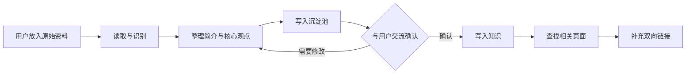

# wiki 管理流程

## 流程图



## 你需要做什么

把新文件放入 `原始资料/主题域/`，然后告诉我“整理原始资料”。如果暂时无法判断主题，放入 `原始资料/待分类/`。如果有特别关注的问题，也可以一并说明。

主题域示例：`项目/`、`Java/`、`数据库/`、`架构/`。一个主题域在三个阶段使用同名目录：

```text
原始资料/项目/
沉淀池/项目/
知识/项目/
```

## 我会做什么

### 第一步：读取

确认文件类型、主题、来源、时间和是否属于当前 `wiki` 知识库。

### 第二步：提纯

从原始资料中提取：

- 一句话简介
- 核心观点
- 关键术语
- 事实与推测的区别
- 值得保留的例子
- 与现有知识的潜在关联
- 需要你确认的问题

### 第三步：沉淀

在对应的 `沉淀池/主题域/` 创建整理稿。整理稿必须链接回原始资料，例如：

```md
来源：[[原始资料/主题域/文件名]]
```

### 第四步：交流

我会把整理结果发给你，等待你确认、纠正或补充。这个阶段不会把内容写入 `知识/`。

### 第五步：定稿

你确认后，我会把内容整理为最终知识页，放入对应的 `知识/主题域/`，并处理标题、属性、来源和相关链接。

## 双向连接规则

如果 `知识/A.md` 和 `知识/B.md` 确实相关，两个文件都应包含对方链接：

```md
## 相关知识

- [[B]]
```

```md
## 相关知识

- [[A]]
```

相关性包括：上下位关系、前置知识、因果关系、对比关系、同一问题的不同角度。仅仅出现同一个关键词，不足以建立链接。

## 推荐指令

整理原始资料：

```text
请读取 wiki/原始资料/ 中新增的文件，提取简介、核心观点、关键词、事实与推测、潜在关联和待确认问题。
按照原始资料所在的主题域，把整理稿放入 wiki/沉淀池/同名主题域/，不要写入 wiki/知识/，完成后向我汇报并等待交流。
```

确认后定稿：

```text
我确认这份沉淀稿，可以进入知识库。请根据刚才的交流整理最终知识页，放入 wiki/知识/同名主题域/，查找相关知识并建立双向链接，同时保留来源。
```
